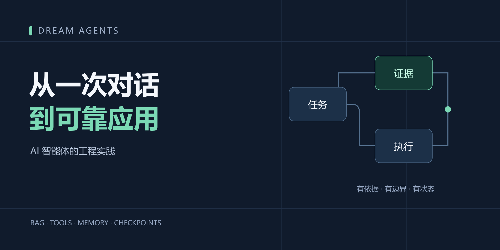
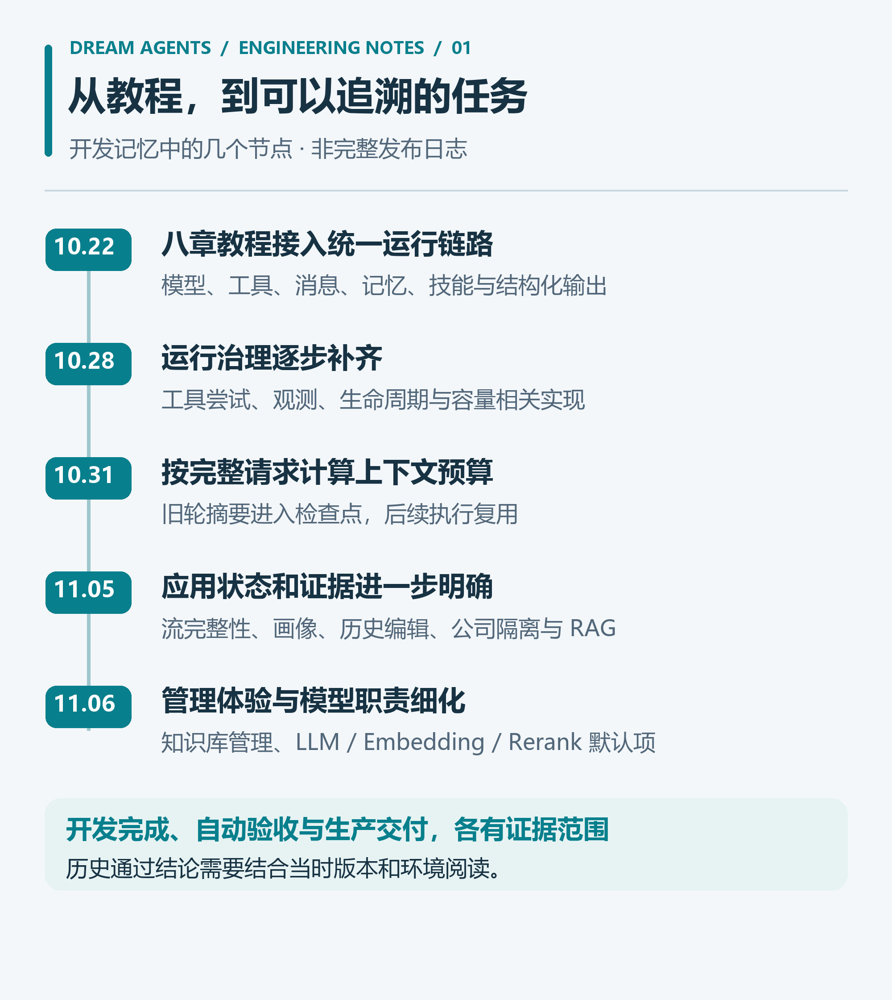
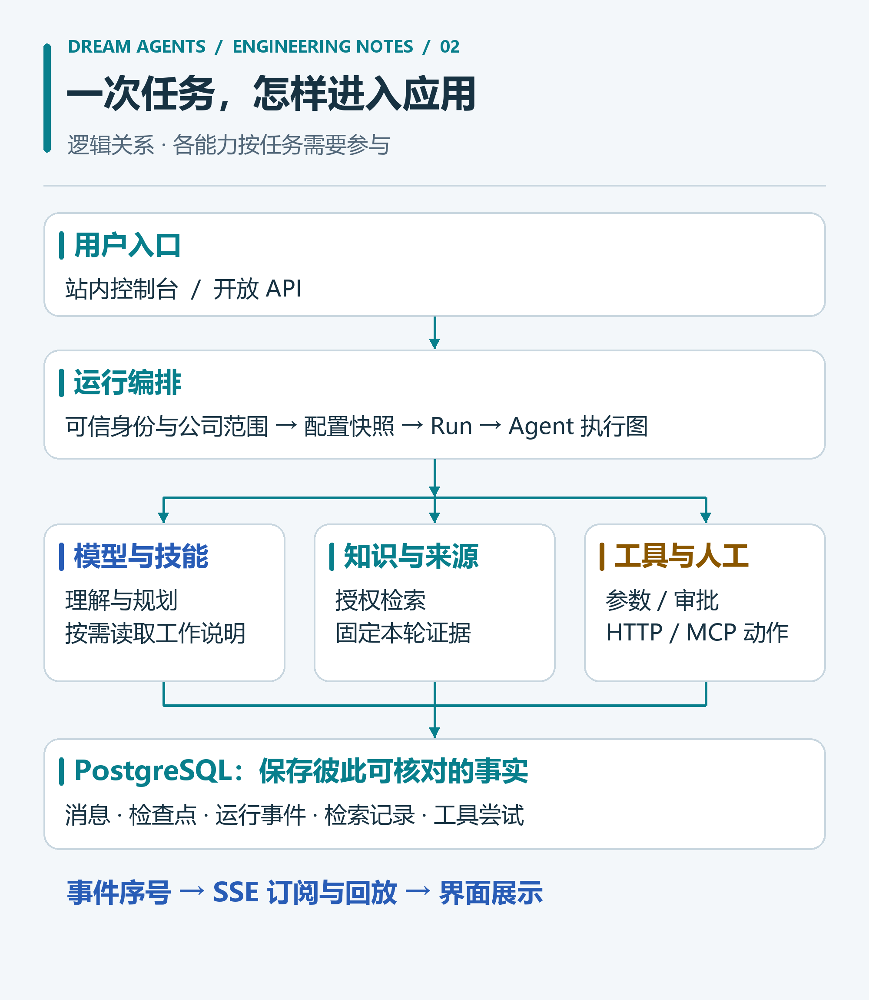
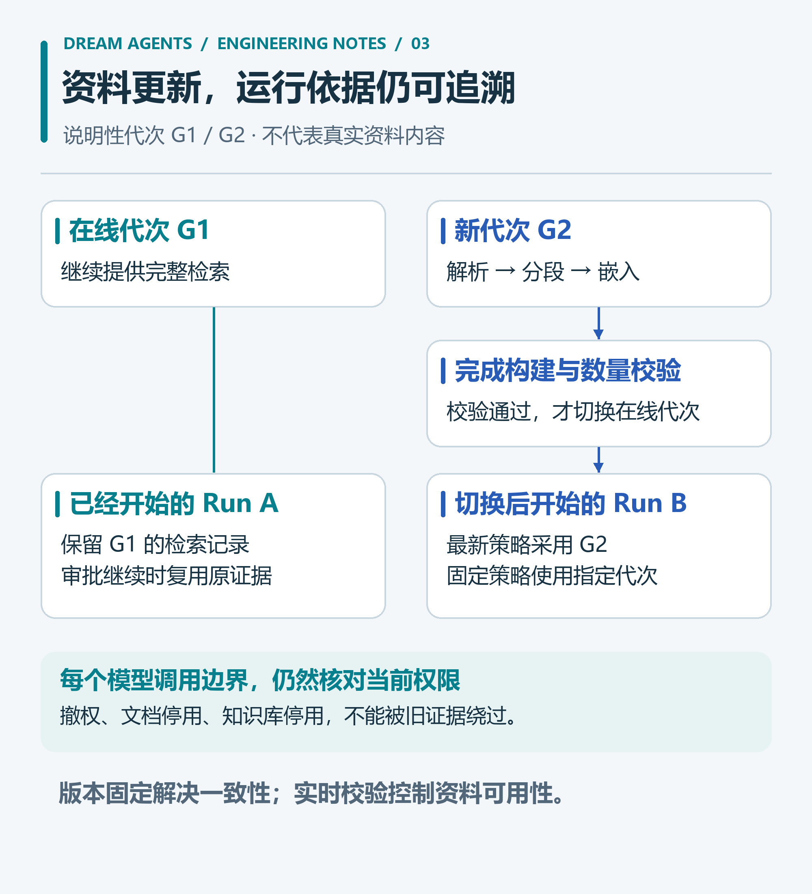
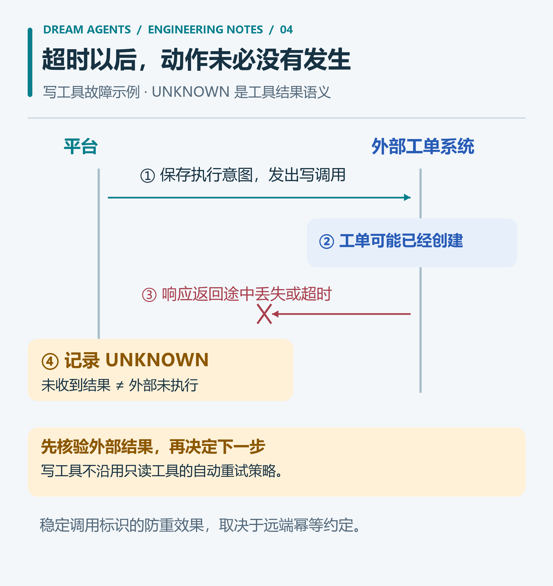
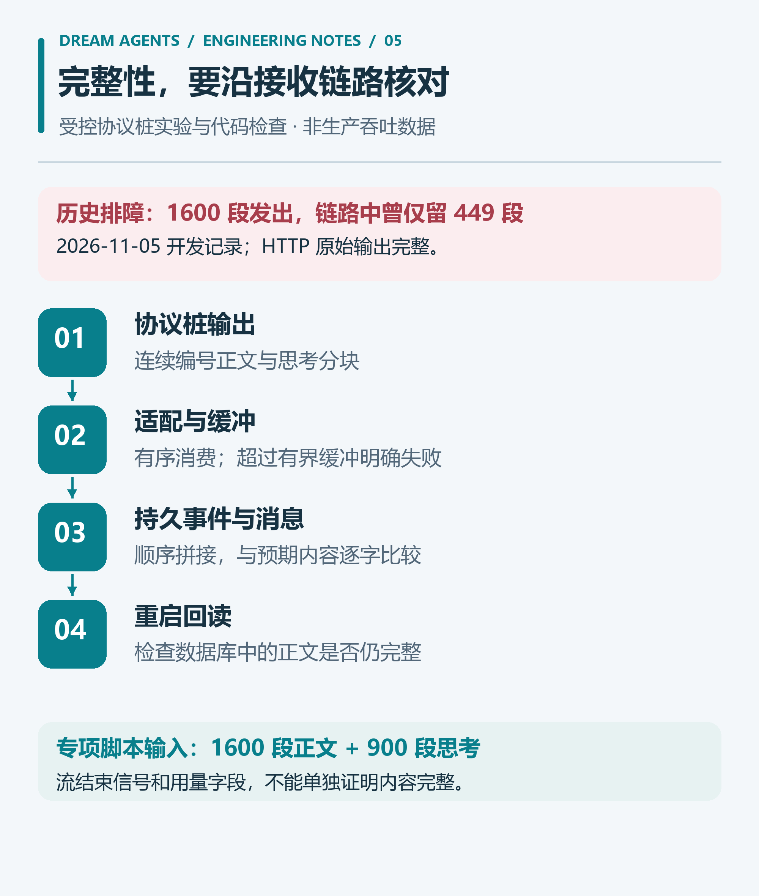
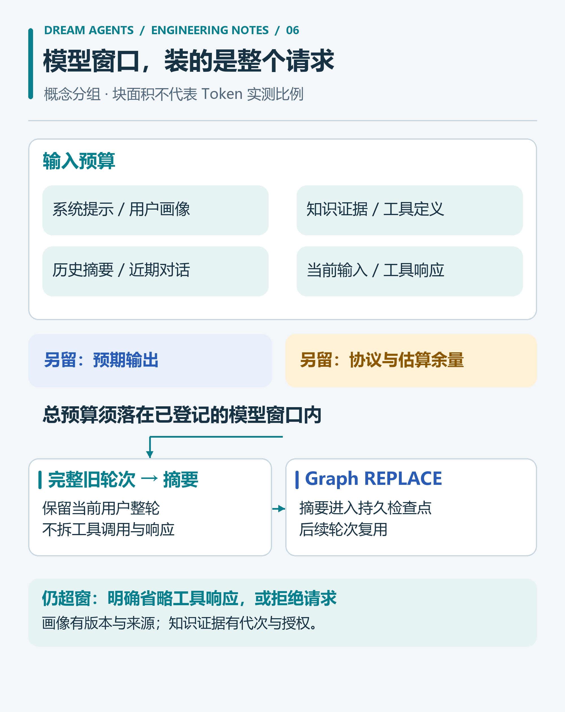
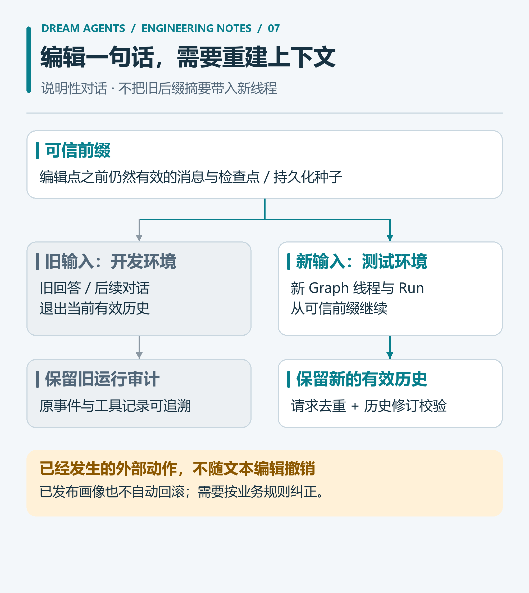

结合 Dream Agents 开发记忆与源码，用七张信息图讲述从教程到智能体应用的演进，深入运行治理、RAG 证据、工具未知结果、流完整性、上下文预算与历史编辑。



{/* truncate */}

“查一下公司最新的系统接入规范，帮我整理申请，确认之后再提交工单。”

这句话很适合放进智能体产品的演示里：读资料、填材料、调接口，几步完成。但只要把页面刷新一下，或者让工单接口在写入后超时，演示之外的问题就会浮出来。

工单有没有创建？刚才确认的内容还在吗？另一家公司的规范会不会被检索进来？修改前面的需求后，模型还会不会沿用旧摘要？

做 Dream Agents 时，我越来越关心这些具体的问题。一个模型可以给出流畅的答案；一个应用还需要解释自己读了什么、做了什么，以及有哪些事情尚不能确定。

这篇文章结合项目的开发记忆、设计文档、使用指南和当前源码，讲一讲这条工程路径。开头的工单申请是**说明性场景**，用于串联设计，不代表项目已经交付了这套业务流程。能力范围以 **2026 年 11 月 9 日**的仓库实现为准；文中排障数据均标明历史背景，不作为本次性能测试结果。

## 1. 从八章教程开始，问题逐渐变成了应用问题

翻开项目 `.memory`，2026 年 10 月 22 日的记录还在围绕八章教程：Agents、Models、Messages、Tools、Memory、Hooks、Skills 和 Structured Output。

这个起点很实用。先把模型调用、工具循环、消息、结构化输出和检查点接起来，确认框架里的概念在一个应用中怎样配合。

随后，问题变了：工具定义改动会不会影响旧会话？审批等待时后端重启怎么办？外部调用已经发出，却没拿到结果，该怎样登记？对话越来越长，工具 Schema 和检索材料占掉的上下文算不算在预算里？

这些问题推动项目从教程走向平台。下面选择几个与本文相关的节点；它们表示开发记录中的实现进展，**不表示对应日期已经上线生产环境**。



*图 1：从开发记忆整理出的演进脉络。功能增加的背后，是需要保存和约束的业务事实越来越多。*

目前仓库采用 Java 21、Spring Boot 4.0.0、Spring AI 2.0.0-M1、Spring AI Alibaba 2.0.0-M1.1 和 PostgreSQL，数据访问统一使用 MyBatis-Flex；控制台使用 Vue 3、Element Plus 与 Element Plus X。

后端拆成 `common`、`framework`、`system`、`ai`、`admin` 五个模块。公共契约、认证、系统管理、AI 业务和启动装配各有位置，整体仍然是模块化单体。这种组织方式让我可以先处理清楚运行、权限与数据的关系，再考虑部署上的进一步拆分。

技术栈只解释实现手段。理解这个项目，更适合从“一次任务怎样存在于系统里”开始。

## 2. 给一次任务正式的身份

用户点击发送以后，一次请求可能调用几轮模型、检索资料、执行工具，最后停下来等待人工决定。它有自己的状态和生命周期。

Dream Agents 用会话承载连续交流，用 Run 承载本次执行。消息、事件、检查点和工具尝试分别保存不同层面的事实。

| 对象 | 保存什么 | 为什么需要分开 |
| --- | --- | --- |
| 会话 | 交流归属、智能体定义快照、有效历史 | 多轮对话需要连续性 |
| Run | 本次请求、运行状态、结果与配置 | 页面离开后仍能查询任务 |
| 消息 | 用户输入与助手表达 | 形成可读的交流记录 |
| 事件 | 按序发生的进展 | 驱动界面、续传和排障 |
| 检查点 | Graph 的执行状态 | 判断从哪里、按什么条件恢复 |
| 工具尝试 | 对外动作、尝试过程与确定性 | 回答未生成时，外部动作也可能已经发生 |

把这些事实都塞进聊天记录，很难处理一种常见情况：**回答生成失败了，外部操作却成功了。** 此时运行结果、助手消息和工具结果表达的是三件不同的事情。



*图 2：逻辑关系示意，省略具体类和线程。各能力按任务需要参与，图中的模块不是独立部署服务。*

当前运行状态包括 `QUEUED`、`RUNNING`、`WAITING_APPROVAL`，以及 `COMPLETED`、`FAILED`、`REJECTED`、`INTERRUPTED` 等终态。它们让“没得到答案”可以进一步解释：是仍在等待、用户拒绝了动作，还是执行已经中断。

模型负责理解需求、整理材料、提出下一步；应用负责身份、授权、参数、状态和持久化。这样，每次判断才有明确的执行位置。

## 3. 权限必须跟着执行走到后台

假设两家公司都上传了“系统接入规范”。标题相同，内容相似，向量距离也可能很接近。

另一家公司的材料不该进入候选集合。这条规则需要落实在查询与执行链路中。

Dream Agents 的公司上下文来自可信入口。`TenantContext.requireTenant()` 在缺少上下文时直接拒绝访问；数据库连接策略与 PostgreSQL 行级安全承担公司隔离，资源范围和具体动作再由业务层校验。

真正容易漏掉的是后台执行。请求受理后，Agent 会进入工作线程，Graph 还可能并行调用工具。只在 HTTP 线程设置身份，后面的查询就可能失去归属。

项目为异步任务捕获并绑定公司上下文，执行结束后恢复原作用域，避免线程复用时遗留上一项任务的身份。开发记忆里也专门记录过：Graph 并行工具和命令行初始化，都必须接上这条边界。

同样，模型传进来的 `userId` 不能成为授权依据。工具应从可信执行上下文取得用户身份，再检查它可以操作哪些对象。

“这个智能体属于 A 公司”只是起点。一次实际执行还要回答：谁发起、用哪个资源、做什么动作、进入哪个后台线程，以及权限变化后是否还能继续。

## 4. RAG 要保存“当时看见了什么”

知识库的一条完整路径是：导入正文，清洗和分段，生成嵌入，建立索引，检索片段，再把来源带到回答中。

Dream Agents 一期支持粘贴正文与 TXT、Markdown、文本 PDF、DOCX 导入，提供入库前预览和普通分段。它还保存正文修订、索引代次、入库任务和检索记录。

这里的“代次”很关键。假设旧索引正在提供服务，新文档只完成了一半向量化。如果边写边让查询看见新内容，同一个问题可能读到一份不完整的资料集合。

项目采用完整构建新代次、核对数量后再切换在线索引的方式。新代次未完成时，旧代次继续提供检索。



*图 3：G1、G2 是说明性代次。在线索引可以更新，已开始的 Run 保留自己的证据；实时撤权和来源停用仍然生效。*

智能体可以选择两种知识版本策略：

- `LATEST_AT_RUN_START`：每个新 Run 固定开始时的在线代次。
- `PINNED`：使用发布绑定指定的完整代次。

一次 Run 保存自己的检索结果。后续审批继续或重启恢复时复用该结果，避免前半段按旧规范整理，后半段突然按新规范执行。

**保存旧证据，也必须服从当前权限。** 每个模型调用边界仍会核对知识库、文档状态、调用者检索权与绑定操作者使用权。来源被停用后，历史摘录也不能绕过检查继续读取。

检索方面，一期提供三种方式：向量、关键词和混合。向量通道在公司、知识库、代次和维度等范围约束下，使用 pgvector 精确距离排序；关键词通道结合 SmartCN 中文分词、PostgreSQL 全文检索及原文精确子串匹配。混合模式通过 RRF 融合名次，避免直接相加不同通道的原始分数，也可配置全局重排。

这里没有大规模近似向量检索的容量承诺。库与分段数量限制是首期资源边界，实际规模仍要用目标语料和机器验证。

回答中的来源也要有落点。项目持久保存命中文档、修订、片段与摘录，校验模型给出的知识来源编号。未知编号不会直接变成可信来源入口。

不过，编号合法只证明它属于本轮证据。模型是否正确理解了材料，仍然需要业务问题和人工复核来检验。

## 5. 工具、Skills 与知识库，分别解决什么问题

同样是“帮我整理申请”，这三类能力可以一起出现，但职责不同。

| 能力 | 在这个示例里做什么 | 项目中的约束 |
| --- | --- | --- |
| 知识库 | 提供接入规范和资料依据 | 授权、代次、检索预算、来源记录 |
| Skill | 给出整理材料的方法和输出格式 | 只加载绑定目录内的技能，正文随定义快照固定 |
| 工具 | 查询系统状态、调用外部接口 | 独立授权、Schema 校验、审批和尝试记录 |

Skill 更像一份可按需读取的工作说明。项目的 `SnapshotSkillRegistry` 将已发布技能组织成当前运行的目录，按需通过 `read_skill` 读取正文，并保留激活状态用于恢复；配置为始终加载的技能则直接进入系统提示。

这减少了每次都把全部技能正文塞进上下文的需要，也让“当前到底采用了哪套工作方法”能够追溯。

**技能里的文字不会自动授予工具权限。** 一份技能即使写了“接下来提交申请”，执行工具仍需独立配置与授权。读取技能正文时也会检查原资源是否仍可用。

工具中心负责另一层集成：API 工具可以从受支持的 OpenAPI/Swagger 文档导入；远程 MCP 支持 Streamable HTTP 与 SSE。当前有明确的协议边界，例如不支持 MCP stdio 本地进程，API 导入也没有覆盖所有请求体与参数形式。

接入时需要认真读这些限制。工具目录能列出来，距离一次安全、可核验的实际调用，还有参数、凭据、权限与故障处理几步。

## 6. 写工具最难处理的结果，是“不知道”

工单接口可能已经完成写入，却在响应回来的路上超时。

此时，应用能确定“没有收到明确结果”，却不能据此确定“没有创建工单”。直接重试可能创建两张工单，提示失败也可能诱导用户手动再提交一次。

Dream Agents 为工具区分只读与写入行为。只读工具按配置有限重试；写工具不复用这套自动重试策略。调用发出后超时，或者响应无法解析，结果可能保留为 `UNKNOWN`，等待核验。



*图 4：外部写入发生而响应丢失，是一种说明性故障。`UNKNOWN` 属于工具结果语义，不是新增的 Run 状态。*

项目保存执行意图、尝试与结果，并为同一次逻辑调用生成稳定标识。这个标识可以与远端幂等约定配合，但远端是否识别、如何去重，需要逐个接口明确。

一次写调用，至少应能回答这些问题：

1. 发出前，是否校验了身份、参数、工具状态和执行预算？
2. 发出了什么动作，关联哪次逻辑调用与哪次尝试？
3. 收到的证据足以判断成功、失败，还是只能保留未知？
4. 结果未知时，用户到哪里核验和登记？
5. 再执行一次会发生什么，外部系统有没有幂等支持？

查询工具增加的是信息来源。写工具会改变外部世界，接入成本也会随之变化。

## 7. 把“确认之后”保存成状态

用户说“确认之后再提交”，系统就需要保存这个“之后”。

Dream Agents 的人工审批会把运行带入 `WAITING_APPROVAL`，保存审批记录与对应检查点。用户作出决定后，服务端核对当前未决动作、检查点、依赖和授权，再恢复执行。

等待期间不需要长期占着数据库事务或工作线程。用户离开页面后，待办仍然属于这次运行；重启后，也要先检查它与持久状态是否匹配。

需求不完整时，项目还提供内置 `ask_user`：模型可以提出问题和选项，用户回答后继续同一次运行。它与工具审批共用等待基础设施，但采用独立回答协议，不能拿一个普通的 `ALLOW` 跳过必需答案。

这几种情形应当分别处理：

| 遇到什么情况 | 系统如何表达 |
| --- | --- |
| 执行需要用户确认的动作 | 等待审批，决定与检查点对应 |
| 缺少会改变执行方向的信息 | 展示澄清问题，保存结构化回答 |
| 普通 `QUEUED` / `RUNNING` 在进程重启时遗留 | 按恢复规则标记中断 |
| 待审批运行在重启后仍有匹配检查点和有效依赖 | 保留等待，后续决定再恢复 |

“可恢复”因此有具体范围。它不等于任意任务在任何故障后都从原处无缝继续，也不意味着重启后可以擅自重发外部写操作。

## 8. 流结束了，正文也可能没收完整

2026 年 11 月 5 日的一条开发记录，给我留下了很深的印象：在受控实验里，上游发送了 1600 段正文，链路中却只保留了 449 段；HTTP 原始输出是完整的。

这不是生产吞吐测试，也不是对所有模型供应商的结论。它是一次定位应用接收链路问题的实验。

当时的问题指向项目锁定 SDK 的流式窗口处理：并发窗口可能打乱顺序，下游背压又使尚未投递的内容被替换。当前适配代码用有序 `concatMap` 消费窗口，并通过有界缓冲隔开模型流与慢速事件处理；超过边界明确报 `MODEL_STREAM_OVERFLOW`，避免静默丢块后记成正常完成。



*图 5：完整性需要沿链路核对。图中 1600 段正文、900 段思考来自仓库协议桩专项的测试输入，非实际业务流量。*

`verify_stream_integrity.py` 的检查也很具体：拼接 1600 段连续编号正文与 900 段思考，比较最终结果、助手消息、持久事件，再重启读取。历史记录保存了当时专项通过的结果；本次写作读取了脚本与修复代码，没有重跑这项后端验收。

这次经历改变了我判断“回答完整”的方式：不能只看流的结束信号或用量字段，还要看每一段内容是否按顺序经过适配、事件持久化、消息保存和界面展示。

同样，浏览器 SSE 和后台执行也要分开。Dream Agents 持久保存运行事件，客户端通过事件序号订阅和续传；页面断线时释放订阅资源，取消任务则走独立入口。在事件仍保留、权限仍满足的范围内，重连可以继续读取进展。

前端显示“连接断开”，并不能推出后台任务已经结束。把连接状态和任务状态分开，用户才能知道接下来应该等待、重连还是处理审批。

## 9. 长对话的预算，要把工具和资料一起算进去

只统计聊天文本，很容易低估一次模型请求的大小。

系统提示、用户画像、RAG 摘录、工具描述、JSON Schema、工具参数与响应，都可能占用上下文。即使输入装得下，也要为输出和协议误差留空间。

项目在 2026 年 10 月 31 日补齐按完整请求计算的预算摘要。当前 `ModelContextBudget` 的核心约束可以写成：

```text
估算输入 + 预留输出 + 协议与分词误差余量 ≤ 模型上下文窗口
```

这里的输入估算会包含工具定义和工具消息。它仍然是保守估算，不能当作供应商精确分词器的结果；缺少模型窗口配置时，系统也无法给出精确窗口保证。



*图 6：示意块宽度不代表真实 Token 比例。压缩摘要、长期画像、知识证据和检查点有不同职责。*

`BudgetSummarizationHook` 优先压缩完整旧轮次，保留近期与当前用户整轮，避免切断工具调用和工具响应的配对。新摘要通过 Graph 的 `REPLACE` 更新进入 PostgreSQL 检查点，后续轮次可以复用。

如果只生成一段摘要，却没让它成为后续执行真正读取的状态，那么刷新、下一轮或重启后，旧上下文仍可能重新出现。

摘要之后还有最终边界检查。必要时压缩发往模型的工具响应，并标明省略；仍然装不下就明确拒绝，不能把过长输入偷偷交给供应商裁切。

RAG 本身也有片段预算：放不下的完整片段会跳过并记录，不通过截断片段伪造完整证据。检索选材和最终模型请求预算，控制的是不同环节。

## 10. 长期画像也需要发布规则

会话摘要记录这段交流，长期画像整理跨会话仍有用的用户背景。两者混用，很容易把一次性需求记成长期偏好。

项目现行的长期记忆方案是自动用户画像，旧条目管理与 `remember` 工具已经移除。画像按栏目保存，支持编辑、删除、历史版本和恢复；通过 Store 适配层使用 MyBatis-Flex 持久化。

默认调度按北京时间每天 **00:00、12:00** 登记，也可以手动“立即更新”。它不是从服务启动时间开始每隔十二小时执行，更不是每句话结束后立刻写一份记忆。

后台任务结合当前画像和未成功处理的有效消息，分段提取、校验来源，最后发布新版本。站内对话按规则选择背景注入；当前开放 API 与评测链路不注入这份自动画像。

开发记录中还出现过一次画像整理失败：88 条候选消息里已经分析了 70 条，后续出现 `IllegalArgumentException`。旧日志没有留下足够的失败分类，**无法据此还原具体违反了哪条规则**，也不能直接说是默认模型配置错误。

后续实现补了结构、证据、截断等分类和有限纠正。失败时保留旧画像，未成功确认的消息仍可后续处理；纠正只使用有效草稿与原始来源，不把失败正文重新当成事实传回去。发布前还会再次核对来源与版本。

这套机制回答的是“这份画像依据什么被更新”。至于模型提取的语义是否准确，依然需要真实样本和用户可编辑的入口。

## 11. 修改历史，需要重建推理依据

假设用户原先说“给开发环境申请接入”，后来把这句改成“测试环境”。

如果只修改消息表，最新检查点和摘要可能仍然包含“开发环境”。页面看起来改好了，模型接收到的却还是旧条件。

Dream Agents 的做法是为编辑创建新的 Graph 线程和 Run，将目标消息及旧后缀标记为被替代，保留旧运行审计。新执行从可信前缀检查点或持久化种子恢复，不能直接拿包含旧后缀的最新状态继续。



*图 7：说明性对话分支。项目保留旧审计，本期没有任意旧分支切换入口。*

编辑提交包含两个关键约束：`requestId` 标识这次提交，`expectedHistoryRevision` 检查用户看到的历史版本。网络超时后应核验原请求结果，多页同时修改则需要识别冲突。

还有两个用户必须能理解的后果。

**第一，编辑不会撤销外部动作。** 已创建的开发环境工单仍然存在。新一轮还可能再次执行工具，仍需当前权限、限额与审批；撤销旧工单需要业务补偿流程。

**第二，已发布的用户画像不会随编辑自动回滚。** 后续整理会排除被替代消息，但旧画像结论需要纠正时，应到画像页面编辑。来源已失效、尚未发布的画像任务则不能继续发布旧结论。

对话里的有效事实、执行图状态、长期画像和外部系统，各自有自己的时间线。编辑功能需要把它们的关系讲清楚。

## 12. 先固定候选，再讨论评测和发布

同样的问题，昨天和今天得到不同结果，原因可能是模型参数，也可能是工具 Schema、系统提示、知识绑定或技能正文变了。

Dream Agents 提供候选冻结、配置摘要、发布检查和版本发布。评测围绕固定候选进行，发布形成可追踪版本；已有会话继续使用自己的智能体定义快照，新会话采用新发布版本。

这样的固定有范围：快照约束执行配置，实时授权和依赖状态仍然需要校验；远程模型及外部业务数据也不会因此停在过去。

项目中的评测模式尤其需要读懂：

| 模式 | 获得的主要证据 | 不能直接推出什么 |
| --- | --- | --- |
| `REPLAY` | 对已有输出评分或重算 | 当前模型实时表现 |
| `FIXTURE` | 受控模型协议桩下的流程与协议行为 | 真实业务回答质量 |
| `LIVE_SANDBOX` | 按显式配置执行的模型与工具调用 | 自动具备外部写入隔离或生产验收结论 |

如果真实调用模式连到的仍是协议桩，它提供的依然是协议桩证据。写工具也要显式映射，不能因为名字里有“沙箱”就认为不会改动真实系统。当前入口还会拒绝启用脚本执行的技能，因为项目没有覆盖这类执行的独立进程沙箱。

发布门禁支持 `OFF`、`WARN`、`ENFORCE`，默认是告警模式。存在门禁功能，与实际采用强制拦截策略，是两项需要分别确认的事实。

我会从业务约束编写评测问题：资料缺失时能否说明、撤权后是否阻断、没有审批是否等待、写入未知时是否避免盲目重复、修改历史后是否还有旧条件。它们都能落到可观察的行为上。

## 13. 选择应用场景时，把自主权分步交出去

对开头的接入申请场景，我会按下面的顺序推进：

| 阶段 | 交给智能体的任务 | 先检查什么 |
| --- | --- | --- |
| 查资料 | 检索规范，回答问题 | 授权范围、有效版本和来源 |
| 整理草稿 | 提取申请项，标明缺失信息 | 忠实度、必填项和澄清行为 |
| 查询状态 | 调用只读工具辅助核对 | 参数、查询权限和失败提示 |
| 确认后提交 | 经人工审批调用写工具 | 审批关联、幂等约定和未知结果 |
| 持续维护 | 评测、版本发布与故障处理 | 回归样本、运行证据和补偿入口 |

这条路线也适用于知识助手、运维信息汇总、申请材料整理等候选方向，但具体能否采用，取决于资料质量、外部接口和失败代价。这些是应用设计建议，不是已完成的业务案例。

如果任务本来就有稳定且完整的规则，普通表单和工作流可能更直接。模型应承担有价值的理解与整理，把确定的校验交给程序。

范围越具体，越容易判断一次失败来自哪里：模型没理解、资料没命中、权限被撤回、接口超时，还是应用自身丢失了状态。

## 14. 怎样阅读项目的验证证据

项目的 `.memory` 对理解实现很有帮助：它保存目标、结果、验证范围和遗留项。但记录中的“通过”总是针对当时的代码、环境和输入。

本文涉及的两组历史证据，可以说明这种区别：

- 2026 年 11 月 5 日的流完整性专项，用本地模型协议桩检查连续分块、持久事件、消息与重启回读。它支持接收链路的回归判断，不能证明某个真实供应商永远不会截断。
- 同日知识库一期记录了构建、隔离专项与浏览器检查；同时明确真实供应商、业务语料与容量尚待验证。不能把这些前置检查换算成检索准确率。

自动化验收按项目约定使用独立随机临时数据库，隔离失败立即停止，不回退到日常业务库。`demo` 模型与协议桩使故障路径可重复；真实模型质量、真实接口兼容性和生产容量则需要对应的环境与样本。

本次文章更新核对了源码、设计和历史记录，验证的是文章与网站呈现；没有重新执行后端构建、数据库验收或真实模型调用。

仍需保留几条边界：知识库一期没有覆盖父子切片、知识图谱、OCR 多模态等扩展；普通运行有明确的中断语义；多实例容量相关实现也不等于已完成生产多实例交付。

本地部署同样需要检查信息流向。如果模型端点在远端，系统提示、检索资料或附件内容仍可能进入远程请求。资料接入前，应明确哪些内容会发往哪个服务。

## 15. 下一次做一个小任务，把失败路径也走完

如果重新开始，我仍然会选一个很小的目标：限定一类用户、一组可授权资料，以及少量可控工具。

先让它回答一个能核对依据的问题，再让它整理一份能人工确认的草稿。随后，主动制造几次故障：关掉浏览器、重复提交、撤销资料权限、让写接口超时、在等待审批时重启。

观察的不只是最后一句回答，还包括任务记录、检索证据、审批状态和外部结果是否能彼此解释。遇到不确定的地方，让系统准确保留不确定性，再提供用户可以采取的下一步。

Dream Agents 让我反复回到这些细节：该等待时保存等待，该中断时说明中断，材料变化时知道当时看过哪个版本，动作发生后还能查清来龙去脉。

把一个小任务的正常路径和失败路径都做完，自主执行的范围才有继续扩大的依据。

---

**资料与源码导航**

本文依据仓库 `.memory/records/2026-10-22.md`、`2026-10-31.md`、`2026-11-05.md`、`2026-11-06.md`，以及《八章教程实现指南》《知识库与 RAG 一期使用指南》《历史消息编辑与重新生成》《ABC 凭据安全发布控制与评测中心》等整理，并对照当前源码核实。设计文档中尚未实施的内容未作为已交付能力描述。

阅读源码时，可以先找 `PlatformAgentEngine` 理解编排，再看 `KnowledgeRetrievalService`、`ToolCallbackFactory`、`BudgetSummarizationHook`、`UserProfileJobService`、`ConversationEditService` 与 `ReleaseControlService`。流式排障对应 `OrderedOpenAiApi`、`ModelStreamBuffer` 和 `scripts/verify_stream_integrity.py`。

正文七张信息图均为根据仓库实现绘制的说明图，不是生产截图。图中工单、G1/G2 与环境申请用于解释机制，没有引入真实用户资料或运行数据。
