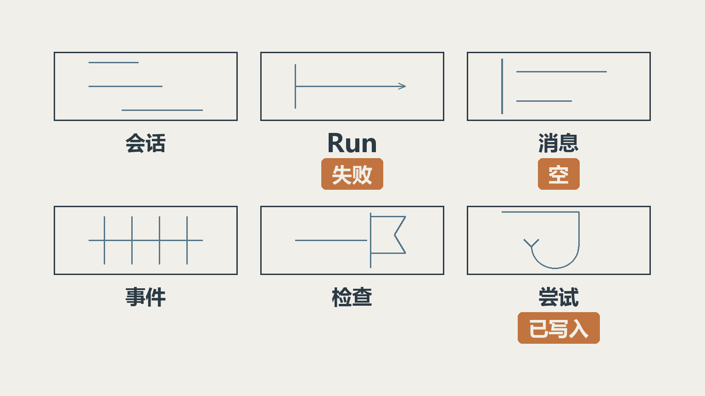
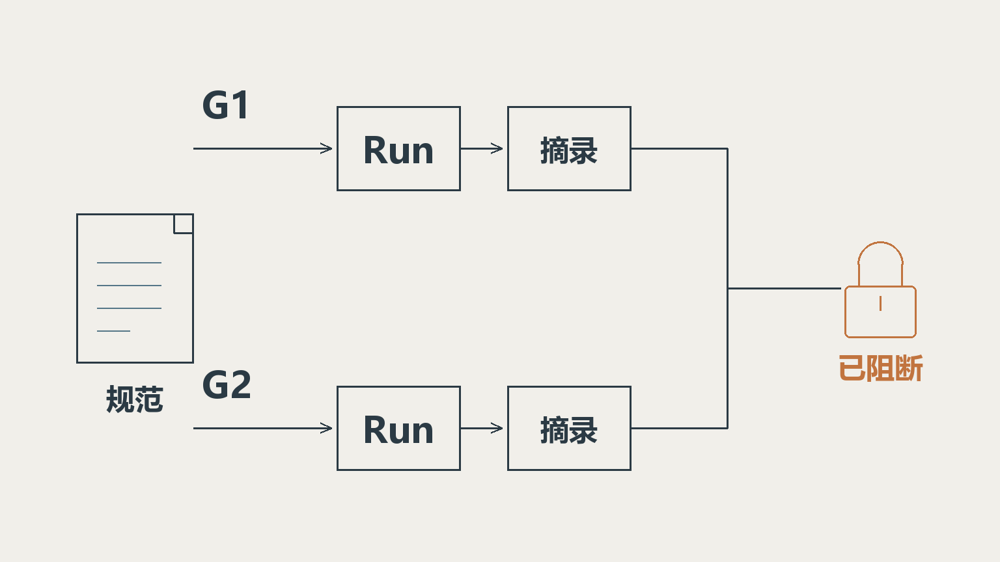
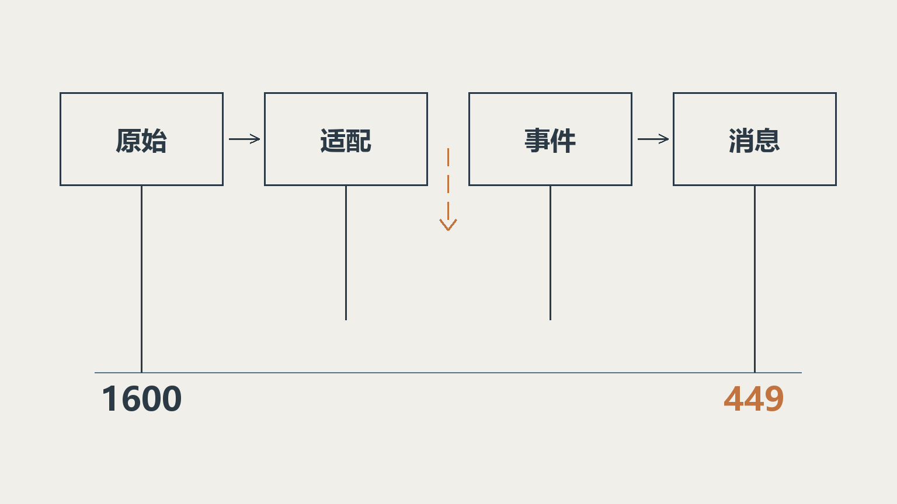

「查一下公司最新的系统接入规范，帮我整理一份申请，我确认之后再提交工单。」

这是本文要用的说明性场景，只用来串机制：读资料、填材料、调接口，几步就能演完。它不是我们交付过的业务流程，后面对工单、环境、审批的描述都请按例子读。下面这些机制在 Dream Agents 这个项目里都已经实现，但还没有在生产环境验证过；能力口径以 2026 年 11 月上旬的仓库实现为准。所以下面只谈机制与判断，不碰效果数字。

一个模型把这句话答得流畅，不难。难的是接下来的追问。

页面刷新了，整理到一半的申请还在吗？工单接口超时了，那张工单到底建了没有？系统里如果挂着两家公司，另一家的《系统接入规范》会不会被检索进来？用户把「开发环境」改成「测试环境」，模型下一轮还在按开发环境往下走吗？

这四个问题，没有一个是模型能力问题。它们都在问同一件事：这次任务在系统里有没有一个够用的身份，让它事后能被解释清楚。

技术负责人在评估一个能动手的 Agent 时，最该问的往往不是「它能做多少事」，而是「出了事它能不能说清自己」。下面几节，就是这句话往回拆出来的几个位置。

## 一、一次任务要存六类事实，一张聊天记录装不下

聊天记录是最不适合当账本的地方。

一次请求可能调好几轮模型、检索资料、执行工具，最后停下来等人决定。它在系统里有自己的生命周期，项目用六类记录分开承载它：

| 记录 | 存什么 | 为什么必须单独存 |
| --- | --- | --- |
| 会话 | 交流归属、定义快照、有效历史 | 多轮对话要连续 |
| Run | 本次请求、状态、结果与配置 | 关掉页面还能查这次任务 |
| 消息 | 可读的交流内容 | 用户要看到发生过什么 |
| 事件 | 按序发生的进展 | 驱动界面、续传和排障 |
| 检查点 | 执行图的运行状态 | 判断能不能恢复、从哪恢复 |
| 工具尝试 | 对外动作、尝试过程、确定性 | 回答失败时外部动作可能已发生 |

这些记录非分开不可的理由，一个故障就说完了：回答生成失败，外部操作却成功了。此时运行结果是失败，助手消息是空的，工具结果是已写入。三件事，三个读者。塞进一条聊天记录，只能留下一个。

运行状态也照这个思路拆：排队、执行中、等待审批，加上完成、失败、被拒绝、被中断四个终态。「没得到答案」因此可以被解释：它在等、被拒了，还是被打断了。

分工在这里定下来。模型负责理解需求、整理材料、提出下一步；应用负责身份、授权、参数、状态和持久化。

## 二、权限得跟着执行下沉到后台线程和并行调用

两家公司都上传了一份《系统接入规范》。标题一样，内容八成相似，向量距离也很接近。另一家那份不能进候选集合。

在查询里实现这条规则不难。公司上下文从可信入口进来，缺了直接拒绝，`TenantContext.requireTenant()` 就守在这一层；数据库连接策略加 PostgreSQL 行级安全承担公司隔离；具体资源和动作再由业务层校验。

真正容易漏的是后台。请求受理后 Agent 进了工作线程，执行图还可能并行调工具；身份只设在 HTTP 线程上，后面的查询就开始失去归属。线程池会复用，上一项任务的身份可能就留在当前线程里。

项目的做法是给异步任务捕获并绑定公司上下文，执行结束恢复原作用域。开发记录里专门标过两条边界：执行图的并行工具、命令行初始化，都必须接上同一套绑定。漏一个，隔离就有缺口。

模型传进来的用户 ID 也不能当授权依据。工具要从可信执行上下文取身份，再校验它能操作哪些对象。模型可以建议「查这个用户的单子」，但不能替系统决定「这个用户有权限查」。

评审时这四个问题够用：这次执行的租户上下文从哪来？线程切走之后它还在不在？并行分支里它还成立吗？权限被撤回时，正在跑的任务怎么办？

## 三、RAG 要保存「当时看见了什么」

知识库的链路不复杂：导入、清洗分段、生成嵌入、建索引、检索、把来源带进回答。真正值得说的是代次。

假设旧索引正在服务，一批新文档才做到一半向量化。如果边写边让查询看得见，同一个问题就可能读到一个不完整的资料集合，而且不会报错。

项目采用完整构建新代次、核对数量、再切在线；新代次没完成，旧代次继续服务。智能体可以在两种版本策略里选一种：每个新 Run 固定开始时的在线代次，或者绑死某个已发布的完整代次。

更关键的一步在 Run 上：一次 Run 要保存自己的检索结果。后半段审批继续、或者重启恢复，复用它。不然就会出现前半段按旧规范整理、后半段按新规范执行，而用户完全看不出来。

这里必须补一句：保存旧证据，也要服从当前权限。每个模型调用边界都会重新核对知识库、文档状态、调用者的检索权、绑定操作者的使用权。来源停用之后，历史摘录不能绕过检查。命中的文档、修订、片段和摘录都持久保存，模型给出的来源编号也要校验，未知编号不成可信入口；但编号合法只证明它属于本轮证据，读懂没读懂要靠业务问题设计和人工复核。

这一层做到没做到，一句话就能验：起了争议，能不能还原「当时它看到的是哪一版」。

## 四、写工具最难处理的结果是「不知道」

工单接口写完，响应在回来的路上超时。

应用能确定的只有一件事：没收到明确结果。它不能据此确定工单没被创建。直接重试，可能得到两张工单；直接告诉用户失败，用户可能自己再交一次，还是两张。

项目把只读和写入分开：只读工具按配置做有限重试，写工具不复用这套自动重试。调用发出后超时，或者响应解析不出来，结果可以停在 `UNKNOWN` 上等人核验。

`UNKNOWN` 很容易被当成设计瑕疵，它其实是必须保留的语义。把它填成失败或成功，都是在替外部系统回答一个你不知道答案的问题。系统诚实地说「不知道，请到这里核」，比编一个结果安全得多。

配套的还有两件事：保存执行意图与每次尝试；为同一次逻辑调用生成稳定标识。这个标识能和远端幂等约定配合，但远端认不认、怎么去重，得逐个接口问。

所以一次写调用，至少要能回答五个问题。发出前有没有校验身份、参数、工具状态和执行预算？发出了什么动作，属于哪次逻辑调用、哪次尝试？手上的证据够判断成功、失败，还是只能记未知？结果未知时，用户去哪里核验和登记？再执行一次会发生什么，远端有没有幂等？

查询工具增加的是信息来源，写工具改变的是外部世界。这两类接进系统的成本不在一个量级上。

## 五、审批是一种状态，不是一次阻塞调用

用户说了「我确认之后再提交」，系统就得把「之后」存下来。

人工审批把运行带进 `WAITING_APPROVAL`，同时保存审批记录和对应检查点。用户作出决定后，服务端核对当前未决动作、检查点、依赖和授权，都对上了才恢复执行。

等待期间不长期占数据库事务，也不占工作线程。用户关掉页面，这条待办仍然属于这次运行。服务重启后，先检查待办和持久状态是否匹配，再决定继续还是标记中断。

需求不完整是另一类等待：模型提问、给选项，用户回答后继续同一个运行。它和审批共用等待设施，协议独立，一个普通的放行过不去。

| 遇到什么情况 | 系统该怎么表达 |
| --- | --- |
| 动作需要用户确认 | 等待审批，决定与检查点对应 |
| 缺少会改变执行方向的信息 | 展示澄清问题，保存结构化回答 |
| 排队或执行中的运行遇上进程重启 | 按恢复规则标记中断 |
| 待审批运行重启后检查点与依赖仍匹配 | 保留等待，等决定再恢复 |

「可恢复」这个词要收紧用。它不等于任意任务在任何故障后都能从原处接着跑，也不意味着重启之后可以擅自重发外部写操作。把这两条讲清楚，比承诺「无缝续跑」有用得多。

## 六、流结束了，正文也可能没接完

2026 年 11 月 5 日的开发记录里有一组数：受控实验里，上游发出 1600 段正文，链路里只留下 449 段，而 HTTP 的原始输出是完整的。这组数来自协议桩专项测试的输入，不是真实业务流量，也不是对哪家模型供应商的结论。它只说明一件事：应用自己的接收链路会把内容弄丢。

根因指向所依赖 SDK 的流式窗口处理。并发窗口会打乱顺序，下游背压又让还没投递的内容被替换掉。修复方式改成有序消费窗口，并在模型流和慢速事件处理之间加有界缓冲；超出边界明确报 `MODEL_STREAM_OVERFLOW`，上限是 32768 段、4194304 字符，不允许静默丢块之后记成正常完成。

验收脚本的检查方式值得抄走：拼接 1600 段连续编号正文和 900 段思考，比较最终结果、助手消息、持久事件，再重启回读一遍。

这段经历改变了我判断「回答完整」的方式。流的结束信号、用量字段、前端那句「已完成」，都不能单独当证据。要看的是内容有没有按顺序走完适配、事件持久化、消息保存、界面展示这四步。

## 七、失败之后还能不能解释自己

系统失败的时候，还能不能解释自己。这条标准能把上面六件事串起来：任务身份、权限下沉、检索证据、未知结果、审批状态、流完整性。

能解释，意味着这几种问法都有答案：那次请求是谁发起的、读了哪一版资料、调了哪个工具、写没写成、现在停在哪个状态。答不上来，能力再强也只能跑演示。

我把这条标准拆成四个问题，可以直接放进方案评审：

1. 一次任务的六类记录齐不齐，缺的是哪一类？
2. 后台线程和并行分支里，租户上下文还成立吗？
3. 一个已完成的 Run，能还原它当时的检索代次和摘录吗？
4. 外部写入超时或进程重启之后，系统留下了什么，用户去哪核？

四个问题里答不上两个的，先别急着扩大它能做的事。把自主权交出去，靠的是系统在出错时仍然说得清话，不是模型更聪明。

下篇接着往下走。等能力补齐了，判断的重心会整体挪到边界上。
