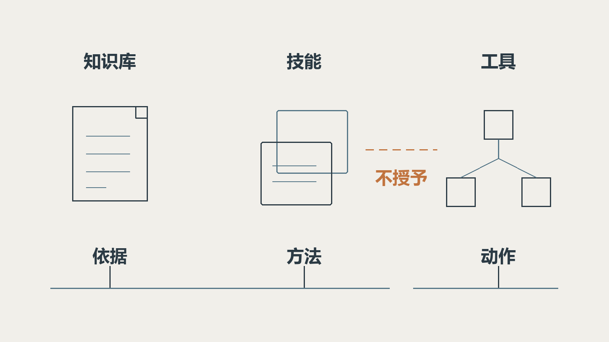
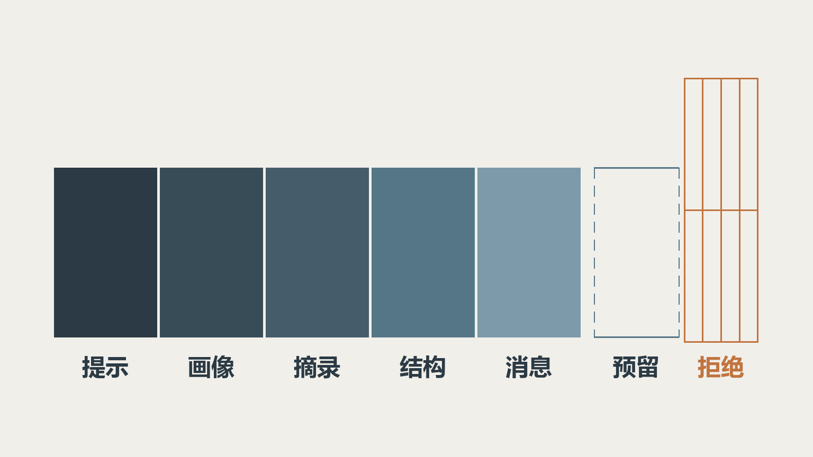
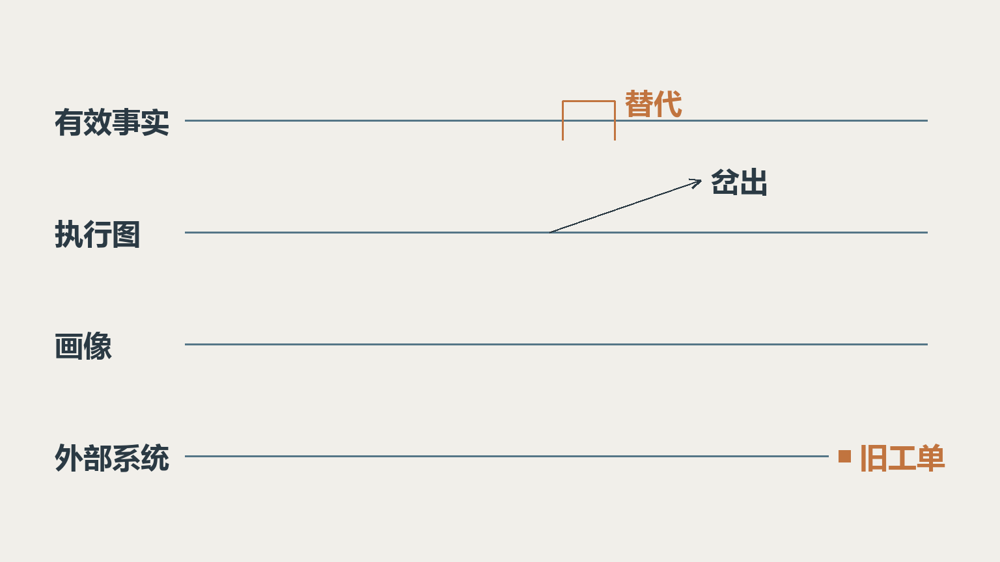

上篇的落点是一句话：失败之后还能解释自己，任务才够格拿自主权。这句话只回答了能不能跑，没回答能跑到哪。

能力补齐之后，问题会换个方向。同一句「整理申请」，昨天和今天结果不一样，原因可能在模型参数，也可能在工具 Schema、系统提示、知识绑定、技能正文。这时候真正缺的是能把「它凭什么这么做」拆开看的结构。

这些机制在 Dream Agents 的仓库里都实现了，但都还没有在生产环境验证过。下面提到的时间点、数字、范围都按当时那次记录写，能力口径以 2026 年 11 月上旬的仓库实现为准。

## 一、工具、Skills、知识库，职责不能混着用

同样是「帮我整理申请」，这三样会同时出现，但它们不该互相顶替。

| 能力 | 在场景里做什么 | 约束在哪 |
| --- | --- | --- |
| 知识库 | 提供接入规范和资料依据 | 授权、代次、检索预算、来源记录 |
| Skill | 给出整理材料的方法和输出格式 | 只加载绑定目录内的技能，正文随定义快照固定 |
| 工具 | 查系统状态、调外部接口 | 独立授权、Schema 校验、审批、尝试记录 |

区别可以这样记：知识库给依据，Skill 给方法，工具给动作。答案引错是知识库，格式不对是 Skill，参数错或权限不够是工具。

`SnapshotSkillRegistry` 做的是目录这件事：把已发布的技能组织成当前运行的目录，需要时按需读正文，同时保留激活状态用于恢复；配置成始终加载的技能直接进系统提示。收益有两头，不会每次都把全部技能正文塞进上下文，而且「这次到底用了哪套方法」可以追溯。

有一条边界得写死：技能里的文字不自动授予工具权限。技能正文就算写着「接下来提交申请」，执行工具仍要独立配置和授权。读技能正文时，还会检查原资源是否仍然可用。

工具中心是另一层集成：API 工具可从 OpenAPI/Swagger 导入，也支持远程 MCP。目录列得出来，离一次安全可核验的调用还隔着参数、凭据、权限和故障处理。

评审这一层问三句：这套方法是配在 Skill 里还是藏在提示词里？技能写了什么，能不能变成实际动作？工具的参数校验和授权，是独立做的还是借来的？

## 二、上下文预算要把工具 Schema 和检索摘录一起算

只统计聊天文本，会严重低估一次请求的大小。系统提示、用户画像、检索摘录、工具描述、JSON Schema、工具参数和响应，全占上下文。输入装得下，还得给输出和协议误差留地方。

项目在 2026 年 10 月 31 日补齐了按完整请求计算的预算摘要。约束一行就够：估算输入加预留输出，再加协议与分词误差余量，不超过模型上下文窗口。输入估算包含工具定义和工具消息，它仍然是保守估算，不等于供应商分词器的结果。

`BudgetSummarizationHook` 负责压缩：优先压完整旧轮次，保留近期和当前整轮，避免把工具调用和工具响应这一对切断。新摘要通过执行图的替换操作写进 PostgreSQL 检查点，后面轮次复用。

只生成一段摘要，却不让它成为后续执行真正读取的状态，那刷新一下、下一轮或者重启之后，旧上下文还会回来。界面看着已经压缩了，模型收到的还是老内容。

摘要之后还有一道边界检查：必要时压缩发往模型的工具响应并标明省略，仍然装不下就明确拒绝，不能把过长输入偷偷交给供应商去裁。

RAG 那侧也有片段预算，放不下的完整片段跳过并记录，不靠截断片段伪造完整证据。检索选材和最终请求预算是两个环节，别用一个数字管两件事。

## 三、长期画像是另一条时间线

会话摘要记的是这一段交流，长期画像整理的是跨会话还有用的背景。两样混着用，最常见的结果是把一次性需求记成长期偏好：用户这次说按测试环境写，下次就默认他永远要测试环境。

现行方案是自动画像，之前那套手动条目管理和写入记忆的工具已经移除。画像按栏目保存，可以编辑、删除、看历史版本、恢复旧版本。调度按北京时间每天 00:00 和 12:00 登记，也能手动立即更新；不是每十二小时滚一次，也不是每句话写完就记一笔。

画像更新的输入是当前画像加上还没成功处理的有效消息。站内对话按规则注入这份背景，开放 API 和评测链路目前不注入。

2026 年 11 月 5 日的记录里有一次失败：88 条候选消息，分析到 70 条时抛了一个参数异常。旧日志没有留下足够分类，没法还原具体违反了哪条规则，也不能归因到默认模型配置。当时的结论很克制，我觉得对：日志不够，就说日志不够。

后续补了结构、证据、截断几类分类和有限次纠正。失败时保留旧画像，没确认成功的消息还能后续处理；纠正只用有效草稿和原始来源，不把失败正文当成事实传回去。

所以看这份画像，要问它依据什么更新、失败时旧版本还在不在、删掉的条目会不会被旧草稿带回来。语义准不准，得靠真实样本和用户可编辑的入口。

## 四、修改历史要重建推理依据

用户原来写「给开发环境申请接入」，后来改成「测试环境」。

只改消息表，最新的检查点和摘要里还是「开发环境」。页面看着改好了，模型收到的还是旧条件，而且不会报错。

做法是为编辑创建新的执行线程和新的 Run，把目标消息和它后面那段旧后缀标成被替代，旧运行的审计保留。新执行从可信前缀的检查点、或者持久化的种子恢复，不能拿含旧后缀的最新状态接着跑。

提交这一侧还有两个约束：一个提交标识对应这次提交；另一个是历史版本号，用来检查用户看到的还是不是当前版本。网络超时要核验原请求结果，多页同时改要识别冲突。

有两个后果，用户必须知道。第一，编辑不撤销外部动作：已经建过的开发环境工单还在，新一轮还可能再调一次工具，权限、限额、审批一样要走，撤销得靠业务补偿。第二，已发布的画像不随编辑自动回滚：后续整理会排除被替代的消息，但旧结论要改，得去画像页面手动编辑；来源已失效、又还没发布的画像任务，不能继续发布旧结论。

这里有四条时间线同时在走：对话里的有效事实、执行图的状态、长期画像、外部系统。编辑功能的价值不是改掉一条消息，而是让人知道这四条线各自在哪。

## 五、先固定候选，再谈评测能证明什么

同一个问题，昨天和今天结果不一样，原因可能在模型，也可能在工具 Schema、系统提示或者知识绑定。不把变量固定住，讨论效果好不好没有意义。

项目提供候选冻结、配置摘要、发布检查和版本发布。评测围绕固定的候选跑，发布形成可追踪的版本；已有会话继续用自己的定义快照，新会话才用新发布的版本。这个固定有范围：快照约束的是执行配置，实时授权和依赖状态照样要校验，远端的模型与外部业务数据也不会停在过去。

| 模式 | 能得到的证据 | 推不出来的结论 |
| --- | --- | --- |
| `REPLAY` | 对已有输出评分或重算 | 当前模型的实时表现 |
| `FIXTURE` | 受控协议桩下的流程与协议行为 | 真实业务的回答质量 |
| `LIVE_SANDBOX` | 按显式配置执行的模型与工具调用 | 自动具备外部写入隔离或生产验收结论 |

真实调用模式如果连的还是协议桩，它提供的仍然是协议桩证据。写工具还得显式映射，不能因为名字里带「沙箱」就认为不改真实系统。当前入口还会拒绝启用带脚本执行的技能，因为项目没有覆盖这类执行的独立进程沙箱。

评测问题最好从业务约束里写：资料缺失时它会不会说明？撤权之后它会不会阻断？没有授权它会不会等？写入未知时会不会盲目重试？改过历史之后还带着旧条件吗？

## 六、把自主权分五个阶段交出去

回到上篇那个场景。如果我要在自己的系统里推这件事，会按这个顺序放权。

| 阶段 | 交给它的任务 | 先检查什么 |
| --- | --- | --- |
| 查资料 | 检索规范，回答问题 | 授权范围、有效版本、来源 |
| 整理草稿 | 提取申请项，标出缺失信息 | 忠实度、必填项、澄清行为 |
| 查询状态 | 调只读工具核对 | 参数、查询权限、失败提示 |
| 确认后提交 | 经人工审批调写工具 | 审批关联、幂等约定、未知结果 |
| 持续维护 | 评测、版本发布、故障处理 | 回归样本、运行证据、补偿入口 |

这五步的失败代价不同，能容忍的自主度也不同。查资料查错了，用户一眼能看出来；写工具写重了，得走业务补偿。顺序按「错了之后有多难收」排，不按技术难度排。

这一段是应用设计建议，不是已经交付的业务案例，上篇那个接入申请场景同理。

这条路也适用于知识助手、运维信息汇总、材料初筛，能不能用取决于三件事：资料质量够不够、外部接口稳不稳、失败代价能不能接受。如果任务本身规则稳定又完整，普通表单和工作流更直接，模型只做需要理解和整理的那部分，确定的校验交给程序。

## 七、记录里的「通过」，只对当时的代码有效

这些机制能一条条讲清楚，靠的是仓库里那套开发记录，不是我的记忆：一份当前状态和任务索引，一份可复用的问题清单，加一份按自然日聚合的记录。篇幅预算本身就是设计：单条摘要不超过 50 字，单条经验不超过 5 行，单个日记录不超过 15KB。超了先压缩旧的再写新的，被取代的条目合并或删掉，历史全文交给 git。

更要紧的是一条自律：记录里的「通过」，永远指当时的代码、当时的数据库、当时的输入。这一轮没跑测试必须写清原因，不能把上一轮的通过结果沿用下来。

这条自律直接决定了本文的写法。1600 段、449 段、900 段思考来自 11 月 5 日那次协议桩专项，88 条、70 条来自同日的画像整理失败记录，00:00 与 12:00 是画像任务的登记时刻。每个数字都带着它出自哪次实验、什么输入、能得出什么、不能得出什么。脱离范围的数字，换一个环境就是错误的前提。

回到整套判断。上篇说，失败之后还能解释自己，任务才有资格拿自主权。这篇补完后半句：能说清边界的系统，才配拿到更多自主权。

边界不是文末的风险提示，是产品的一部分。用户知道它会在哪里停下来、停下来之后去哪查、哪些动作必须他点头，才敢把要紧的事交给它。说不清边界的系统，交出去的自主权越多，出事时越难收场。
