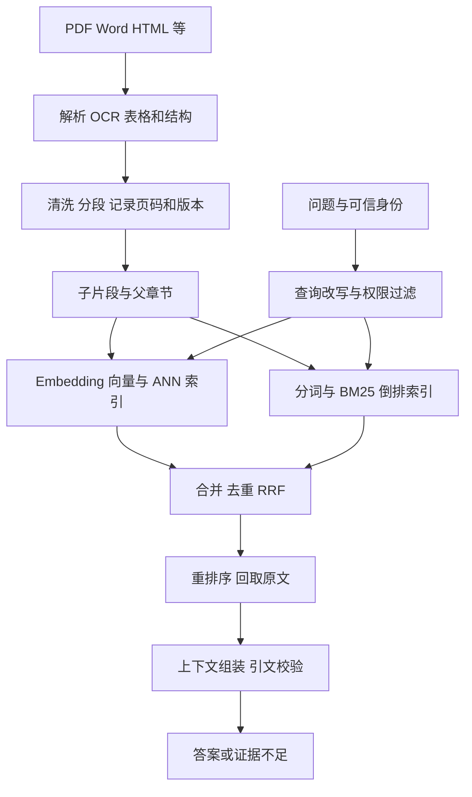
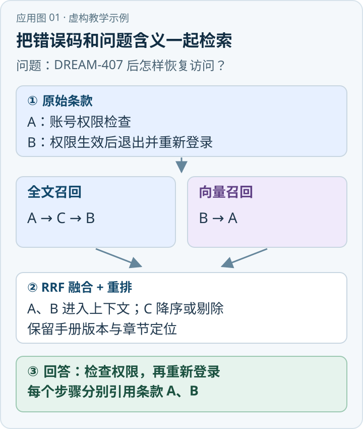

面对“事故发生后应通知哪些单位、顺序是什么、各单位承担什么职责”，文档 RAG 的工作是从有效且用户有权访问的预案中找到证据，再组织回答。原型可以只使用“切片、向量 Top-K、拼接上下文、生成”，但生产效果取决于解析、权限、分片、召回、更新和评价共同组成的链条。

{/* truncate */}

> 知识库技术研究系列 · 资料核验日期：2026 年 11 月 10 日。应急案例均为虚构教学示例。查看[全部专题与架构选型](../11-overview/index.md#系列阅读)。

直接看应用：[动手应用：用混合检索回答工单错误](#动手应用用混合检索回答工单错误)。

RAG 是检索外部知识辅助生成的范式，不要求一定使用向量数据库。其原始论文使用稠密检索与生成模型，也讨论检索与生成联合训练；今天常说的“Naive RAG”是对固定流程的概括，并非原始论文完整架构的同义词。[\[1\]](https://arxiv.org/abs/2005.11401)[\[2\]](https://arxiv.org/abs/2312.10997)

## 一、数据从入库到回答



离线时保留文档标题、章节路径、页码、段落偏移、来源、适用范围、生效时间、版本、租户和访问控制列表（ACL）。扫描件需要 OCR，表格需要保留表头与行列关系。文本、索引和来源记录通过稳定的 `document_id / version / chunk_id` 关联。在线时用户身份由可信服务端提供；检索请求携带权限与生效条件，结果回取时再次校验。

数据对象可设计为 `Document(version, source, effective_time, ACL)`、`Chunk(id, document_id, location, text, parent_id)`、`Embedding(chunk_id, model_version, vector)` 和 `Posting(term, chunk_id, tf)`。这些是示例，实际可由不同数据库承载。文档或权限变化时，仅更新原文件而不更新派生索引，会使旧内容继续被召回。

## 二、分片与稠密向量

一份长预案混有事故分级、通知方式、职责和附件。若整份文档只有一个向量，局部细节可能被整体表示稀释；若每句话单独切开，“通知该单位”又可能失去指代对象和适用条件。分片同时控制索引粒度、召回粒度、排序成本与上下文 token 预算。

常见做法是按标题、段落、表格结构切分，并用 token 上限兜底；相邻片段可少量重叠以减少边界截断。重叠会增加存储与重排次数，也可能让重复片段占满 Top-K。表格宜保留或重复列名；图片、版面区域应保留页面坐标；扫描质量不佳时必须先修复 OCR。切多大应由业务评测决定，不存在普适最优值。

**Parent-Child Retrieval** 保留父章节作为上下文单元，用更细的子片段检索；命中后，在权限与 token 预算内回取父段或相邻内容。它有助恢复条件，但不能自动判断回取内容是否过时或无关，更不能跨权限边界扩大上下文。

Embedding 模型将文本映射为固定维度实数向量，例如 `v = encoder(text)`。模型通过训练让相关问题和文本在向量空间更接近；这是统计表示，不是严格逻辑。查询侧和文档侧必须使用模型规定的编码方式、前缀与兼容版本。常见余弦相似度为：

```text
cos(q,d) = (q · d) / (||q|| × ||d||)
```

单位归一化时余弦等于点积。系统可以精确扫描所有向量，也可用 HNSW、IVF 等近似最近邻（ANN）索引，以速度和空间换取近似性；应比较其 Recall@K 与精确搜索。HNSW 通过分层邻近图搜索候选，IVF 将向量划入多个簇并查询部分簇；具体构建与搜索参数因实现而异。[\[3\]](https://arxiv.org/abs/2004.04906)[\[13\]](https://github.com/pgvector/pgvector) 向量有机会连接“道路封控”和“交通管制”等相近表达，却不保证识别否定、数值、编号或版本差异。选择模型还要测试中文和专业术语、输入长度、维度、吞吐、许可证与部署约束。更换模型通常要重新编码并灰度切换，不能直接混用不同模型的向量空间。

## 三、BM25、RRF 与重排

BM25 利用词到文档的倒排索引，结合词频、逆文档频率和长度归一化给候选打分。一种常见形式是：

```text
BM25(q,d) = Σ[t ∈ q] IDF(t) · tf(t,d)(k1+1)
             / [tf(t,d) + k1(1-b+b·|d|/avgdl)]
```

`k1` 控制词频饱和程度，`b` 控制长度归一化；不同引擎的 IDF 和细节可能不同。[\[4\]](https://nlp.stanford.edu/IR-book/html/htmledition/okapi-bm25-a-non-binary-model-1.html) 对编号、精确名称和专有缩略词，词法检索往往是必要基线；对中文还需评估分词、同义词、数字与符号。BM25 不天然理解同义词和业务关系，语义相似同样不能保证精确匹配。

Hybrid Retrieval 并行使用稀疏检索和稠密检索后融合。两路原始分数量纲不同，可使用 Reciprocal Rank Fusion（RRF）融合排名：

```text
RRF(d) = Σ[r ∈ 检索结果列表] 1 / (k + rank_r(d))
```

文档未出现在某列表时，该列表贡献为零；`k` 控制头部与后部名次的差距。RRF 使用名次而非原始分，因此可以组合不同评分尺度；但它丢失分数差距、受召回深度影响，也不能自动修正质量差的候选源。[\[5\]](https://plg.uwaterloo.ca/~gvcormac/cormacksigir09-rrf.pdf) 融合时按版本、原文位置和内容哈希聚合，并保留每路排名及来源。不同切片或不同索引召回了同一事实，不应因此当成独立证据。

**Reranker** 常使用 cross-encoder 联合阅读“问题＋候选片段”，对有限候选进行更细的相关性评分。Bi-encoder 分别编码问题和文档，文档向量可以提前计算并建立 ANN 索引；但一次相似度主要比较压缩后的向量。Cross-encoder 把问题与候选一同输入，允许 token 间直接交互，更容易利用细粒度匹配，却不能事先为所有可能的问题生成通用候选分数，逐对计算成本也更高。因此常先用词法或双编码器召回，再对有限候选重排。[\[7\]](https://www.sbert.net/examples/sentence_transformer/applications/retrieve_rerank/README.html) 这是一种常见方案，不保证交叉编码器在任何数据上都更好。重排不能补回从未召回的证据，相关性分数也不能证明材料真实、生效或满足用户权限。

## 四、Advanced、Modular 与预编译摘要

Advanced RAG 不是固定配方，而是一组可选择的改进：

- **Query Rewrite**：把带上下文指代的追问改成独立查询，必须保留地区、事故等级和时间条件。
- **Query Expansion / Multi-Query**：为同义词、术语与多个子问题生成查询，并保留原问题；提高覆盖的同时也可能引入噪声。
- **HyDE**：先生成假设性答案或文档，用其向量查找真实文档；假设文本可能幻觉，仅是查询代理，不能作为事实或引文。[\[6\]](https://arxiv.org/abs/2212.10496)
- **Metadata Filtering**：按照租户、权限、类别和生效时间过滤；强制约束应由可信服务执行。
- **Parent-Child、Reranker**：分别解决上下文缺失和候选排序，但均有额外资源与维护成本。

Modular RAG 将解析、路由、检索、融合、重排、上下文构造和生成拆为可替换模块，支持按问题选择路径；这是一种架构组织方式，不是特定数据库。RAPTOR 是可组合的具体方法：递归聚类片段、生成上层摘要，并在不同抽象层检索；摘要仍需回链原文，生成和更新摘要需要额外计算。[\[8\]](https://arxiv.org/abs/2401.18059)

## 五、“RAG 2.0”究竟指什么

Contextual AI 在 2024 年提出的 RAG 2.0，强调将检索器和生成器视为一个系统，利用端到端训练及微调减少组件间目标错位：独立优化的检索器可能找到语义相近但生成器无法有效利用的材料。作者的效果比较受其模型、数据与实验约束，不能外推为任意系统的结果。[\[9\]](https://contextual.ai/research/introducing-rag2)

联合训练并非 2024 年才出现：Lewis 等 2020 年原始 RAG 论文已将文档作为潜变量，联合微调查询编码器与生成器，同时固定文档编码器和文档索引。不能说“传统 RAG 在理论上都无法联合训练”；生产系统可能冻结组件、使用近似检索并离线重建索引，训练数据和算力成本也很高。[\[1\]](https://arxiv.org/abs/2005.11401)[\[9\]](https://contextual.ai/research/introducing-rag2)

从原论文的 RAG-Sequence 可以看出联合训练的基本思想。对问题 `x`、目标答案 `y`、候选文档 `z`，其 Top-K 边缘化和训练目标可简写为：

```text
p(y|x) ≈ Σ[z ∈ TopK(x)] pη(z|x) · pθ(y|x,z)
L(η,θ) = −log p(y|x)
```

`pη` 是检索器给候选文档的概率，`pθ` 是生成器在问题与文档条件下生成答案的概率；训练用答案似然同时更新查询编码器和生成器，Top-K 是离散截断近似，原实验固定文档编码器与文档索引。[\[1\]](https://arxiv.org/abs/2005.11401) 该式专指原论文的 RAG-Sequence 解释，不能推断梯度穿过所有离线索引构建环节，也不是 Contextual AI 已公开的训练损失。Contextual AI 讨论的是更广义的检索器与生成器协同优化，其具体损失、数据和参数更新范围应以公开材料为限。[\[9\]](https://contextual.ai/research/introducing-rag2)
ApeRAG 是包含全文、向量、图等能力的开源产品。截至本次核验，其官方仓库没有把产品能力定义为与 Contextual AI 联合训练等同的“RAG 2.0”。[\[10\]](https://github.com/apecloud/ApeRAG) 其他资料若使用同名标签，需核查上下文，不应根据名称推断训练实现。

## 六、虚构示例：回答事故通知问题

假设资料库有《示例预案 A》、事故分级表、职责表与联系方式附件，且存在版本与权限差异：

1. 验证用户权限，确定地区、事故等级和预案有效日期；缺关键条件时澄清或分条件回答。
2. 构造“事故等级＋通知”“通知先后”“单位职责”等子查询。BM25 查预案名、条款号与单位缩写，向量查语义近似表达。
3. 将两路候选融合并按文档版本、位置去重，重排后回取职责表表头和通知条款的上级条件。检查三类子问题是否都有证据，不能只看最高分。
4. 对每个待答事实建立“说法→原文页码／条款→生效范围”的映射；如果材料只列出单位而未写先后，不得把列表顺序当通知顺序。
5. 新旧预案或不同层级资料冲突时，展示来源与生效日期；按明确配置的权威规则处理，没有规则时提示人工确认。

文档 RAG 只能利用被正确解析、授权且召回的材料。需要严格验证复杂顺序、跨表计数或实时状态时，应结合结构化规则、SQL、图检索以及人工复核。

## 七、部署、更新与评价

建立黄金问题集，覆盖简单事实、编号、同义词、多文档、冲突、无答案和权限隔离，标注文档版本、证据位置与正确答案。分开测解析完整率、Evidence Recall@K、MRR / nDCG、证据覆盖、回答正确率、引用可点击及支持率、无答案拒答、越权泄漏，以及 P50/P95 延迟、token 与单位查询成本。先比较 BM25、稠密和融合基线，再逐项加入改写、重排与父段扩展，在相同预算下做消融。

社区实践者既报告混合检索和重排有帮助，也有人报告其自有评测变差；它们是个案，不构成统一结论。[\[11\]](https://www.reddit.com/r/Rag/comments/1v7g3oe/hybrid_search_and_reranking_made_my_rag_worse/)[\[12\]](https://www.reddit.com/r/Rag/comments/1u88gi7/what_actually_broke_when_we_took_rag_from_demo_to/) 原始和官方资料解释了方法，但无法保证任何特定企业数据的收益。

维护上，以源事件驱动增量重建：生成新版本，完成稀疏与向量索引后切换可见版本，并对失败重试、幂等与索引一致性做对账。删除或撤权要覆盖原文、分片、向量、倒排、摘要、缓存和派生结果，并按保留策略处理备份与审计。权限校验必须贯穿搜索、父段回取、上下文和引文访问，不能依赖模型提示自觉遵守。

## 八、工程设计：检索质量如何逐层损失

一次问答可以看成多个有损环节的串联：解析时 OCR 把单位名称识别错，后续哪怕排序完美也找不到原文；分片把“仅适用于一级事故”与通知条款拆开，模型就可能把局部规则当成无条件规则；召回候选数量太少、过滤时权限元数据缺失、重排输入被截断，也都可能造成证据不可用。因此排障顺序应该是先检查原文是否在解析结果中，再检查分片是否完整、候选是否出现、排序是否靠前、上下文是否被送到模型，最后才检查生成阶段。每一步记录可观测信息，但日志必须脱敏并遵守文档权限。

索引构建要区分两种更新：内容变了，需重新解析受影响区域并重建对应分片和索引；只改了标签、权限或生效时间，原则上不必重新计算内容向量，但必须可靠地同步元数据、过滤条件和缓存失效。具体是否需要重建取决于数据库如何保存过滤字段。最安全的切换方式是先构建新版本，校验向量数量、倒排记录数、父子映射与来源坐标，再更新可见版本；跨组件无法原子切换时，要让查询固定到同一快照，并通过后台对账修复失败项。

如果部署 ANN，建索引参数与查询参数都影响召回率和资源占用；索引越激进地压缩，查询越快但可能丢失最近邻。不能只看向量数据库宣传的吞吐量，应把具体过滤条件、向量维度、数据规模、并发和刷新频率带入压测。ACL 过滤在 ANN 之前还是之后也会影响召回：若先取全局 Top-K 再过滤，用户有权访问的相关片段可能因为前面全是无权内容而被遗漏；通常需要使用支持过滤的检索设计，并在回取时做二次鉴权。

BM25 的索引还涉及标记化和统计口径。中文“应急指挥部”既可能作为整体术语，也可能按词拆分；单位简称、道路编号、连字符和全半角要分别测试。领域词典和别名字典可以改善匹配，但错配会扩大召回范围；业务缩写必须区分不同部门同名的情况。调整 `k1`、`b` 和词典应以标注样本做实验，避免凭几个演示问题优化，导致另一类问题退化。

重排阶段除相关性，还要考虑候选多样性、时效和覆盖。对“单位、顺序、职责”这类多条件问题，候选一百条都来自同一职责表，即使重排结果相关，也不能证明顺序。可先按子问题或来源保留候选配额，再对整组证据去重，必要时补充查找；这属于应用策略，不等同于 RRF 本身。将重排分数作为置信度之前要校准；不同模型与查询分数不可直接比较。

成本预算也要按环节拆分：入库包括 OCR、embedding、索引写入和更新；查询包括多路召回、网络与数据库访问、候选重排、回取原文、上下文 token 和生成。缓存可能减少重复计算，却必须随版本和权限变化失效。对于数据少而准确编号多的系统，先用 BM25 可能已经满足需求；对于术语多样、跨语言或用户说法不规范的系统，稠密检索可能带来补充。每次引入组件都应回答：它改善了哪类错误，增加多少成本，有没有新的失败模式。

检索评价还需检查“遗漏但正确”的材料。若黄金答案只标了一条证据，而同一事实在另一份有效预案中也被清楚写出，自动指标可能错误地把第二份材料记为无关。标注人员应尽可能记录可接受的多组证据，并区分事实正确但引用不支持、引用支持但答案遗漏条件、以及检索不到证据三类错误。对高风险内容，完整覆盖安全条件比只得到一个流畅回答更重要。

另一个常见边界是时间：模型生成时知道当前日期，并不意味着它知道知识文件的有效期。元数据中的发布日期、生效日期与失效日期不是同一字段；修订文件可能只覆盖原预案的一部分。系统应保留适用区间和修订关系，按照问题所问时间选取材料，并明确历史查询与当前查询的区别。来源缺失或时间冲突时应返回不确定性，不把最新上传文件自动视为最新生效文件。

需要历史答案时，引用还应保留当时实际使用的版本和页面位置，使事后审计能够重现依据，不能静默替换为当前文档。

## 动手应用：用混合检索回答工单错误

假设内部服务台有一份虚构的工具使用手册，员工提问：“出现 DREAM-407、提示没有权限，该怎么处理？”下面展示一个教学数据集和一次假定的检索轨迹，数字用于解释计算，并非实测模型结果。



*应用示意图 · 对应下方虚构教学数据。* [查看 SVG 原图](../assets/application-01.svg) · [下载 PNG](../assets/application-01.png)

### 第一步：准备资料和可追溯的片段

| 分片 | 假设手册内容 | 元数据 |
|---|---|---|
| A | `DREAM-407：内部工具提示没有权限时，检查服务账号是否具有工具访问权限。` | `handbook-v2`，第 3 节 |
| B | `权限变更生效后，退出并重新登录，再次访问内部工具。` | `handbook-v2`，第 4 节 |
| C | `DEV-407：开发环境连接失败时，联系开发环境管理员。` | `handbook-v2`，第 8 节 |

解析手册后按条款分片，保存文档 ID、版本、章节、权限和片段位置；对 A、B、C 同时建立全文索引和向量索引。正式系统还要保存片段到原始 PDF 页码或 HTML 锚点的映射，便于返回出处。

### 第二步：检索、融合和组装

先根据当前用户权限、手册版本过滤候选。假设全文检索返回 A、C、B，向量检索返回 B、A；不同模型和分词方式实际次序可能不同。RRF 以 `k=60` 融合时：

| 片段 | 全文排名 | 向量排名 | 融合分数（约） |
|---|---:|---:|---:|
| A | 1 | 2 | 0.03252 |
| B | 3 | 1 | 0.03227 |
| C | 2 | 未召回 | 0.01613 |

未召回的一路对该片段贡献为零。重排器再同时阅读问题和候选，可把错误码与语义都不对应的 C 降下来；这只是期望行为，需要实际测量，不保证每次成立。将 A、B 原文、版本和位置送入模型，要求每条操作关联来源，并禁止补写资料没有提供的修复步骤。

**预期回答**：“先检查服务账号是否具有访问权限（手册第 3 节）；权限变更生效后退出并重新登录，再次访问（第 4 节）。”如果只有 A 可用，应只回答权限检查，并说明没有找到后续步骤。

### 第三步：落地与验收

先用一批实际允许公开的工单制作问题集，覆盖完整错误码、同义描述、无答案和版本过期四类；检查原文解析、召回位置、引用链接和最终回答，再在相同权限与候选预算下比较全文、向量及融合方案。测试时撤销用户对第 4 节的访问权，B 不得进入上下文或引用。记录 Recall@K、引用支持率和耗时，融合或重排没有改善就不必强行上线。

## 参考资料

1. [Lewis 等，Retrieval-Augmented Generation for Knowledge-Intensive NLP Tasks，2020](https://arxiv.org/abs/2005.11401)。
2. [Gao 等，Retrieval-Augmented Generation for Large Language Models: A Survey](https://arxiv.org/abs/2312.10997)。
3. [Karpukhin 等，Dense Passage Retrieval for Open-Domain Question Answering](https://arxiv.org/abs/2004.04906)。
4. [Stanford IR Book，Okapi BM25](https://nlp.stanford.edu/IR-book/html/htmledition/okapi-bm25-a-non-binary-model-1.html)。
5. [Cormack 等，Reciprocal Rank Fusion，2009](https://plg.uwaterloo.ca/~gvcormac/cormacksigir09-rrf.pdf)。
6. [Gao 等，Precise Zero-Shot Dense Retrieval without Relevance Labels（HyDE）](https://arxiv.org/abs/2212.10496)。
7. [Sentence Transformers，Retrieve & Re-Rank 官方文档](https://www.sbert.net/examples/sentence_transformer/applications/retrieve_rerank/README.html)。
8. [Sarthi 等，RAPTOR: Recursive Abstractive Processing for Tree-Organized Retrieval](https://arxiv.org/abs/2401.18059)。
9. [Contextual AI，Introducing RAG 2.0](https://contextual.ai/research/introducing-rag2)。
10. [ApeRAG 官方仓库](https://github.com/apecloud/ApeRAG)。
11. [Reddit：Hybrid search and reranking made my RAG worse，个人实践](https://www.reddit.com/r/Rag/comments/1v7g3oe/hybrid_search_and_reranking_made_my_rag_worse/)。
12. [Reddit：What actually broke when we took RAG from demo to production，个人实践](https://www.reddit.com/r/Rag/comments/1u88gi7/what_actually_broke_when_we_took_rag_from_demo_to/)。
13. [pgvector 官方仓库：HNSW、IVFFlat 与过滤](https://github.com/pgvector/pgvector)。

---

[下一篇：GraphRAG](../02-graphrag/index.md)
