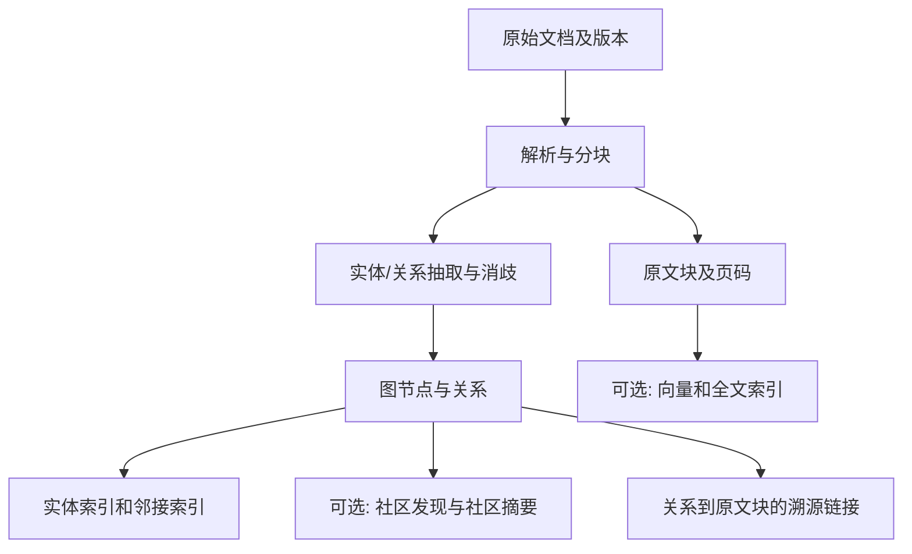
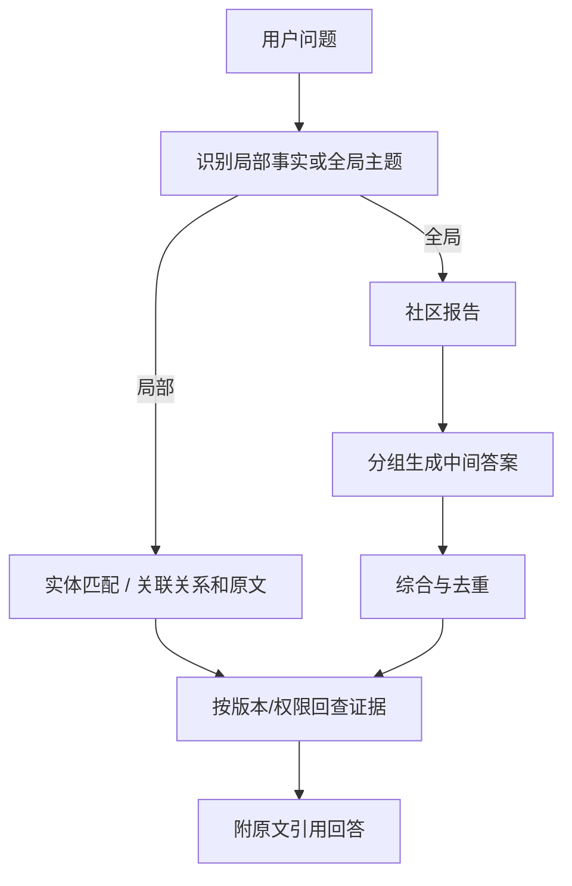
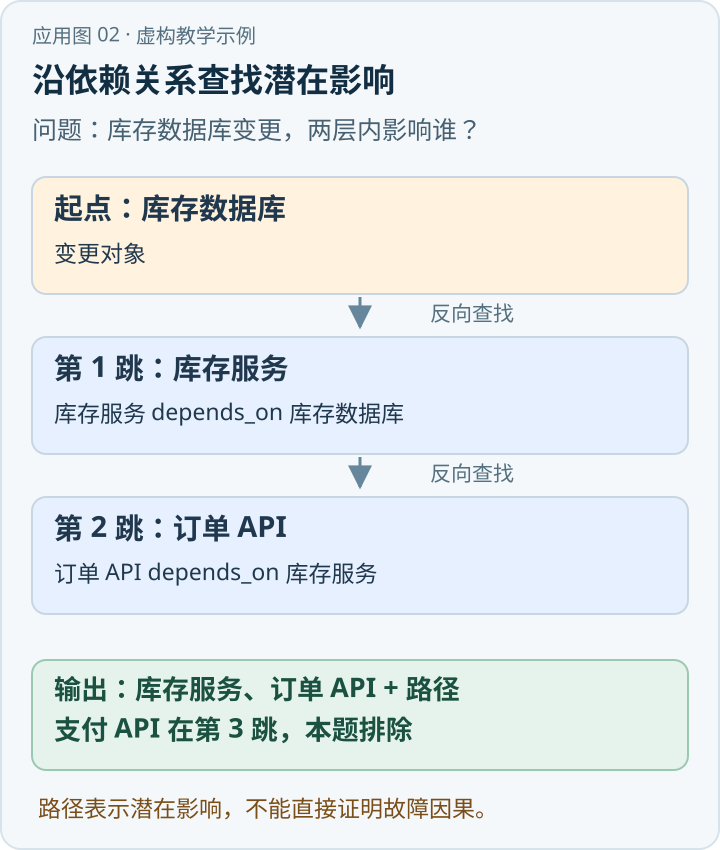

“某高速发生事故后，谁负责通知，哪些单位承担哪些职责？”答案可能散落在总则、响应分级、通信保障和单位职责四章。普通检索可能分别找到“通知交警”和“医疗救援”，却漏掉“谁负责发起通知”或两条规定的适用条件。图检索的价值，是把原本散落的关系组织成可以沿关联继续查找的路径，并让每一跳回到可核验的原文。

{/* truncate */}

> 知识库技术研究系列 · 资料核验日期：2026 年 11 月 10 日。应急案例均为虚构教学示例。查看[全部专题与架构选型](../11-overview/index.md#系列阅读)。

直接看应用：[动手应用：分析服务变更的影响范围](#动手应用分析服务变更的影响范围)。

GraphRAG 不是单一算法，也不等同“LLM 在图上推理”。广义上，它用图结构参与检索增强生成；Microsoft GraphRAG 则是其中一个有明确索引与查询实现的项目。图谱可与向量、关键词和原文块同时使用，取得图节点并不能自动保证关系真实、完整，或让生成模型完成严格逻辑证明。[\[1\]](https://arxiv.org/abs/2404.16130)[\[2\]](https://microsoft.github.io/graphrag/query/overview/)

## 1. 底层结构：节点、边与原文证据

一个最小可用的图可以包含：`Entity(id, type, canonical_name)`、`Relation(subject, predicate, object, attributes)`、`Chunk(document_version, offsets, text)`。例如，“应急指挥部—负责通知—高速交警”是一条关系；`source_chunk_ids` 应指向产生该关系的原文，另保存有效期、适用条件、抽取方法与置信提示。抽取置信度不是事实正确概率，仍需验证。

物理索引可采用邻接表支持一跳扩展、实体名或别名索引支持精确定位、向量索引查找语义相近的实体描述与原文块；图节点及边可存储在图数据库、关系表或其他图结构中，部署图数据库并不是 GraphRAG 的定义。高频更新下，应同时考虑版本化、关系溯源与增量重算：两份文件可能对同一关系给出不同时间或级别下的规定，不能简单合并为一条永远成立的边。



上述流程是工程抽象，不是每个实现都同时建立社区摘要和向量索引。抽取出“应急指挥部→高速交警”还不够：职责是什么、事故级别是什么、生效日期是什么，都应作为关联事实或可追溯限定条件保存。图索引会放大漏抽取、错消歧和错误合并：一条错误边既可能被直接召回，也可能污染后续路径。[\[1\]](https://arxiv.org/abs/2404.16130)[\[3\]](https://microsoft.github.io/graphrag/index/architecture/)

## 2. Microsoft GraphRAG：社区摘要处理全局问题

Microsoft GraphRAG 的标准索引以文档块为输入，借助模型抽取实体、关系和描述；构建实体图后，使用 Leiden 等社区发现方法形成层级社区，再为社区生成报告或摘要。实现中还有索引表、原文块、实体描述及可选向量表示；具体步骤和配置应以所用版本为准。[\[2\]](https://microsoft.github.io/graphrag/query/overview/)[\[3\]](https://microsoft.github.io/graphrag/index/architecture/)

**Local Search** 从查询相关实体进入，整合实体、关系、关联文本块和社区报告，在上下文预算内组织证据，适合“指挥部与交警有什么关系”一类围绕局部实体的问题。它不是所有局部检索都必须逐边遍历，更不保证每次都执行任意深度多跳。[\[4\]](https://microsoft.github.io/graphrag/query/local_search/)

**Global Search** 面向“整套预案反映了哪些响应主题”一类全局问题，将社区报告分组，在 map 阶段生成中间答案，再在 reduce 阶段汇总。社区摘要让系统无需在查询时把所有原文送给模型，但预先生成摘要消耗模型调用；层级、摘要遗漏、过期与引用粒度都会影响结果。Microsoft 论文在其评测设计下比较了全局问题的回答综合性与多样性，不能据此推论全部企业问答或单事实查询都会优于混合检索。[\[1\]](https://arxiv.org/abs/2404.16130)[\[5\]](https://microsoft.github.io/graphrag/query/global_search/)

**DRIFT Search** 把社区层线索用于扩展局部调查，是另一种可配置的查询模式；它的效果取决于数据、查询及设置，不应把它当作固定多轮数的通用算法。[\[6\]](https://microsoft.github.io/graphrag/query/drift_search/)



## 3. 四种图路线的差别

| 实现 | 图和索引重点 | 查询时怎样使用结构 | 代价与边界 |
|---|---|---|---|
| Microsoft GraphRAG | 实体、关系、社区与社区报告；可结合文本和向量 | Local 围绕实体；Global 对社区报告 map-reduce；另有 DRIFT | 抽取和社区摘要可能昂贵；摘要是派生内容，需要回源 [\[1\]](https://arxiv.org/abs/2404.16130)[\[3\]](https://microsoft.github.io/graphrag/index/architecture/)[\[4\]](https://microsoft.github.io/graphrag/query/local_search/)[\[5\]](https://microsoft.github.io/graphrag/query/global_search/)[\[6\]](https://microsoft.github.io/graphrag/query/drift_search/) |
| LightRAG | 实体和关系图结合向量表示；论文提出低层、高层双层检索及增量更新 | 低层侧重实体细节，高层侧重关系及主题线索 | 需要抽取、消歧及维护图；“增量”不代表复杂变更或删除天然一致 [\[7\]](https://arxiv.org/abs/2410.05779) |
| HippoRAG 2 | 通过事实、实体和更深的原文段集成组织记忆图 | 在线利用 LLM 辅助识别，从种子进行 Personalized PageRank 关联传播，再检索原文 | 传播受种子、图边和参数影响；关联得分不是逻辑证明 [\[8\]](https://arxiv.org/abs/2502.14802) |
| LazyGraphRAG | 尽量将昂贵的 LLM 工作推迟；官方介绍用相对轻量的名词短语及共现建立结构 | 结合文本块向量、社区排序和 LLM 相关性判断，按查询动态分层探索和摘要 | 节省多少与语料、查询频次、质量目标有关；在线工作和等待可能增加 [\[9\]](https://www.microsoft.com/en-us/research/blog/lazygraphrag-setting-a-new-standard-for-quality-and-cost/) |

HippoRAG 2 论文报告其测试中关联记忆任务的改善，属于特定基准、模型和实验设置；不是跨企业语料的效果承诺。[\[8\]](https://arxiv.org/abs/2502.14802) LazyGraphRAG 的官方成本和质量比较也属于所报告配置，读者应复现自身数据的建索引费用、每问成本、延迟和质量，而不是照搬比例。[\[9\]](https://www.microsoft.com/en-us/research/blog/lazygraphrag-setting-a-new-standard-for-quality-and-cost/)

### LightRAG：高、低关键词分别命中什么

LightRAG 论文的离线阶段先对文本块抽取实体节点、关系边及描述，给节点和边建立检索用的键值表示；实体键主要是名称，关系键可由关系及更高层主题组成。在线先由模型把问题分成**低层关键词**（具体实体或细节）和**高层关键词**（关系与主题），再用向量检索：低层关键词匹配候选实体，高层关键词匹配带主题键的关系，接着取命中节点或边的一跳邻居，汇总实体描述、关系描述和相关文本块。[\[7\]](https://arxiv.org/abs/2410.05779)

例如“指挥部怎样组织联动”，低层关键词可能是“指挥部”，高层关键词可能是“应急联动”；前者找实体及邻边，后者找描述联动主题的关系。两类关键词由模型生成，可能漏词或错配，双层检索也不是两次 BM25 精确字符串匹配。

官方实现（核验时的 `main` 分支）通过实体和关系的 `source_id` 关联文本块 ID，再从文本块存储中取回对应内容；多条实体与关系可能指向同一块，回源时需要去重和限量。实现含可配置的块选择策略和版本差异。[\[10\]](https://github.com/HKUDS/LightRAG/blob/main/lightrag/operate.py) 工程上仍需进一步保存文档版本、页码及精确证据位置：原文块包含某实体不等于块中每句话都支持生成答案。官方 `main` 会变化，实际项目应固定依赖版本和提交。

### HippoRAG 2：从三元组识别到 PPR 原文排序

论文的离线流程对每个 passage 用 OpenIE 抽取三元组，将主语和宾语表示为 **phrase 节点**，以谓词形成关系边；用向量相似度寻找同义词组并添加同义边。HippoRAG 2 额外引入 **passage 节点**，用 `contains` 关系连接该 passage 和从中抽出的 phrase，并对文本编码。这里的图可以是开放式 Schema，自动识别的同义边可能误连，需靠数据与评估控制。[\[8\]](https://arxiv.org/abs/2502.14802)

在线流程按论文默认设计：① 用整条查询的向量召回候选三元组，同时计算查询与 passage 的稠密相似度；② 通过 LLM 的 recognition memory 对候选三元组做相关性筛选；③ 以筛后保留的三元组中的 phrase 节点和 passage 节点设置个性化重启权重，论文附录的实现最多选择 5 个 phrase 节点，并对 passage 分数加权；④ 在图上运行 Personalized PageRank（PPR），按 **passage 节点**得分排序并把高排名原文交给问答模型。若筛后没有 phrase 节点，论文实现回退为直接按 embedding 取 passage，不运行图搜索。[\[8\]](https://arxiv.org/abs/2502.14802) 节点上限、权重和模型均是该实验配置，不是 PPR 的普遍规定。

PPR 可以用下式理解，其中 `P` 是归一化后的图转移矩阵，`v` 是由查询设定的重启分布，`α` 是继续沿边传播的权重，`r` 是收敛后的节点相关分布：

```text
r = α · Pᵀr + (1 − α) · v
```

查询种子、图边权和归一化方式改变都会影响 `r`；其得分表达图上的关联程度，不表达事实真值、逻辑蕴含或事件发生顺序。不同文献可能把重启权重而不是传播权重记为 `α`，应先核对参数约定。
## 4. 同一虚构应急问题如何走完一条路径

假设虚构预案仅规定：“现场负责人向指挥部报告；指挥部按响应级别组织联系交警与医疗单位；交警维护交通秩序，医疗单位开展救护。”这只是演示数据，不声明交警和医疗单位之间存在先后关系。

1. 入库时抽取现场负责人、指挥部、交警和医疗单位；建立“报告对象”“负责联系”“承担职责”等关系，同时保留每条关系的原文版本和页码。
2. 查询理解阶段识别事故、通知、单位、职责，以及用户要求的“顺序”；按授权和当前生效版本限定可访问文档。
3. 用实体名、别名、向量或关键词定位起始实体，向外检索“报告对象、负责联系、职责、响应条件”等邻接关系，再取回相应原文。
4. 比较原文与边：如果只说“组织联系交警与医疗单位”，系统只能说两者都需要联系；不得因为图遍历结果先返回交警就声称其先被通知。缺少可证明顺序的条款时应明确说明。
5. 生成答案时给每项职责和通知依据标注到原文条款；存在冲突则并列标注适用条件与版本，不能由模型自行选择。

图可能帮助发现“现场→指挥→单位→职责”的关系链，但图路径顺序并非业务时间顺序。要证明“先 A 后 B”，需要明确时序关系和适用条件，或者引用原文中的程序规定。

## 5. 工程实施与评估

**先做对照，再决定建图。** 选取真实授权问题，建立关键词、向量和 Hybrid RAG 基线；标注问题类型、所需跨文档关系、标准证据和“不足以回答”的情况。将相同模型、检索权限、语料版本和上下文预算尽可能固定，比较证据召回、完整性、关系正确率、引用可验证率、拒答质量，以及 p50/p95 延迟、总成本和索引更新时间。

图谱质量单独评估：在抽样文档上统计实体识别与消歧、关系方向和类型、证据链可追溯性；对按版本撤销和权限变更后的结果做回归。对同名单位、简称变更、条件性职责和多个版本冲突建立专项测试。若社区摘要涉及多个 ACL 级别，不能仅在返回原文时过滤；摘要构建和查询都要避免泄露不可见来源。

组织应把图当作**可更新的派生索引**，保留原文是事实来源：原文变更后定位受影响 chunk、实体、边与摘要；建立重算队列并标识版本，避免旧摘要和新原文混用。增量维护复杂且有成本；语料规模小、问题多数为单条文档定位、更新频繁或关系抽取质量差时，Hybrid RAG 可能更合适。

本篇的图不是严格本体：是否存在 OWL 公理、能否通过描述逻辑推出结论，取决于是否额外引入语义契约、数据和推理器。邻接搜索、LLM 归纳和本体推理是可以组合但需要分别验证的能力。

## 6. 更新、删除与评测的故障场景

变更原文后，正确的处理对象不止是文档块：还包括由该块支持的实体描述、关系、向量、社区归属和社区摘要。若一条边有三个来源，删除一个来源不应直接删除仍有其他依据的边；若唯一来源被撤销，系统必须让旧边和由其派生的内容失效。可为每个派生对象保存来源集合和版本号，用后台任务重算，未完成时标记索引滞后，并避免将新原文与旧摘要当成同一快照。

权限也应作用于图扩展和派生内容。只在最终原文展示前过滤，仍可能通过关系、摘要或结果数量泄露未授权信息；例如用户没有权查看某部门预案，不应从跨部门社区摘要中看到它的职责。建立图时需要设计权限域，查询时使用身份、租户和文档 ACL 做过滤，并测试删除、撤权、跨租户实体同名与摘要缓存失效。

离线评测不应只有“答案像不像”。可以把证据集定义为含适用版本的原文段落，把关系评测集定义为源实体、关系、目标实体和条件；分别观察实体链接、关系召回、证据覆盖和引用支持，再检查最终回答是否把推测写成事实。比较方案时用同一问题集和答案模型，同时报告索引构建模型调用、人工校对成本、每次查询的步骤及不同预算下的质量，才能判断图结构是否值得其维护成本。
## 动手应用：分析服务变更的影响范围

假设团队维护一套虚构的订单系统，问题是：“库存数据库变更时，哪些服务在两层依赖范围内？”这是应用依赖图的教学示例，不代表一次真实故障。



*应用示意图 · 对应下方虚构教学数据。* [查看 SVG 原图](../assets/application-02.svg) · [下载 PNG](../assets/application-02.png)

### 第一步：把服务目录变成带来源的边

| 起点 | 关系 | 终点 | 依据 |
|---|---|---|---|
| 订单 API | `depends_on` | 库存服务 | 服务目录第 12 行 |
| 库存服务 | `depends_on` | 库存数据库 | 服务目录第 18 行 |
| 支付 API | `depends_on` | 订单 API | 服务目录第 25 行 |
| 订单 API | `depends_on` | 营销数据库 | 服务目录第 26 行 |

将服务、数据库分别建成节点，依赖写为有方向的边；每条边保存源文件版本、行号和生效状态。图构建可由服务目录直接导入，或让模型从设计文档提取候选后由负责人确认。不要把两种方式生成的数据都默认为准确。

### 第二步：从变更对象沿反向依赖查找

问题指定“谁依赖库存数据库”，所以从库存数据库沿 `depends_on` 的**反方向**搜索，限定最多两条边，并只保留当前有效且用户有权查看的边。

| 搜索步数 | 本轮发现 | 可引用路径 |
|---:|---|---|
| 1 | 库存服务 | 库存服务 → 库存数据库 |
| 2 | 订单 API | 订单 API → 库存服务 → 库存数据库 |
| 3 | 支付 API | 支付 API → 订单 API → 库存服务 → 库存数据库；超出范围，不列入两层结果 |

预期回答：两层范围内有库存服务、订单 API；分别列出上表路径及服务目录对应行号。营销数据库是订单 API 的另一项依赖，不在从库存数据库反向出发的路径上。将命中路径关联的原始文档交给生成器，能说明“为什么被列入”，也方便核对图边是否过期。

### 第三步：从演示走到上线

先从经维护的服务目录导入小范围子图，固定“依赖方向”“最大跳数”和有效期；对路径断边、服务别名、环路、权限隔离分别准备测试。把一条边改为失效后，重新执行查询，订单 API 不应再通过该边被列为两层影响对象。

图中存在依赖路径只说明**可能受影响**，不能证明故障已经发生或存在因果关系；还需要结合变更类型、运行时调用、监控和负责人确认。社区摘要适合汇总整体主题，不能代替本例的逐边依据；文档中的路径也不能自动证明服务当前仍在线。

## 参考资料

| 编号 | 一手资料 | 用途 |
|---|---|---|
| [1] | [From Local to Global: A Graph RAG Approach to Query-Focused Summarization](https://arxiv.org/abs/2404.16130) | Microsoft GraphRAG 论文与实验范围 |
| [2] | [GraphRAG 查询方式概览](https://microsoft.github.io/graphrag/query/overview/) | 官方查询模式 |
| [3] | [GraphRAG 索引架构](https://microsoft.github.io/graphrag/index/architecture/) | 官方离线索引流程 |
| [4] | [GraphRAG Local Search](https://microsoft.github.io/graphrag/query/local_search/) | 局部查询上下文 |
| [5] | [GraphRAG Global Search](https://microsoft.github.io/graphrag/query/global_search/) | 社区报告 map-reduce |
| [6] | [GraphRAG DRIFT Search](https://microsoft.github.io/graphrag/query/drift_search/) | 混合式查询模式 |
| [7] | [LightRAG 论文](https://arxiv.org/abs/2410.05779) | 双层检索及增量更新设计 |
| [8] | [HippoRAG 2 论文](https://arxiv.org/abs/2502.14802) | 图记忆、PPR 与论文实验 |
| [9] | [Microsoft Research：LazyGraphRAG](https://www.microsoft.com/en-us/research/blog/lazygraphrag-setting-a-new-standard-for-quality-and-cost/) | 延迟知识组织与官方报告 |
| [10] | [LightRAG 官方检索实现](https://github.com/HKUDS/LightRAG/blob/main/lightrag/operate.py) | 实体、关系到原文块的来源链接；实现随版本变化 |

---

[上一篇：文档 RAG](../01-document-rag/index.md) · [下一篇：KAG](../03-kag/index.md)
