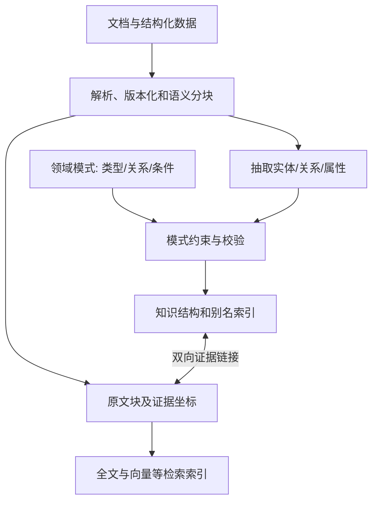
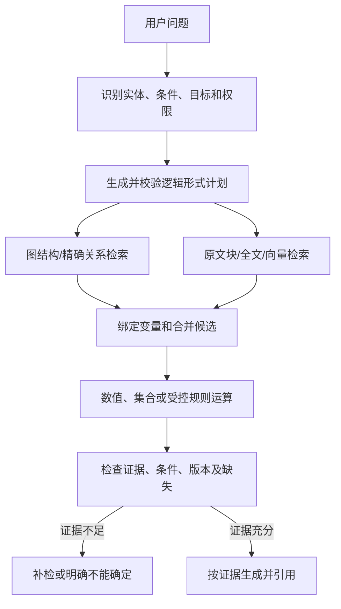
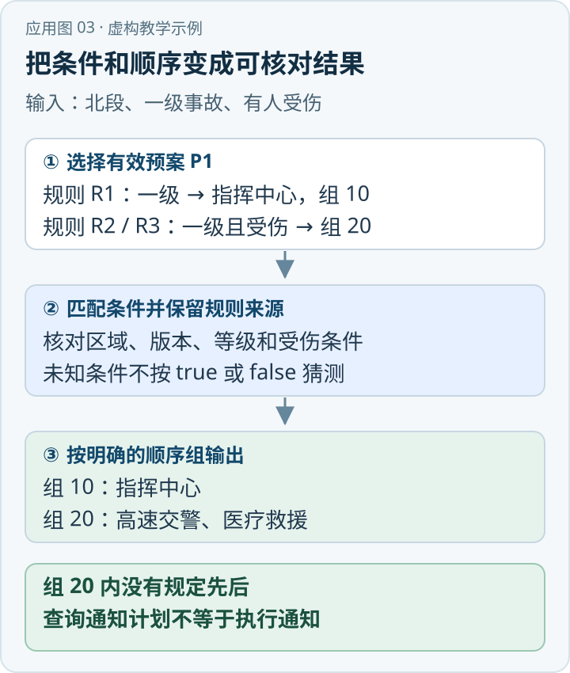

一个系统检索到“指挥部通知交警”“医疗单位负责救护”两个片段，并不意味着它已经回答了“事故达到某一响应级别时，应由谁依次通知哪些单位，各单位承担什么职责”。它还需要知道响应条件、角色之间的关系、是否存在先后约束，以及证据是否属于同一生效版本。单纯把相似片段送进生成模型，很难稳定处理这些结构和条件。

{/* truncate */}

> 知识库技术研究系列 · 资料核验日期：2026 年 11 月 10 日。应急案例均为虚构教学示例。查看[全部专题与架构选型](../11-overview/index.md#系列阅读)。

直接看应用：[动手应用：按条件求解通知顺序](#动手应用按条件求解通知顺序)。

OpenSPG KAG（Knowledge Augmented Generation）尝试将**领域知识结构、原文检索、逻辑形式和语言模型**组织进同一个求解过程。其论文将五项设计概括为 LLM 友好知识表示、图与原文块互索引、逻辑形式引导的混合求解、知识对齐和模型能力增强。[\[1\]](https://arxiv.org/html/2409.13731)[\[2\]](https://github.com/OpenSPG/KAG) 这是一套具体框架，不是“任何结合知识图谱的 RAG”的统称，也不意味着模型输出天然可信。

## 1. 为什么除了文档还要建模式

文档本身善于保留表格、条件、例外和出处，却不一定以稳定格式表达同一概念。假设某一资料称“应急指挥部”，另一份称“指挥中心”，第三份把某职责放在表格行内：先统一概念、保留别名和类型，系统才能回答“哪个单位、按哪个条件承担什么职责”。

可设计如下最小领域模式，作为本文案例的工程示意，并非 KAG 官方规定的标准模式：

| 类型或关系 | 含义 | 重要限制 |
|---|---|---|
| `Event`、`ResponseLevel` | 事故事件与响应级别 | 事件和级别须关联到有效版本及适用范围 |
| `Organization`、`Role` | 单位与角色 | 别名不是无条件同义；同名不同地区可能是不同实体 |
| `reportsTo`、`contacts`、`responsibleFor` | 报告、联系、承担职责 | 每条关系需注明来源和条件，关系方向不可反转 |
| `condition`、`validFrom`、`validTo` | 适用条件和生效区间 | 新旧规则冲突时不能按抽取先后覆盖 |
| `supportChunk` | 图事实到原始片段的证据链接 | 必须可定位到文档版本、页码或段落 |

KAG 论文提出的 LLMFriSPG 表示旨在把开放式抽取与受模式约束的知识构建结合，并支持知识结构与原始文本块互索引；这与“所有知识都先用完整 OWL 本体建模”不是同一个要求。[\[1\]](https://arxiv.org/html/2409.13731) Schema 是系统对类型、关系、属性及其使用方式的约束，是否拥有 OWL 描述逻辑语义、是否由某个推理器执行 OWL 推理，要看实际实现和配置。



入库不止“抽实体”：还要维护实体消歧、关系方向、限定条件、来源和跨版本冲突。机器抽取可以产生候选，专业人员审核关键规则，结构化数据库或权威规则也可以成为输入。原文—图双向链接的意义，是既能从文本定位相关图事实，也能从关系回查证据；并不保证抽取内容与原文一定一致。[\[1\]](https://arxiv.org/html/2409.13731)

## 2. Logical Form：把自然语言问题拆成可执行步骤

KAG 论文中的 logical form 不是普通思维链文本，而是用一组带变量的操作组织求解。论文列出的操作包括 `Retrieval`、`Sort`、`Math`、`Deduce` 和 `Output`：结构化检索可约束主语、谓语、宾语及其属性；多跳通过多个检索和变量引用连接；还可做排序、数值计算与语义判断。[\[1\]](https://arxiv.org/html/2409.13731)

例如以下是解释性伪代码，展示意图，不保证是某个 KAG 版本可直接运行的语法：

```text
事件 = Retrieval(type=Event, name="交通事故", scope=授权范围)
级别 = Retrieval(subject=事件, predicate=hasResponseLevel)
指挥主体 = Retrieval(subject=事件, predicate=commandedBy, condition=级别)
单位集合 = Retrieval(subject=指挥主体, predicate=contacts, condition=级别)
职责集合 = Retrieval(subject=单位集合, predicate=responsibleFor, condition=级别)
顺序证据 = Retrieval(predicate=precedes, scope=事件及级别)
Output(单位集合, 职责集合, 顺序证据, 对应原文)
```

其中“找出单位”和“查找顺序证据”是不同动作。若 `precedes` 未能从同版本且适用的资料中获得，系统应报告顺序待核，而不是根据结果列表顺序推断。若逻辑形式把“指挥部是否通知”误解析为“现场负责人是否通知”，后续执行再准确也会得到错误结果。因此对计划本身、参数绑定与每步证据都要做校验。

论文描述的求解框架既可进行图结构检索，也可结合自然语言子问题做混合检索：结构化知识不足时回退文本片段检索；依情况组合精确匹配、语义检索、计算和语言推断。[\[1\]](https://arxiv.org/html/2409.13731) “逻辑形式引导”强调步骤和依赖显式化，不等于每一个 `Deduce` 都是可证明的形式逻辑定理。



## 3. 与 GraphRAG、OWL 和规则引擎如何配合

**与 GraphRAG：** 两者都能利用图与原文。Microsoft GraphRAG 的 Global Search 核心问题之一是以社区报告帮助回答整个语料的主题问题；KAG 论文强调领域知识对齐、逻辑形式拆解和图文混合求解。两者目标、索引和在线编排不同，但可以在同一系统里协作：社区报告帮助寻找主题，经过校验的图事实和原文支持具体求解。[\[1\]](https://arxiv.org/html/2409.13731)[\[3\]](https://arxiv.org/abs/2404.16130) 把图遍历称作 KAG 逻辑求解，或声称 KAG 一定不使用向量检索，都是错误概括。

**与 Ontology：** 本体可为概念、关系和约束提供语义契约，知识图谱存储实例及关系；KAG 的领域模式与知识结构可以与本体对齐，但一份 Schema 或三元组不自动具备 OWL 语义。若接入 OWL reasoner，描述逻辑可在对应语义下推断蕴含；缺少某条事实不等于事实为假。对“必填、值格式、数量上限”等数据验收规则，可考虑 SHACL 或业务校验，不能只依赖 OWL 的开放世界语义。[\[4\]](https://www.w3.org/TR/owl2-primer/)[\[5\]](https://www.w3.org/TR/shacl/)

**与确定性规则：** 例如“满足已明确录入的某级响应条件时触发某动作”，可以交给有版本、有测试且可审计的规则服务；逻辑形式负责准备参数并调用。LLM 可以辅助解释规则，不能单凭自然语言推断来替代确定性判定。业务规则存在授权范围、状态和生效时间，图与规则服务必须使用一致版本。

## 4. 虚构示例：可证明的答案与不可证明的顺序

假设同一版本的虚构预案载明：现场负责人向指挥部报告；指挥部根据响应级别组织联系交警和医疗单位；交警负责交通秩序，医疗单位负责救护。文本没有规定交警和医疗单位相互之间谁先被通知。

系统先按权限、日期和地域定位适用预案，再生成“查响应条件→查报告对象→查联系人→逐个查职责→查是否有明确先后”的计划。图中关系从相应文档段落提取，并与段落建立链接；如果某一职责图边缺失，可以对同一版本的原文做全文或向量补检。最终回答应说明报告对象、应联系的单位及职责，逐项附原文引用；“两个单位之间的先后顺序”应标为资料未规定。若新预案规定不同流程，必须保留生效时间，不能把不同版本的边混成一条路径。

关键边界是：**可执行计划提高了过程的可检查性，不能消除输入知识错误、计划错误或模型推理错误。** 置信分值、图距离与模型自述不是事实证明。

## 5. 建设、评估和取舍

建议分三阶段落地。第一阶段选取一个责任边界明确、具备权威来源的小领域，制作概念表、别名表、关系类型和样例；高风险规则由专家确认，并记录来源。第二阶段先实现“结构化检索＋原文回查＋结果引用”，再引入计划生成和必要的数值、集合算子。第三阶段按业务风险接入规则执行、人工审核、监测和增量更新。不要为了图谱规模而强行把每段文字都变成三元组。

评估应分层：标注实体与关系抽取准确率、别名消歧和条件识别；检查图事实与原文一致性、证据链可追溯率；评估逻辑形式计划是否完整、变量绑定是否正确、求解输出与标准规则是否一致；最后以真实问题测试答案覆盖、引用支持、冲突提示和拒答。同时比较 Hybrid RAG 基线，以及端到端 p95 延迟、每次查询模型调用与 Token、索引构建成本、人工审核工时和变更后修复时间。

KAG 论文在其选定基准和应用设置下报告多跳问答改进；论文也明确指出多次模型调用、较长计划输出、复杂问题规划错误及知识对齐难题带来的成本和风险。[\[1\]](https://arxiv.org/html/2409.13731) 这些是研究结果与作者观察，不能直接作为企业生产性能承诺。查询以单篇文档找段落为主、规则变化频繁而领域建模资源不足，或可直接由受控 SQL 精确回答时，先采用更简单的方案通常更容易维护；需要跨关系、数值和约束组合并能维护权威模式时，再验证 KAG 的收益。

## 6. 从算子到执行：可检查在哪里产生

以一条三元组检索为例，`Retrieval` 接收主语、关系、宾语及可选条件，各变量不仅有名称，也可以有类型。计划第一次引入单位变量时标明其属于组织类型，下一步引用同一变量以查找职责；这让执行器知道两步需要通过同一个实体关联，而不是把两段相似文本随意拼起来。若两个候选实体同名，应先检查地域和标识，不能直接将变量绑定到得分最高的那个。[\[1\]](https://arxiv.org/html/2409.13731)

多跳求解由数个检索动作串联组成，依赖通过变量传递。某一步返回多个候选时，下一步要保留候选与各自条件、证据及时间的对应关系；若直接把所有候选名合并进一段文字，再让模型概括，就可能把甲单位的职责归给乙单位。执行中还要控制候选集合大小；关系扩展产生太多结果时，可按权限、类型、时间与精确条件先过滤，再用文本相关性辅助排序，不能只按向量得分截断唯一正确路径。

`Math` 和 `Sort` 适合把已检索到的数字、时间或集合交给确定性代码运算，但前提是单位、口径、计量时间及空值语义已统一；“同比增长 5%”和“增加 5 个百分点”不能由相同算式直接替换。`Deduce` 等环节可能涉及语义判断或逻辑比较，应保留输入、算子、模型版本和输出，并通过规则或人工校核关键结果。论文中的名称说明了动作设计，并不表示所有算子在不同版本中都有相同参数、确定性或实现细节。[\[1\]](https://arxiv.org/html/2409.13731)

## 7. 知识对齐：索引存在不等于概念对上

领域语言常见三种不一致。第一是同义：某地区“指挥中心”和“指挥部”可能是同一个单位，也可能是不同机构；合并必须结合机构代码、职责和生效时间。第二是上下位：交警支队属于交通管理单位，并不意味着所有交通管理单位都是交警支队。第三是关系方向：“甲通知乙”不能变成“乙通知甲”，即使句子包含相同的两个实体。语义向量有利于寻找候选，最终需要通过领域类型、关系、条件和权威材料验证。[\[1\]](https://arxiv.org/html/2409.13731)

当图中没有所需关系时，应区别三种情况：该事实不存在、事实存在但尚未入图、当前用户没有权限查看。可以使用受权全文或向量检索找原文，再交给验证环节；模型不能把检索未命中翻译成“业务上绝对没有”。来源冲突时应同时展示版本和适用范围。对相同来源的重复片段去重，对不同来源支持的同一事实保留多条证据，避免删除能够支持结论的独立来源。

## 8. 权限、变更和运行指标

规划器及执行器必须继承调用者授权：在生成计划前只暴露可用 Schema，在每个检索操作中施加租户和文档权限，回查原文时再次校验。不能让模型通过多跳路径发现未授权实体名称，再指望最后生成环节主动隐藏。对模式调整、规则变更和文档撤销，记录受影响的图事实、别名、向量和缓存，以版本化方式异步重建；旧版本完成撤权或失效前应阻止继续使用。

建议将延迟拆成查询理解、规划、每轮检索、图查询、模型调用、验证与答案生成分别测量；对每一阶段记录成功、超时、空结果和失败来源。在规划层设置最大步骤、检索轮数、上下文和模型调用预算；预算耗尽时返回已验证的部分结果并注明缺口。对于规则严肃程度高的业务，可要求由确定性服务给出结果，模型只负责解释和呈现来源；对无法自动判定的冲突走人工处理。
## 动手应用：按条件求解通知顺序

假设某单位在演练中使用一份虚构预案：一级事故先通知指挥中心；有人受伤时，再通知高速交警和医疗救援。第二组两个单位之间没有规定先后。这里展示的是 KAG 思路的教学设计，不是任何地区的真实预案，也不等同于官方 API 的调用语法。



*应用示意图 · 对应下方虚构教学数据。* [查看 SVG 原图](../assets/application-03.svg) · [下载 PNG](../assets/application-03.png)

### 第一步：定义领域结构并录入可追溯事实

| 概念或属性 | 示例内容 |
|---|---|
| `Event.level`、`Event.injured` | `一级`、`true`，来自演练事件记录 E1 |
| `Plan.status`、`Plan.region` | `有效`、`北段`，来自预案 P1 的元数据 |
| `NoticeAction` | 事件等级、伤亡条件、通知单位、顺序组、来源段落 |

预案 P1 有三条经过人工确认的规则：`R1：一级 → 指挥中心，顺序组 10`；`R2：一级且有人受伤 → 高速交警，顺序组 20`；`R3：一级且有人受伤 → 医疗救援，顺序组 20`。三条规则分别映射到 P1 的对应段落；规则的含义、顺序组和事件字段由业务方确定。

### 第二步：把问题转换为可检查的求解计划

用户问：“北段发生一级事故且有人受伤，需要按什么顺序通知？”系统先核对区域、事件记录和预案有效期，再构造类似下列逻辑计划；这是**示意伪代码，不是 KAG 内置算子或可直接运行的接口**：

```text
plan = 选择授权范围内、北段、当前有效的预案
rules = 读取 plan 中的通知规则，并保留原始条款来源
matched = 筛选 event.level 和 event.injured 均满足条件的规则
result = 按规则明确给出的顺序组排列 matched
输出 result、事件事实和每条规则的来源
```

对于 E1，三条规则均满足。按顺序组得到：`10：指挥中心`；`20：高速交警、医疗救援`。答案应说明组 20 的两家单位之间未规定先后，并分别引用规则 R1、R2、R3 与事件记录 E1。这个排序代表预案中的通知顺序组，不自动证明前一单位已完成通知，也不推断谁负责拨打电话。

如果伤亡情况未知，R2、R3 的条件不能按 `false` 或 `true` 猜测；应返回 R1 能证明的内容，并要求确认伤亡情况。若存在多份同区域有效预案而选择优先级未定义，也应提示冲突，不自行选第一份。

### 第三步：落地与验收

先让领域人员定义事件字段、条件、顺序组和来源标识，再对存量预案抽取候选规则并人工审核；保留规则版本及生效时间，查询时检查权限。用“有人受伤、无人受伤、伤亡未知、规则冲突”四组输入验收，分别核对命中规则、排序、拒绝推断及引用。知识图谱保存结构化事实，规则执行与证据校验仍需要应用明确实现。

## 参考资料

| 编号 | 原始资料 | 用途 |
|---|---|---|
| [1] | [KAG 论文全文](https://arxiv.org/html/2409.13731) | 领域表示、逻辑形式算子、混合求解、实验与限制 |
| [2] | [OpenSPG/KAG 官方仓库](https://github.com/OpenSPG/KAG) | 项目定位及版本化实现 |
| [3] | [From Local to Global: A Graph RAG Approach to Query-Focused Summarization](https://arxiv.org/abs/2404.16130) | Microsoft GraphRAG 全局查询思路 |
| [4] | [OWL 2 Primer](https://www.w3.org/TR/owl2-primer/) | OWL 语义和开放世界 |
| [5] | [SHACL 标准](https://www.w3.org/TR/shacl/) | RDF 图的数据形状和约束验证 |

---

[上一篇：GraphRAG](../02-graphrag/index.md) · [下一篇：SQL 知识库](../04-sql/index.md)
