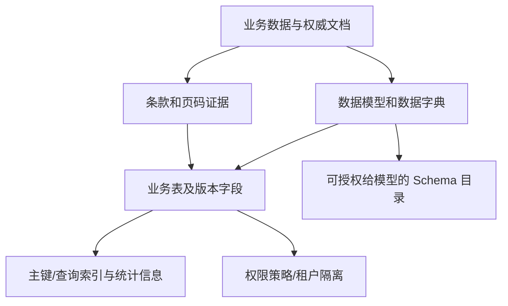
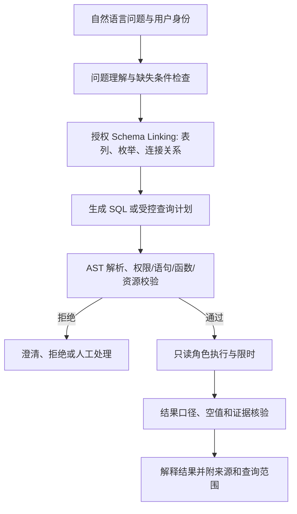
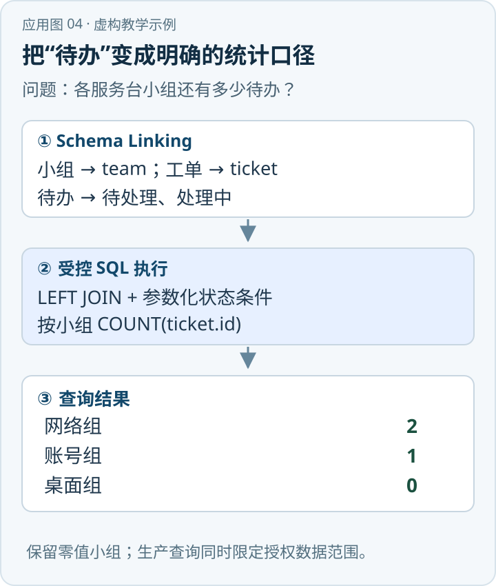

如果用户问“某地区当前有哪些值班单位，负责什么”，而数据已经以结构化表维护，最直接的知识来源可能是 SQL 数据库，而不是向量库。SQL 能对经过权限约束的数据执行过滤、关联、分组和精确聚合：数据、查询与结果都可以被检查。但模型生成一条语法正确的 SQL 并不等于业务含义正确，也不代表数据库里的数据就是现行、权威或完整的。

{/* truncate */}

> 知识库技术研究系列 · 资料核验日期：2026 年 11 月 10 日。应急案例均为虚构教学示例。查看[全部专题与架构选型](../11-overview/index.md#系列阅读)。

直接看应用：[动手应用：查询各服务台小组的待办工单](#动手应用查询各服务台小组的待办工单)。

所谓 SQL 知识库可以理解为：围绕业务表、数据字典、约束、查询权限和证据口径构建可供问答使用的数据系统。Text-to-SQL 是把自然语言问题转成 SQL 的接口技术；它不要求数据库必须包含自然语言长文，也不取代面向非结构化文件的 RAG。[\[1\]](https://arxiv.org/abs/1809.08887)[\[2\]](https://arxiv.org/abs/2305.03111)

## 1. 数据怎样组织

设有以下虚构表，表中关系只作说明，不表示现实预案的通知顺序：

```text
plan(id, title, region_id, effective_from, effective_to, version, status)
organization(id, name, region_id, tenant_id)
responsibility(id, plan_id, organization_id, duty, response_level, evidence_id)
notification_step(id, plan_id, source_org_id, target_org_id, sequence_no, condition, evidence_id)
evidence(id, document_version_id, page_no, paragraph_id, quoted_text)
```

业务实体以行表示，列承载属性，主键识别记录，连接字段表达关联；唯一约束、非空约束及业务约束可以防止部分无效数据。数据库外键是否启用取决于项目规范；未建外键时，应用仍需维护引用完整性。精确事实来自已维护的结构化记录，记录本身应指向可追溯的文档条款或业务来源，避免把模型抽取结果当作权威数据。

`sequence_no` 只有在业务明确赋值时才能用于排序；空值不意味着最后、第一或任意顺序。两个单位同一个序号也可能表示并行或排序未知，具体以数据字典规定为准。必须把适用地区、响应级别、生效时间、版本和权限纳入查询，否则 SQL 即便执行成功也可能跨条件拼接出错误结论。

索引决定的是访问效率，不能修正错误模型。常见关系型数据库用 B-tree 支持等值、范围等访问；其他索引类型服务不同数据类型和操作。复合索引需根据实际过滤条件、选择性和访问模式设计，用执行计划与真实负载验证，不能根据列名机械建立。[\[3\]](https://www.postgresql.org/docs/current/indexes-types.html)[\[4\]](https://www.postgresql.org/docs/current/using-explain.html)



## 2. 从提问到 SQL：Schema Linking 是关键

模型看到“由谁通知交警”时，需要判断“交警”可能指 `organization.name`，通知关系可能来自 `notification_step.target_org_id`，而不是 `responsibility.duty`。这个把问题中的名词、条件和动作对齐到表、列、值与关联路径的过程称为 **Schema Linking**。它涉及字段同义词、缩写、枚举值、单位、时间口径、业务定义和表间连接。Spider 等基准专门考察跨数据库、跨 Schema 的复杂查询，但公开基准的结果不等同于企业上线准确率。[\[1\]](https://arxiv.org/abs/1809.08887)

一条可生产化的查询链可以这样组织：

1. 接收用户身份、租户、部门范围和问题；澄清无法从上下文确定的地区、有效日期或响应级别。
2. 在**授权后的**数据目录中检索候选表、列、受控枚举值和关联说明；包含字段中文名、类型、口径、敏感级别及可用连接关系。
3. 模型在明确 SQL 方言、允许使用的视图和参数约束下生成查询或结构化查询计划；把模型输出当作不可信输入。
4. 对 SQL 进行解析与策略检查，仅允许经过授权的只读语句、表列及安全函数；强制参数绑定、资源限制、结果集上限和超时。
5. 以最小权限只读身份执行，记录生成 SQL、执行状态、实际查询版本和权限上下文；对可疑、高开销或权限不明确的查询拒绝执行或转人工。
6. 检查结果是否为空、存在多版本、条件是否完整，再把结果连同证据引用交给模型解释；无法确认时如实说明。



这是一份工程设计，不是某篇 Text-to-SQL 论文的现成实现。BIRD 研究指出，现实数据库中的值和数据库内容会影响问题理解；实际系统不能只提供表名和列名，却忽略枚举、数据分布、缩写及真实业务口径。[\[2\]](https://arxiv.org/abs/2305.03111) 同时，向模型暴露数据库样本本身也受权限和脱敏要求约束。

## 3. SQL 如何查询关系与聚合

下面是可读的 PostgreSQL 风格示意，`:name` 等表示由驱动安全绑定的参数，不应把用户输入直接拼入 SQL。假设视图已提供完整的租户和行级访问控制，且服务端已确定该视图所用的数据库身份；示例仅演示数据含义，不覆盖权限实现。

```sql
-- 通知步骤与职责分别返回各自的来源，避免用通知条款替代职责依据。
SELECT n.sequence_no, source.name AS source_org, target.name AS target_org,
       r.duty,
       ne.document_version_id AS notification_document_version,
       ne.page_no AS notification_page, ne.paragraph_id AS notification_paragraph,
       re.document_version_id AS responsibility_document_version,
       re.page_no AS responsibility_page, re.paragraph_id AS responsibility_paragraph
FROM authorized_plan p
JOIN authorized_notification_step n ON n.plan_id = p.id
JOIN authorized_organization source ON source.id = n.source_org_id
JOIN authorized_organization target ON target.id = n.target_org_id
-- 职责缺失时仍保留通知步骤，以便明确报告资料不足。
LEFT JOIN authorized_responsibility r
  ON r.plan_id = p.id AND r.organization_id = target.id
 AND r.response_level = :response_level
JOIN authorized_evidence ne ON ne.id = n.evidence_id
LEFT JOIN authorized_evidence re ON re.id = r.evidence_id
WHERE p.region_id = :region_id
  AND p.status = 'PUBLISHED'
  AND p.effective_from <= :as_of
  AND (p.effective_to IS NULL OR p.effective_to > :as_of)
  AND n.condition = :response_level
ORDER BY n.sequence_no NULLS LAST, n.id;
```

这段查询分别返回通知和职责的证据位置，仍需根据真实数据模型处理空序号、多版本重叠和可能的重复行；不能把 `n.id` 的稳定排序说成业务规定的通知顺序。`LEFT JOIN` 保留没有匹配职责的通知记录，便于报告职责未查到；若把右表过滤条件移到 `WHERE`，可能改变其结果含义。[\[5\]](https://www.postgresql.org/docs/current/queries-table-expressions.html) 对自然语言“哪些单位都要通知”和“至少通知一个”应分别使用正确的集合或逻辑语义，不能以文字相似度替代判断。

SQL 能够做 `COUNT`、`GROUP BY`、`SUM`、窗口函数和多表 `JOIN`。它擅长回答定义清晰、数据结构完整的问题：例如按生效版本列出单位，统计某地区单位数。SQL 查询自身没有自动完成复杂常识推断；其结果的正确性依赖数据、过滤条件和业务规则。

## 4. 与 GraphRAG、向量检索怎样分工

关系库中的表与 JOIN 本身也能表达图结构；部分 SQL 方言可用递归查询处理有限路径。但 GraphRAG 常从非结构化文档抽取实体关系，或使用社区结构、图传播及原文检索应对关联和主题问题。二者区别更多在**数据来源、查询机制和系统目的**，不是“关系型数据库没有关系，图数据库才有关系”。[\[6\]](https://arxiv.org/abs/2404.16130)

对于“预案中如何解释救援职责”，原文可能比结构化表更完整，适合全文或 Hybrid 检索；对于“当前预案涉及哪些已维护单位、每类有多少”，SQL 更直接；对于“在数份文件中某职责由哪些关系间接关联”，可将图检索作为辅助。跨系统回答时，应分别保留 SQL 结果行和原文块的来源、时间、权限、版本，不能用 SQL 返回的 ID 虚构文档内容。

## 5. 虚构应急问题如何回答

假设测试数据只录入：现场负责人报告指挥部；指挥部按响应级别联系交警与医疗单位；交警维持交通秩序，医疗单位开展救护。没有为交警与医疗单位配置先后顺序。系统首先筛选指定地区和生效版本，查询关联单位及各自职责，回查这些记录对应的预案条款；对“通知顺序”，可以说明“先报告指挥部”仅在对应原文有明确规定时成立，而两个被联系单位之间先后顺序未提供。若 SQL 返回空结果，还应区分“没有记录”“没有权限”“没有适用版本”与“连接字段不匹配”，不能一律回答“不需要通知”。

## 6. 安全和实施验证

参数绑定保护的是值，通常不能把任意表名、列名或 SQL 语法片段当作绑定参数；动态标识符需要白名单或由可信代码构建。[\[7\]](https://cheatsheetseries.owasp.org/cheatsheets/SQL_Injection_Prevention_Cheat_Sheet.html) 仅靠提示词要求模型“不要删除数据”不是安全措施。执行层需要只读角色、限定 schema/视图、允许的 AST、禁止危险函数与多语句、超时、并发与返回行数上限；对导出敏感大结果、笛卡尔积和低效查询也要限制。

以 PostgreSQL 为例，行级安全（RLS）是强制行过滤的机制之一，但表所有者通常绕过策略，超级用户和具有 `BYPASSRLS` 的角色也可能绕过，实际执行身份必须核实；视图权限、连接池的租户上下文及防绕过机制要做集成测试。[\[8\]](https://www.postgresql.org/docs/current/ddl-rowsecurity.html) 还要考虑元数据泄露、查询日志脱敏、SQL 结果对提示注入的防御，以及业务数据变更后的缓存失效。

评估应同时测：Schema Linking 的表列及连接路径准确率；SQL 能否执行；查询结果是否与人工审核的标准一致；多租户隔离和越权拒绝；生效时间、空值、同义词、多对多 JOIN 和重复行；最终回答的结果忠实度与证据覆盖。执行成功率不等于语义正确率；单一测试数据库上结果碰巧相同，也不一定说明 SQL 表达式等价。追踪 p95 延迟、超时、扫描行数与成本，使用 `EXPLAIN` 检查真实执行计划，必要时由专家复核高风险问答。[\[4\]](https://www.postgresql.org/docs/current/using-explain.html)

## 7. 数据字典和 Schema Linking 需要保存哪些内容

只把 `responsibility.duty` 这样的字段名交给模型不足以支撑准确查询。一个可维护的数据目录至少应提供字段的业务名称和含义、SQL 类型、是否可空、枚举值、计量单位、数据来源、敏感级别、更新频率、使用示例，以及它与其他表的连接条件。针对“当前预案”，目录还应说明 `status='PUBLISHED'` 是否足够，还是必须同时检查生效起止日期和地域；若一个地区允许多套有效预案，还应说明选择优先级。

查询词与数据库值的对齐同样重要。“高速交警”“高速公路交警支队”和机构正式名称可能是同义词，也可能在不同区域指向不同机构。可用维护过的别名字典和受权限保护的值搜索得到候选，再结合地区、组织代码及有效期确认。向量搜索和全文检索可用来发现候选字段或枚举，最终精确过滤仍要使用核对后的值与参数；高风险歧义不能靠选择第一个匹配项解决。

连接路径需要显式维护。若预案与组织通过 `responsibility` 和 `notification_step` 各有一条路径，前者说明职责，后者说明联系动作；随意交换会把“承担救护职责”误解为“必须由其负责通知”。计划生成后应验证所选路径是否满足问题语义，以及一对多连接是否引发重复计数。`COUNT(*)` 统计连接后的行数，不总等于机构数；是否使用去重、按何种主键去重，要由业务口径决定。

## 8. 查询沙箱和跨数据源组合

较稳妥的生产方式是在权威业务库之上提供经过审核的只读视图或受控数据集，隐藏未授权的表、列和敏感值；模型只看到经过用户权限过滤的数据目录。执行器先解析 SQL 的抽象语法树，验证所有被引用对象与函数；再用独立的只读身份连接，叠加数据库行级策略和连接超时。AST 校验规则应按数据库方言测试，包含子查询、公共表表达式、视图、系统表、用户自定义函数和多语句等情况；若无法证明安全，则拒绝并返回可解释原因。

只读也不等于无风险：一个巨大 JOIN 可能占用数据库资源，一个统计查询可能通过反复试探暴露小群体信息，一个可执行的高权限函数也可能造成额外影响。部署时应考虑只读副本或隔离工作负载、查询预算、输出脱敏、速率限制和异常审计；具体限制取决于数据库权限模型和业务风险。生成失败时，不应把完整数据库错误、未授权表名或敏感参数回显给用户。

在混合知识库中，SQL 可以先返回符合条件的单位 ID 和准确计数，再让文档检索器查找该单位对应职责条款。连接的键、时间和业务版本必须一致：如果 SQL 数据来自昨日快照、预案检索使用今日新版本，答案需要提示时效差异；不能把两个时间点的结果包装成一个确定事实。相同证据段被多个单位引用时可去重展示，但每项事实与依据的映射仍需保留。

## 9. 把演示变成可验收服务

上线前用经授权的真实问题集建立基准，覆盖简称、多义词、多个地区同名机构、生效时间边界、缺失参数、未知单位、多对多关系及空表。每题保存预期 SQL 的业务语义、标准结果和来源，而不是只比较 SQL 字符串，因为不同 SQL 可以表示同一查询。对存在多个正确写法的问题，应结合标准数据库快照和人工复核判断；对数据可能巧合相同的查询，补充反例数据集。

测试需要同时验证用户不可访问的表列、租户及记录确实无法通过任何生成语句读取；权限撤销后查询和缓存同步生效；数据库故障、超时及没有结果时给出准确状态。运行指标至少包含请求成功率、需要澄清比例、语义正确率、越权拦截、慢查询比例、p95 延迟与每次查询成本。人工审核抽样应覆盖高影响答案，而不是只抽取模型认为低置信度的请求。
## 动手应用：查询各服务台小组的待办工单

业务人员问：“各小组还有多少待办工单？”下面使用虚构数据和 Python 标准库中的 SQLite，创建内存数据库后即可运行；实际接入生产库时应改用受控只读数据源，并先核对用户权限。



*应用示意图 · 对应下方虚构教学数据。* [查看 SVG 原图](../assets/application-04.svg) · [下载 PNG](../assets/application-04.png)

### 第一步：创建最小数据并执行查询

```python
import sqlite3

conn = sqlite3.connect(":memory:")
conn.executescript("""
CREATE TABLE team (id INTEGER PRIMARY KEY, name TEXT NOT NULL);
CREATE TABLE ticket (id INTEGER PRIMARY KEY, team_id INTEGER NOT NULL, status TEXT NOT NULL);
INSERT INTO team VALUES (1, '网络组'), (2, '账号组'), (3, '桌面组');
INSERT INTO ticket VALUES
  (101, 1, '待处理'), (102, 1, '处理中'),
  (103, 2, '待处理'), (104, 2, '已关闭');
""")

sql = """
SELECT team.name, COUNT(ticket.id) AS pending_count
FROM team
LEFT JOIN ticket ON ticket.team_id = team.id
                AND ticket.status IN (?, ?)
GROUP BY team.id, team.name
ORDER BY pending_count DESC, team.name
"""
for row in conn.execute(sql, ("待处理", "处理中")):
    print(row)
```

预期输出如下：

```text
('网络组', 2)
('账号组', 1)
('桌面组', 0)
```

### 第二步：解释从问题到结果的映射

Schema Linking 把“小组”映射到 `team.name`，把“工单”映射到 `ticket`，使用 `ticket.team_id = team.id` 连接两表；业务词“待办”在本例中明确映射为“待处理、处理中”两个状态。状态放在 `LEFT JOIN` 的连接条件里，`COUNT(ticket.id)` 只数匹配的工单，因此没有待办工单的桌面组也会显示为 0。若业务对“待办”有另一套定义，应先调整数据字典和参数，而不能凭模型猜测。

应用把查询结果交给模型后，预期回答为：“网络组 2 件、账号组 1 件、桌面组 0 件。”结果应附数据快照时间及授权数据源；这段演示本身不包含真实工单或时效信息。

### 第三步：从演示变成服务

把表结构、字段说明、枚举和允许的连接路径整理成数据字典；先固定问题集及期望结果，再让模型生成候选 SQL，由服务端做方言解析、对象白名单、参数绑定、只读权限、行级隔离和超时控制。增加“某组只有已关闭工单”“新状态未定义”“用户无权看某组”等反例，并在隔离数据上验收。无权限或统计口径不明确时，系统应拒绝或请求澄清，不能把空结果写成零。

## 参考资料

| 编号 | 原始资料 | 用途 |
|---|---|---|
| [1] | [Spider：跨数据库 Text-to-SQL 基准](https://arxiv.org/abs/1809.08887) | 复杂多表查询与跨 Schema 泛化 |
| [2] | [BIRD：数据库内容驱动的 Text-to-SQL](https://arxiv.org/abs/2305.03111) | 数据库内容、现实数据及查询效率挑战 |
| [3] | [PostgreSQL 索引类型](https://www.postgresql.org/docs/current/indexes-types.html) | 常见物理索引能力 |
| [4] | [PostgreSQL Using EXPLAIN](https://www.postgresql.org/docs/current/using-explain.html) | 查询计划与成本检查 |
| [5] | [PostgreSQL Table Expressions](https://www.postgresql.org/docs/current/queries-table-expressions.html) | JOIN 与过滤语义 |
| [6] | [Microsoft GraphRAG 论文](https://arxiv.org/abs/2404.16130) | 基于文档图和社区摘要的查询架构 |
| [7] | [OWASP SQL 注入防护](https://cheatsheetseries.owasp.org/cheatsheets/SQL_Injection_Prevention_Cheat_Sheet.html) | 参数化与动态标识符白名单 |
| [8] | [PostgreSQL 行级安全](https://www.postgresql.org/docs/current/ddl-rowsecurity.html) | RLS 的权限和绕过边界 |

---

[上一篇：KAG](../03-kag/index.md) · [下一篇：PageIndex](../05-pageindex/index.md)
