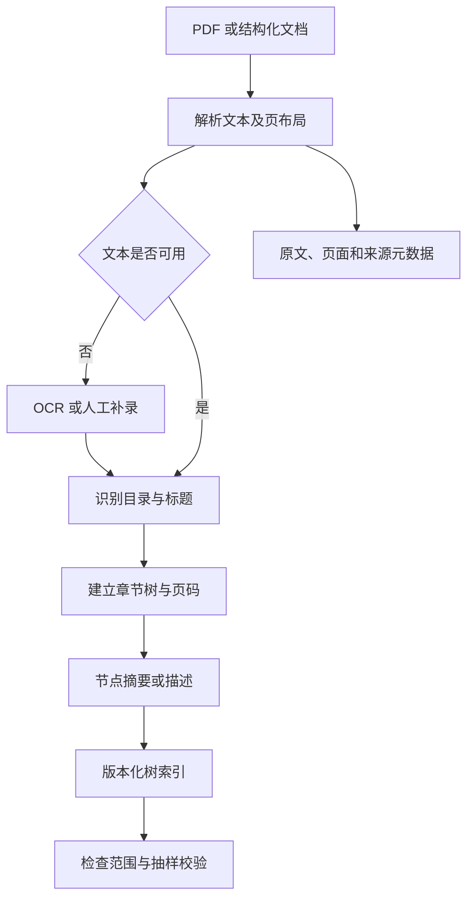
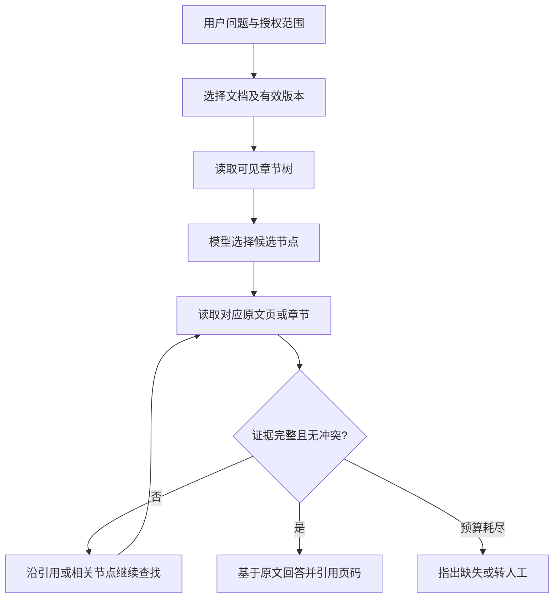
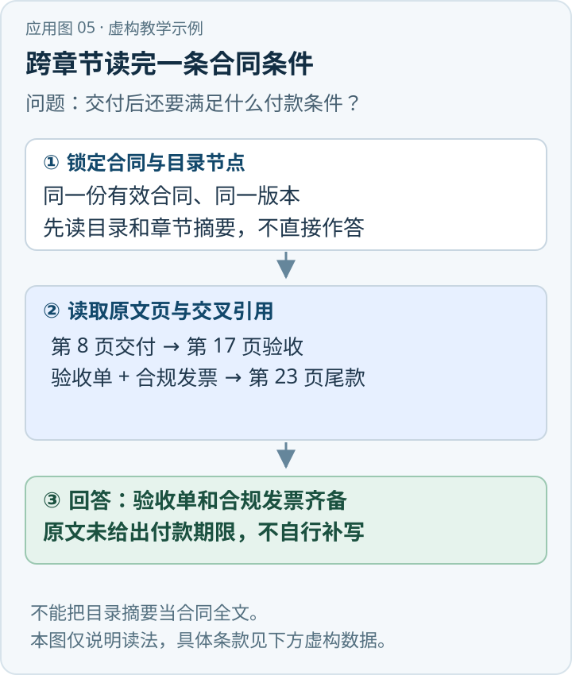

一份高速公路应急预案的“事故报告”“部门职责”“通信录”可能分布在几个章节，后者还可能放在附件。只把全文切为等长片段再做向量相似度排序，系统找到的短片段可能列出了部门，却漏掉适用条件、上级标题或生效范围。PageIndex 的核心尝试，是先把章节层次及页码组织成树，再让模型依据问题选择要读的范围。[\[1\]](https://github.com/VectifyAI/PageIndex)

{/* truncate */}

> 知识库技术研究系列 · 资料核验日期：2026 年 11 月 10 日。应急案例均为虚构教学示例。查看[全部专题与架构选型](../11-overview/index.md#系列阅读)。

直接看应用：[动手应用：从采购合同中找出付款条件](#动手应用从采购合同中找出付款条件)。

它不等于“模型从头读完每一页，也不建立索引”，而是把索引从向量邻近结构换成可导航的文档结构；它也没有证明向量检索普遍无效。对没有稳定章节的日志、零散聊天记录或跨海量未知文档的首轮召回，目录未必是最好的入口。

## 一、从向量邻居转向章节导航

PageIndex 是 VectifyAI 的文档树索引与检索方案。官方仓库将它描述为 vectorless、reasoning-based RAG：先为文档生成树，再让模型依据问题选择节点并读取相应文本。[\[1\]](https://github.com/VectifyAI/PageIndex) 向量数据库不是这条路线的必要条件，但建树、摘要和查询可能调用模型，仍需核算 token、网络与推理成本。

“无 chunking”主要表示不依赖固定长度文本块作为主要检索索引。实际系统仍然按页、章节、节点或范围读取文字；受上下文窗口限制，过长章节也需要分段。“没有固定长度 chunk”不等于“全文永不切分”。PageIndex 是知识组织及检索策略，可与 BM25、向量、SQL 和权限系统结合，并不是新的本体标准。

### 实现版本：Classic 和当前 Flash 不是同一条建树流水线

截至核验日，官方 README 将 **PageIndex Flash** 列为 SDK 本地模式默认索引方法。Flash 面向文本型 PDF，从版面统计提取章节树；模型可用于生成摘要和优化结构。其源码说明支持关闭摘要与优化，生成无需模型的原始树；这不意味着扫描件无需 OCR，也不保证原始树适合直接用于所有查询。[\[1\]](https://github.com/VectifyAI/PageIndex)[\[5\]](https://github.com/VectifyAI/PageIndex/blob/2ac8694bf8fe89a3840dda9bdb88db5119b77fc4/pageindex/flash/README.md)

仓库另有 **Classic** 建树实现，不能把它的 LLM 目录识别描述成 Flash 必经步骤。Classic 首先检查前若干页是否存在目录：有目录且带页码时，提取目录结构，比较目录页码与在正文找到的标题物理页，计算偏移后映射；有目录但缺页码时，根据标题和正文推断物理页；无目录时，从分组后的正文构建结构。[\[6\]](https://github.com/VectifyAI/PageIndex/blob/2ac8694bf8fe89a3840dda9bdb88db5119b77fc4/pageindex/page_index_classic.py)

Classic 进一步检查标题是否出现在推断页面，对错误页面有限次重试；验证不充分时按“带目录页码 → 无页码 → 无目录”顺序退回，最终仍失败则报错。过长叶节点同时满足页数和 token 阈值时，可在其范围内递归重新建树；实现还避免对相同范围无限拆分。[\[6\]](https://github.com/VectifyAI/PageIndex/blob/2ac8694bf8fe89a3840dda9bdb88db5119b77fc4/pageindex/page_index_classic.py) 这些属于特定源码版本的机制，不等于所有版本都采用相同阈值，也不能把模型校验视为完备性证明。
## 二、离线：从文件到可追溯的章节树



树节点通常包括稳定 ID、标题、父子关系、页码范围、可选摘要与来源版本。下例是企业实现建议，不是官方固定协议：

```json
{
  "document_id": "plan-demo",
  "version": "v3",
  "node_id": "response.notify",
  "title": "事故信息报告与通知",
  "start_page": 12,
  "end_page": 16,
  "summary": "事故报告触发条件、通知对象和程序",
  "children": ["response.notify.initial", "response.notify.followup"]
}
```

树是带层次的导航结构：父节点覆盖一个主题，子节点细化范围，标题帮助选择，页码使系统回到原文。构建时至少检查标题是否漏识别、页码是否越界、扫描页 OCR 是否失败、子节点是否位于父节点范围内，并抽样比对标题与页面内容。模型摘要可能遗漏“仅适用于重大事故”等限定条件，因此摘要宜用于导航，最终事实要回到原文核验。

目录印刷页码可能与 PDF 物理页码相差数页，封面、罗马数字前言、附件单独编号也会破坏简单偏移。生产记录最好同时保存物理页号、印刷页码和原文定位片段。扫描件、跨页表格、双栏排版、页眉和脚注都可能使树看似完整，实际证据却不可读。OCR 的存在是解析能力前提，不代表 PageIndex 能自动解决所有扫描问题。

## 三、在线：选择节点、读取原文、继续寻找



系统先识别问题需要哪些事实，根据目录选择候选章节，读取原文；如章节写有“见附件”，则继续查找附件；然后核对版本、适用条件与各条证据，给出可点击的出处。模型在树上做判断，能够利用问题与标题的领域关系，但其决策不是严格逻辑证明：选错节点、摘要失真或忽略例外，都可能漏掉关键证据。

资料库通常包含多份文件，还需要先做**文档级路由**：按租户、领域、有效期、文件类型过滤，结合全文检索、元数据或语义检索找到候选文件，再搜索各自章节树。文档选错后树检索再准确也无济于事，因此必须把“找对文件”和“找对页面”分开评估。[\[1\]](https://github.com/VectifyAI/PageIndex)

### 本地 SDK、示例与云服务的边界

开源 SDK 不只提供建树：官方 README 和本地代码均展示本地 `chat`／检索路径，调用配置的模型搜索树并读取内容；模型可以通过外部 API 提供，因此“索引本地”不必然意味着模型离线。上图是按可核验性增加版本过滤和引用检查的生产参考流程，不是声称每个节点都由开源 SDK 自动完成。[\[1\]](https://github.com/VectifyAI/PageIndex)[\[7\]](https://github.com/VectifyAI/PageIndex/blob/2ac8694bf8fe89a3840dda9bdb88db5119b77fc4/pageindex/local_chat.py)

官方还提供云端索引与托管存储、OCR、图像理解等能力；其文件级 File System 是云端能力。2026 年 10 月推出的 Page Search API 是产品服务，官方的延迟和成本说法属于其特定基准主张，不能直接套用到本地 SDK 或企业环境。[\[1\]](https://github.com/VectifyAI/PageIndex) 对多文件路由、页码证据、权限隔离和数据出境，必须分别核实所选路径。
## 四、一个应急预案问题的完整示例

用户问：“某高速公路发生交通事故后，按照应急预案需要通知哪些单位？通知顺序是什么？各单位分别承担什么职责？”

以下是虚构教学例子，不代表真实预案。假设《示例预案》第 3 章规定触发条件，第 4 章列通知程序，第 6 章描述职责，附件列联系人。系统先根据事故等级和有效日期选择版本，然后分别读取 3、4、6 章及所引用附件。

如果第 4 章只说“按通信录通知”，附件只列联系人而未明确顺序，答案只能说明已有证据支持哪些单位，并指出“已检索条款未明确先后顺序”，不能依据一般经验补出顺序。每项职责要附版本、章节、页码与支持该结论的原文。

章节树能保留上下文并引导跨章节阅读；但如果通知条件散落在多个例外条款，或者多份预案适用范围冲突，模型仍会误读。真实联系人是否仍有效、跨文件引用是否已废止，也不是文档树自身能自动保证的。

## 五、为什么可能有效，何时会失效

| 场景 | 章节树可能带来的收益 | 必须检验的条件 |
|---|---|---|
| 合同与法律文件 | 在定义、主体义务、例外之间导航 | 条款、修订附件和引用链可定位 |
| 年报与招股书 | 定位财务报表及附注 | 表格、单位、列名和年份解析正确 |
| 技术规范 | 按章节查定义、步骤和例外 | 标题准确、规范版本正确 |
| 应急预案 | 连读触发条件、职责与附件 | 部门和条件未被摘要丢失 |
| 无结构聊天和日志 | 层级不稳定，树的收益不确定 | 考虑全文、向量、时间及实体过滤 |

官方仓库报告其 Mafin 系列在 FinanceBench 上获得 98.7% 准确率。[\[1\]](https://github.com/VectifyAI/PageIndex)[\[2\]](https://github.com/VectifyAI/Mafin2.5-FinanceBench) 这是特定产品、模型、测试数据与评分口径下的官方结果，不能直接当作开源树算法在企业里的准确率，更不表示所有问题上 PageIndex 都优于向量检索。比较时要控制文档解析、模型、上下文预算、文档范围、数据分布和评分方式；参考完整评测代码与结果。[\[2\]](https://github.com/VectifyAI/Mafin2.5-FinanceBench)

## 六、更新、权限与成本

**更新**：原文保留内容哈希和版本号。新版本异步构树、完成抽样检查后，再原子切换索引指针；单次查询固定一个版本。只更新原文而保留旧页码，会造成引用错位。废止版本是否可见应遵从业务规则。

**删除**：按文档版本反查并删除章节节点、摘要、缓存及其他派生索引；有法定保留要求时执行组织的留存策略。文档撤权时，不仅原文，摘要和缓存也要失效。

**权限**：按用户、租户、文档及章节授权，在读取树和调用模型之前过滤；节点摘要本身可能泄密，不能先暴露整棵树再做后过滤。向外部模型发送原文前还应确认数据处理与授权范围。

**性能**：分别记录离线解析和摘要、在线树导航、重复读取页码与答案生成的成本。可缓存按权限隔离的版本化树，设置节点数、轮次、页数和 token 上限；对明确页码问题直接读取，对多章节高风险问题才追加检索。解析失败或模型超时不能冒充“文档没有相关内容”。

## 七、如何评估和决定是否采用

用同一批带金标准文件、页码和原文片段的问题，同时比较 BM25、混合检索、章节树与组合方案：

1. 文档定位：正确文档 Recall@K，分开统计单文档和跨文档问题。
2. 证据定位：章节和页召回率、必要证据完整覆盖率、错页率、表格定位正确率。
3. 答案质量：逐条核验事实、适用条件、引用支持度与拒答正确性，不只看语言流畅度。
4. 工程质量：索引耗时、更新后不一致窗口、解析失败率、p50/p95 延迟、模型调用次数与费用。
5. 安全和稳健性：越权率、旧版本误用、坏目录、OCR 噪声、相似章节和冲突条款。

目录结构是潜在优势，不是质量保证。应先建立正确的文档选择、原文映射和引用，再由本企业的实际问题判断额外树索引是否值得维护。

## 八、关键实现：如何从目录走到可引用证据

企业实现中可将一次定位拆成四个可观测操作。第一，解析器为每页记录文字、图像区域和物理页号；第二，目录检测器给出候选标题及父子层级；第三，对每个节点计算起止页并绑定实际页内容；第四，为节点生成便于筛选的简短说明。模型可以参与第二至第四步，但应用必须保存每一步的输入、版本和结果，才能区分“目录抽错”“模型选错”和“原文解析缺字”。

**跨页与跨章节问题。** 章节起点可能位于一页中间，结束位置也可能处于下一节标题之前。如果只按整页读取，返回内容会混入相邻条款；如果只按摘要返回，又容易遗漏条件和例外。可先按页粗定位，再用版面坐标或段落锚点缩小引用范围。对“参见第 X 条”等交叉引用，要保存源节点、引用文本和目标节点的解析状态；找不到目标时保留明确的断链标记，不要猜测目标。

**表格与附件。** 表格常把“单位”放在第一列、“通知时限”放在另一列，页面纯文本排序可能打乱对应关系。存储时应尽量保留表头、行列坐标和跨页续表关系，生成答案前检查单位与数值列是否对应。附件、图示和扫描印章是否被解析，也要在索引质量报告中列出；系统不能因为文字搜索不到就宣称附件不存在。

**目录和真实内容不一致。** 自动生成目录可能产生重复标题、失效页码或漏掉未编号章节。建议设置结构质量门槛：页面范围不能为负，父子范围不能明显错位，标题可在文档附近找到，样本中的正文可正确回显。低质量文档可回退到全文检索并提示定位精度下降，而不是强行生成一棵看似完整的树。

## 九、联合其他检索器：分工比叠加更重要

| 问题特征 | 建议入口 | 后续证据获取 |
|---|---|---|
| 已知文件、未知具体章节 | 章节树 | 读取命中节点和交叉引用原文 |
| 已知精确条款号或设备型号 | BM25／全文索引 | 根据命中位置回到章节上下文 |
| 不知道企业里哪份文件适用 | 元数据过滤后混合检索 | 对候选文件分别导航章节树 |
| 需要实时库存、联系人或统计 | 受权限控制的 SQL | 用文档确认规则，数据以授权系统为准 |
| 需要跨多个条款验证关系 | 有预算上限的迭代检索 | 每次扩展回到原文并记录来源 |

融合时先按 `文档版本 + 页范围 + 内容哈希` 做来源级去重，再在候选级排序；相邻页即使内容相似，也不能随意合并到丢失例外条款。BM25 得分、模型判断和向量相似度的量纲不同，不能直接相加；可先用排名融合或经过验证的重排序器，再评估是否保留必要证据。树搜索返回的章节本身不是最终证据，最终引用仍应落到具体原文。
## 十、社区反馈如何使用

PageIndex 的一条公开 issue 报告特定版本的 JSON 修复逻辑会改写字符串里的 `None` 和空格，并附本地最小复现；报告同时明确该复现没有调用真实模型或云服务。[\[4\]](https://github.com/VectifyAI/PageIndex/issues/650) 这是一条针对特定代码路径和版本的报告，不能据此断言所有版本都会发生同样错误。它提示生产方在模型输出解析之外，还应测试标题、引号、Unicode、特殊字符和原文回显是否完整，并跟踪 issue 的后续处理状态。

微信公众号原文检索本次没有取得可供核验的正文；下方腾讯云转载正文可读，文中归署 Vishal Mysore，并注明来自微信公众号，但未给出可核实的公众号原文链接。行业宣传、社区报告和自己的生产验证分别对待，避免从单个案例推广为技术结论。
## 动手应用：从采购合同中找出付款条件



*应用示意图 · 对应下方虚构教学数据。* [查看 SVG 原图](../assets/application-05.svg) · [下载 PNG](../assets/application-05.png)

以下是虚构合同和教学演示，不代表实际系统运行记录。采购人员问：“设备交付后，满足什么条件才能支付尾款？”合同有 30 页，付款条款并不重复验收程序：

| 原文位置 | 片段 | 索引的节点摘要 |
|---|---|---|
| 第 8 页，3.1 交付 | 供方须在约定日交付设备及装箱单。 | 交付材料和时间 |
| 第 17 页，5.2 验收 | 双方完成现场测试并签署验收单。 | 验收程序及凭证 |
| 第 23 页，7.3 尾款 | 买方在收到双方签署的验收单和合规发票后支付尾款。 | 付款前置条件 |

**第一步：生成并复核章节树。** 从解析结果保留节点标题、页码和原文件版本。下面的 JSON 只展示本例需要的数据结构，不是 PageIndex 的固定 API 返回格式；页面范围还应与 PDF 原文核对。[\[1\]](https://github.com/VectifyAI/PageIndex)

```json
{
  "document": "采购合同-v1.pdf",
  "nodes": [
    {"title": "3.1 交付", "pages": [8, 8]},
    {"title": "5.2 验收", "pages": [17, 17]},
    {"title": "7.3 尾款", "pages": [23, 23]}
  ]
}
```

**第二步：按问题找候选，按原文补齐条件。** 先从标题和节点摘要选择“7.3 尾款”，读取第 23 页，发现“验收单”是必要条件；再找“5.2 验收”，读取第 17 页确认验收单如何形成。问题涉及交付，因此读取第 8 页核实交付要求；仅凭目录不能断定付款条件，必须回到正文。

**第三步：组织可追溯回答。** 示例回答：“尾款须在收到双方签署的验收单和合规发票后支付［第 23 页，7.3］；验收单由双方完成现场测试后签署［第 17 页，5.2］。设备交付及装箱单要求见［第 8 页，3.1］。”没有原文支持时，不应自行补写付款期限、比例或违约条件。

上线时先挑选一批有清晰目录、能定位页码的合同，人工核对节点边界，并用不同措辞测试是否同时找回两条付款条件。验收至少检查相关页码、合同版本和引用是否正确；扫描件还要复核 OCR 和页码映射。章节标题不清或合同分散在多个附件时，需要全文检索等补充手段。

## 参考资料

[1] VectifyAI，[PageIndex 官方仓库](https://github.com/VectifyAI/PageIndex)。

[2] VectifyAI，[Mafin 2.5 FinanceBench 官方评测仓库](https://github.com/VectifyAI/Mafin2.5-FinanceBench)；[官方文章](https://vectify.ai/blog/Mafin2.5)。官方实验结果需按其数据与口径理解。

[3] Vishal Mysore，腾讯云账号 deephub 转载《无 Embedding、无向量数据库的 RAG 方法：PageIndex 技术解析》，[腾讯云转载正文](https://developer.cloud.tencent.com/article/2658053)，2026-04-21；页面称原始发表 2026-04-14、分享自微信公众号。转载正文已读，公众号原文及其账号名称未核实，不能算作原文已读。

[4] PageIndex 社区，[JSON recovery rewrites quoted strings，Issue #650](https://github.com/VectifyAI/PageIndex/issues/650)，报告内容与复现范围由提问者提供。

[5] VectifyAI，[PageIndex Flash README](https://github.com/VectifyAI/PageIndex/blob/2ac8694bf8fe89a3840dda9bdb88db5119b77fc4/pageindex/flash/README.md)，固定提交源码。

[6] VectifyAI，[PageIndex Classic 建树源码](https://github.com/VectifyAI/PageIndex/blob/2ac8694bf8fe89a3840dda9bdb88db5119b77fc4/pageindex/page_index_classic.py)，固定提交源码。

[7] VectifyAI，[本地模型对话源码](https://github.com/VectifyAI/PageIndex/blob/2ac8694bf8fe89a3840dda9bdb88db5119b77fc4/pageindex/local_chat.py)，固定提交源码。

---

[上一篇：SQL 知识库](../04-sql/index.md) · [下一篇：LLM-Wiki](../06-llm-wiki/index.md)
