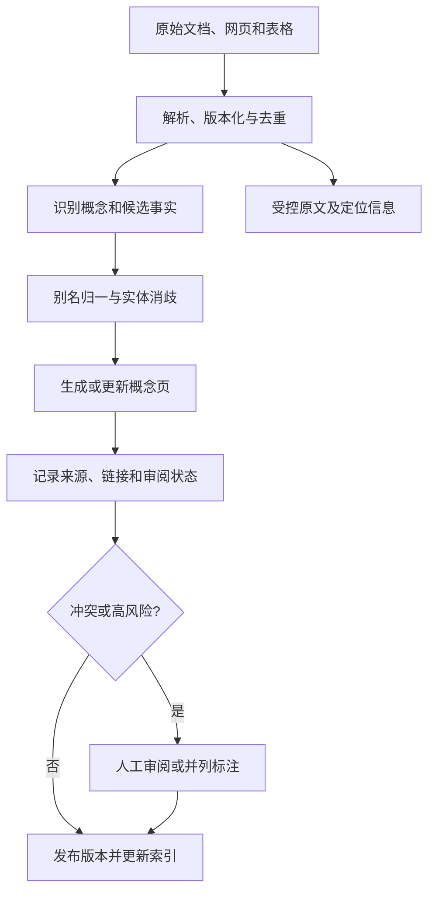
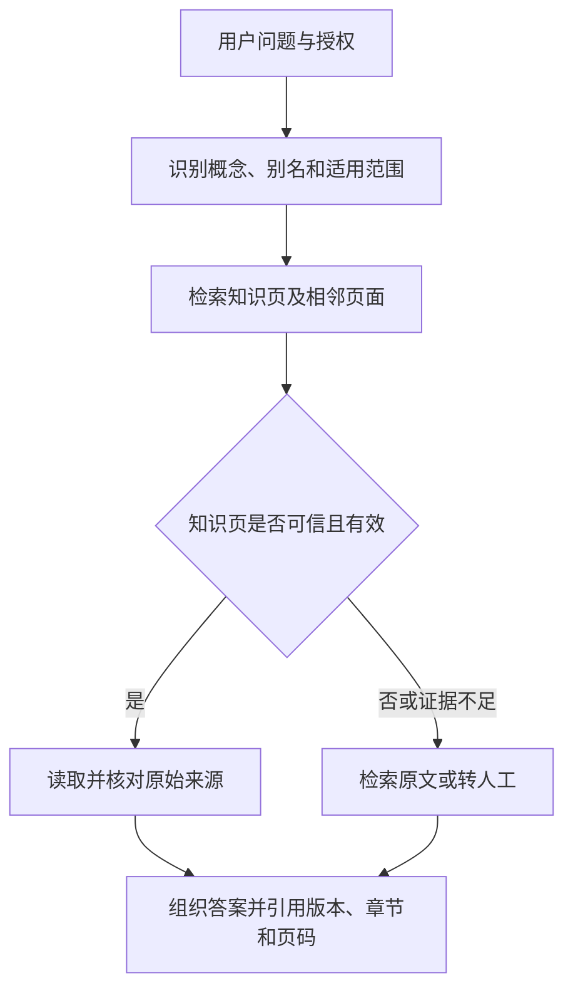
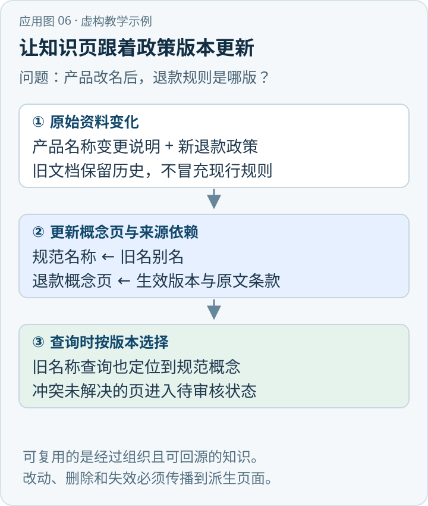

某企业收到一份新的应急预案。一般文档 RAG 可能将它解析、切片并建索引，等用户提问时再召回和综合。LLM-Wiki 还会主动更新“事故报告程序”“部门职责”“预案适用范围”等主题页，关联此前资料，标出来源和矛盾。用户下次提问时，系统可先读取这些预先整理的知识，再按需要返回原文。[\[1\]](https://gist.github.com/karpathy/442a6bf555914893e9891c11519de94f)[\[2\]](https://github.com/Astro-Han/karpathy-llm-wiki)

{/* truncate */}

> 知识库技术研究系列 · 资料核验日期：2026 年 11 月 10 日。应急案例均为虚构教学示例。查看[全部专题与架构选型](../11-overview/index.md#系列阅读)。

直接看应用：[动手应用：产品改名后如何维护退款知识页](#动手应用产品改名后如何维护退款知识页)。

其优势是让知识整理结果能持续复用；代价是要长期维护生成内容、版本、权限和引用。若一份错误或过时总结在多个答案中被重复使用，错误也会被放大。因此，知识页是辅助证据，不应自动取代经核验的原始依据。

## 一、LLM-Wiki、OKF 与知识图谱分别是什么

LLM-Wiki 是一条由 LLM 持续整理和维护 Wiki 页面的方法路线，不是单一厂商产品、强制格式或严格统一的行业标准。Karpathy 的公开方案描述了由原始资料、模型维护的 Wiki 和维护约定组成的工作流；社区可以用不同工具实现。[\[1\]](https://gist.github.com/karpathy/442a6bf555914893e9891c11519de94f)

Google Cloud Platform 的 Open Knowledge Format（OKF）是另一个独立的知识交换格式：以 Markdown 文件、YAML frontmatter 和链接表达 concept 及其元数据。核验时规范为v0.2，要求概念文件具有`type`，概念ID由仓库根目录下的相对文件路径去掉`.md`得到；`sources`和验证／生成元数据是可选约定。它不是知识页生成器，也不强制使用某个检索服务，更不是所有LLM-Wiki的必选标准。[\[3\]](https://github.com/GoogleCloudPlatform/open-knowledge-format/blob/main/SPEC.md) 例如 Astro-Han 的社区实现将自己称为非官方 Karpathy 风格实践，README 明确将 OKF 一致性列为未实现事项。[\[2\]](https://github.com/Astro-Han/karpathy-llm-wiki) 因此，**可以用 OKF 表达 LLM-Wiki，但不能把 OKF 概念页与所有 Wiki 系统划等号**。

Wiki 的双向链接通常是编辑或检索便利：页面 A 指向 B，也可通过反向索引列出所有指向 B 的页面。它不自动赋予链接类型严格语义，也不等于 RDF/OWL 知识图谱、本体或形式化推理。Wiki 也可以额外建立有类型的关系、搜索索引和数据库，但这些属于具体实现。

## 二、离线：建立原文层、概念层和来源映射



可以把它设计成三类资产：

- **原文层**：文档原件、解析文本、页面坐标、时间与权限，保存可供复核的来源。
- **知识页层**：每个概念的定义、职责、别名、相关概念和由来源支持的陈述。
- **映射与索引层**：概念名称表、同义词、正反向链接、文本索引、知识页到原文的溯源关系。

下面是一份按OKF v0.2约定组织的最小教学示例，可保存为`playbooks/incident-reporting.md`。`aliases`和`status`是本例的自定义扩展，原始预案路径及版本是假设资料；在真实知识包中必须替换为可访问来源。它没有声称通知对象或顺序已经经过验证：

```markdown
---
type: Playbook
title: 事故信息报送
aliases: [事故信息报送, 事故上报]
status: review-required
sources:
  - id: plan-demo-v3
    resource: references/plan-demo-v3.md
    ingested: 2026-11-10
---
# 事故信息报送

适用条件、通知对象和顺序应按所引用预案及附件确定。[^plan-demo-v3]

[^plan-demo-v3]: 《示例预案》v3，第12页。虚构来源，仅说明引用映射。
```

OKF没有规定每个概念必须对应现实实体：它也可以表示流程、规则或主题。上述概念ID是`playbooks/incident-reporting`；来源的稳定ID与正文脚注对应。概念页之间还可通过标准Markdown相对链接连接，正反向链接索引由使用方实现，格式规范本身不会执行消歧、冲突裁决或自动更新。[\[3\]](https://github.com/GoogleCloudPlatform/open-knowledge-format/blob/main/SPEC.md)

一个概念页可综合多个来源，一份来源也可影响多个概念页。概念归一化需要区分简称、历史名称与真正同名异义：例如不同地区可能都有同名机构。把同名部门直接合并会污染所有关联页面。系统宜保留候选映射、行政区划和时间条件，并给低置信或高风险合并设置人工审核。

## 三、链接与索引怎样支持查询

知识页可采用关键词全文索引、标题／别名映射、向量索引或图遍历。原始 Wiki 并不天然决定使用哪一种。查询时先按身份和权限筛选，然后匹配问题涉及的概念页；沿链接读取相关页；回查原文、验证生效条件；最后组合答案和引用。频繁查询不一定需要每次完整重做实体抽取，但“预编译过”不应成为跳过证据检查的理由。



正向链接可在保存页面时扫描 Markdown 链接生成；反向链接可在数据库中维护 `target → sources` 倒排表。这样修改一个页面时，系统能找出可能受影响的其他页面。但关系数量多时会产生陈旧链接和循环引用，检索需限制深度、去重并监控断链；反向链接本身也可能暴露无权限页面的存在。

## 四、应急预案案例：编译和查询各做什么

以下为虚构教学示例，不对应任何真实预案。用户问：“某高速公路发生交通事故后，按照应急预案需要通知哪些单位？通知顺序是什么？各单位分别承担什么职责？”

入库时，新预案可能创建或更新“交通事故报告”“适用事故等级”“部门职责”页。系统提取各条原文并记录文档版本和位置，将对应单位映射到既有概念。如果旧预案的通知对象与新预案不一致，页面应同时保存两个版本各自的适用范围，而不是无条件覆盖其中一个。

查询时，系统先确定地点、事件级别与生效日期，找到适用预案；随后读取报告程序和职责页，再回到对应原文核对。假如文件只列出应通知单位而未给出明确顺序，回答应注明证据不足，而不是把概念页中的列表顺序当成法定通知顺序。若职责来源于另一份文件，要分别引用；如不能确认两份文件共同适用，应说明限制。

## 五、与查询时临时综合的权衡

| 比较点 | 常见文档 RAG | LLM-Wiki 知识资产层 |
|---|---|---|
| 主要单位 | 文档片段、标题、元数据 | 经过组织的主题页、别名、链接及来源 |
| 整理时间 | 一部分在入库，大量综合发生在查询时 | 入库与维护时预先综合，查询时仍需核验 |
| 跨文档关系 | 可在查询时临时拼接 | 可保留已审阅的概念关联 |
| 成本分布 | 入库索引成本、查询召回和生成成本 | 额外的编译、冲突审核和持续维护成本 |
| 主要失败 | 检索遗漏、片段割裂、上下文缺失 | 预编译错误、版本陈旧、知识污染、权限泄漏 |
| 最佳用途 | 资料广、问题多变、希望按原文回溯 | 主题相对稳定、反复询问、可投入治理的领域 |

两者并不互斥：知识页本身可以切片或建立全文、向量索引；查询时既召回概念页，也召回原始条款。对话中经常复用的主题可以提前整理，罕见问题则回到源文档实时检索。

## 六、冲突、更新与删除：资产治理才是主要难点

**冲突不是简单去重。** 不同版本、地区、部门或适用时间产生的差异，可能都是真的。事实记录至少保留来源、适用条件、生效／失效时间和审核状态。只有拥有明确权威级别及业务规则时才能自动裁决；否则并列展示并请求业务人员审阅。

**增量更新要处理依赖。** 来源更改后，沿“文档 → 被引用事实 → 概念页 → 下游页面”反查受影响范围，先标记待重建，完成新版本生成和校验再切换。没有可靠依赖图时应保守扩大重建范围。不能让旧页继续显示为最新。

**删除要传播到派生物。** 被删除或撤权的来源可能已经出现在摘要、向量、日志及缓存中。为每项陈述保留可追踪来源，撤销相应陈述并重新生成；没有权限保留的原文和衍生内容需要按实际制度清除。审计日志只保留合规所需的最少信息。

**权限不能只套在原文上。** 汇总页可能混合不同权限的多份资料，其权限应由所用证据共同决定；若无法做可靠的片段级授权，应拆分页或对所有依赖采取最严格可见范围。模型输出和缓存也要按租户、用户、权限版本隔离。

**模型可能捏造引用。** 必须检验引用对象存在、定位可达且原文支持该具体陈述；路径格式正确不代表事实正确。高风险事实、外部法律政策和关键流程应设置人工审批及定期复核。

## 七、评估与落地路径

先选一个范围明确、重复提问多、业务责任人能参与审阅的主题，做几十至几百篇来源的试点。建立固定问题集，以常规混合 RAG 为基线，在同样的源文档、权限和模型预算下对比：

1. 检索质量：概念命中率、原文证据覆盖率、多来源证据完整率。
2. 事实质量：答案支持率、引用正确率、冲突暴露率、应拒答问题的拒答率。
3. 新鲜度：来源变更到页面更新的延迟、已撤销事实残留率、失效引用比例。
4. 治理成本：每篇文档模型调用量、审核人时、合并消歧工作量、单次查询费用与 p95 延迟。
5. 安全质量：跨租户与跨权限泄漏、衍生页删除覆盖率、缓存失效时间。

如果资料变化极快、原文解析不稳定或无法维护来源级权限，先完善文档治理和常规检索，比扩大 Wiki 更有价值。Wiki 能否降低查询成本，也必须加上其离线编译与长期审核成本一起计算。

## 八、知识页如何从草稿走到可使用状态

为了防止新资料一入库就覆盖可靠结论，可以将每次更新设计为独立变更集：先确定来源及其版本，再提取候选陈述，列出计划新增、修改和撤销的页面；随后检查别名冲突、引用是否可达及页面权限；对于高风险变更交由责任人确认；最终一次性发布，并记录可回滚的变更版本。这里的“审核”应有具体的责任人、范围和证据，而不是让模型自评一个未经校准的置信分数后直接上线。

例如某预案修订了单位名称，旧名称可能同时作为历史文档里的正式名称、当前口语简称或另一个机构名称。应先区分三种情况：确已更名、同一实体的别称、两个不同实体。只有来源能支持同一性时才建立别名；跨时段使用时保留名称生效范围。若系统无法区分，则显示多个候选并保留原文，不擅自合并。

**冲突处理的最小记录**可以包含：冲突的陈述、各自的原文定位、来源版本、时间范围、待判问题、处理责任人和状态。冲突不能仅通过“较新文件获胜”处理：较新的新闻报道可能不如旧的正式规章具有权威性；新文件也可能只适用于另一地区。版本关系和效力判断应通过明确业务规则及人工确认维护。

**避免摘要洗白。** 多个概念页可能循环引用同一份未经核验的来源：A 引 B，B 引 C，C 又引 A。表面上有三处证据，实际只有一个来源。系统应计算最底层的独立来源集合，对每条事实保留来源链；无法回到原文时将其标为未证实，而不是增加证据数量。模型复制早期错误也不是独立验证。

## 九、一个可执行的上线方案

第一阶段只维护原文、文档版本、访问控制及全文检索，建立有代表性的测试集；第二阶段选择一小批高价值概念，人工定义页面模板、来源字段和发布流程；第三阶段让模型提出增量变更，由业务人员对比原文审阅；第四阶段接入查询路由，让系统同时检索知识页和原文，衡量引用质量、维护成本及对响应延迟的影响。每阶段都应有失败回退，不必等待全部文档先编译成 Wiki 才提供服务。

对不同问题，可采取不同路径：精确条款号先查原文；“某个概念是什么、与哪些制度相关”先查知识页；实时人员与库存通过授权数据库查询；涉及跨文件制度冲突则同时展示来源和生效条件。若知识页版本落后于原文，系统应显式提示并重新检索，不能静默把旧总结当作现行政策。

与成本有关的负载包括新资料解析、页面编译、关联页更新、人工审核、索引刷新及查询。假设一个高频主题每天被问上千次，预编译可能摊薄重复综合；若问题大多只问一次、文档每日大幅变动，维护成本可能超过节省的查询成本。两种情况都要用具体工作量、模型价格、证据质量和更新滞后测算，不能以“预编译”一词直接推断收益。
## 十、社区实践与尚未解决的问题

该社区实现的维护者和使用者在公开 issue 中讨论过源码变动后 Wiki 如何避免漂移，以及从哪里开始核验知识页。[\[4\]](https://github.com/Astro-Han/karpathy-llm-wiki/issues/7)[\[5\]](https://github.com/Astro-Han/karpathy-llm-wiki/issues/3) 这些问题反映了实践者的关注点，并不构成关于所有 Wiki 系统的统计结论。引入业务前仍需基于本组织权限、版本和文档治理机制单独验证；也不应将社区实现的规模经验当作任意规模的性能保证。

本次检索没有取得可核验的微信公众号原文正文，因此没有将公众号二手转述作为上述技术结论的依据。
## 动手应用：产品改名后如何维护退款知识页



*应用示意图 · 对应下方虚构教学数据。* [查看 SVG 原图](../assets/application-06.svg) · [下载 PNG](../assets/application-06.png)

以下资料、日期和处理结果都是虚构的教学数据，目的是演示知识页如何从原文生成、更新及回溯，不代表某个 Wiki 产品的默认行为。

| 来源 | 版本 | 内容 |
|---|---|---|
| 产品公告 P1 | v1 | 产品原名“星云助手”，自 2026 年 4 月 1 日起改名为“星图助手”。 |
| 退款政策 P2 | v1 | 2026 年 3 月 31 日及之前购买的订单，可在购买后 7 日内申请退款。 |
| 退款政策 P2 | v2 | 2026 年 4 月 1 日及之后购买的订单，可在购买后 14 日内申请退款。 |

**第一步：建立来源与概念页。** 保留 P1、P2 的原文、版本和适用时间。给产品建立稳定页面 ID `product-001`，页面标题是“星图助手”，并将“星云助手”记录为旧名称；给退款政策建立 `policy-refund`。产品页链接退款页，退款页反向链接产品页。链接和别名都是索引关系，不能代替原始政策。

```text
页面：product-001（星图助手）
别名：星云助手（2026-04-01 前使用）
关联：policy-refund
来源：P1@v1

页面：policy-refund（退款政策）
2026-03-31 及之前的订单：7 日内申请 [P2@v1]
2026-04-01 及之后的订单：14 日内申请 [P2@v2]
关联：product-001
```

**第二步：查询并回到来源。** 用户问“星云助手 4 月 3 日购买，几天内能申请退款？”先用别名定位 `product-001`，再沿链接找到 `policy-refund`，按购买日期选择 P2@v2。预期回答：“该订单可在购买后 14 日内申请退款，依据是 P2@v2；‘星云助手’是该产品旧名，依据是 P1@v1。”若缺少购买日期，系统应询问日期或同时列出两个适用区间，不能擅自用最新规则覆盖历史订单。

**第三步：管理变更和冲突。** P2@v2 到达时先保存原文，按来源依赖找到 `policy-refund` 并生成待审核草稿；审核确认后发布新页面版本，历史政策仍保留适用时间和来源。若另一份同一适用期政策写成 10 日，标记冲突并提交负责人核实，查询时展示冲突，不由模型投票选答案。若 P2@v1 被删除或撤权，应使引用它的页面版本、搜索缓存及向无权用户暴露的派生内容失效，再重建或隐藏受影响内容。

先用少量政策建表记录“来源版本 → 知识页版本 → 引用片段”的依赖，再通过别名查询、历史日期查询、冲突发布和撤权场景验收；其中页面审核和失效机制需要应用自行实现，不是 Markdown 链接本身提供的能力。

## 参考资料

[1] Andrej Karpathy，[LLM Wiki 原始方案](https://gist.github.com/karpathy/442a6bf555914893e9891c11519de94f)。

[2] Astro-Han，[karpathy-llm-wiki 社区实现](https://github.com/Astro-Han/karpathy-llm-wiki)。该项目是非官方实践，不代表 Karpathy 官方实现；README 的使用统计属于项目方陈述。

[3] Google Cloud Platform，[Open Knowledge Format 规范](https://github.com/GoogleCloudPlatform/open-knowledge-format/blob/main/SPEC.md)。规范可能演进，实施时应固定版本。

[4] Astro-Han 社区，[Question: how do you handle wiki drift when monitored code changes?](https://github.com/Astro-Han/karpathy-llm-wiki/issues/7)。

[5] Astro-Han 社区，[Question: where should LLM wiki verification start?](https://github.com/Astro-Han/karpathy-llm-wiki/issues/3)。

---

[上一篇：PageIndex](../05-pageindex/index.md) · [下一篇：Ontology](../07-ontology/index.md)
