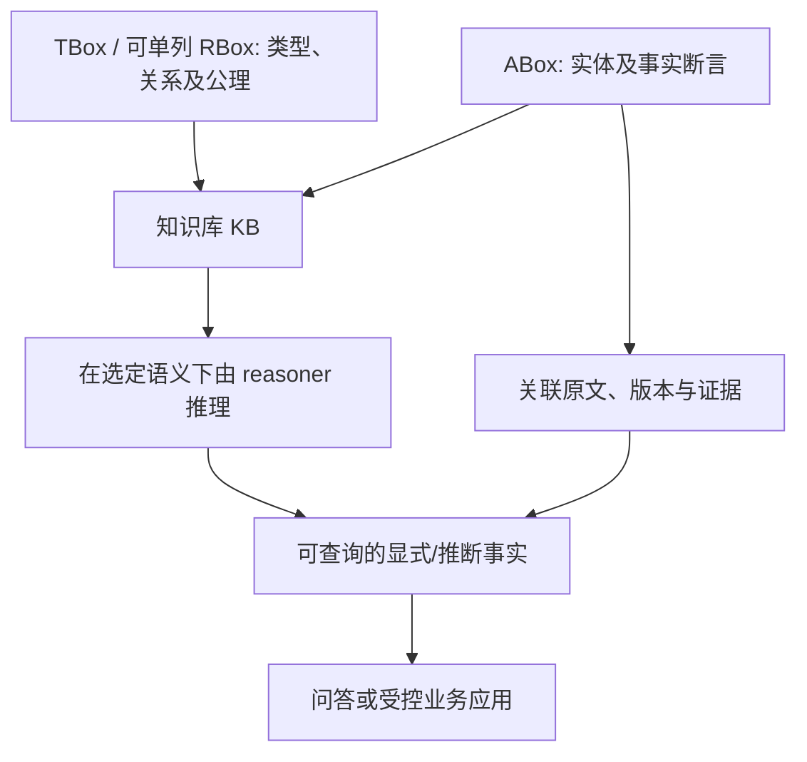
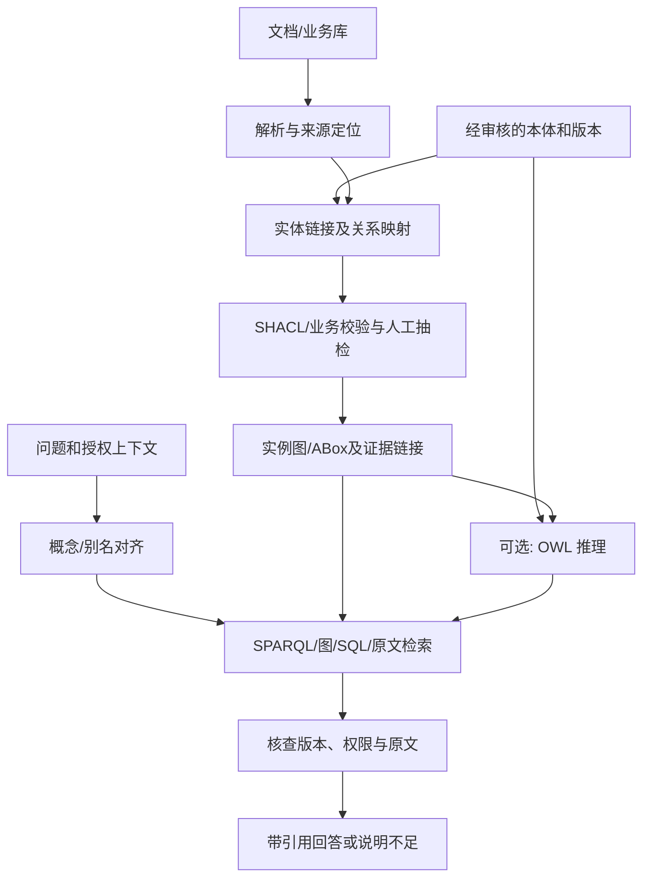
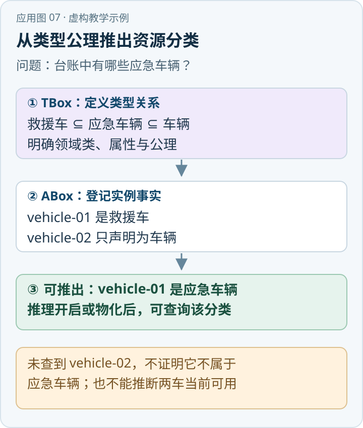

在一套应急知识库中，“救援单位”是一个组织类别，还是一次事故中的临时角色？“负责通知”与“被通知”是否方向相反？“道路管制组”在不同预案中指同一个单位吗？这些问题如果没有共同定义，图谱、SQL 表和 Wiki 页面可能都能存储数据，却会对同一字段作出不同解释。

{/* truncate */}

> 知识库技术研究系列 · 资料核验日期：2026 年 11 月 10 日。应急案例均为虚构教学示例。查看[全部专题与架构选型](../11-overview/index.md#系列阅读)。

直接看应用：[动手应用：把应急车辆分类交给本体推理](#动手应用把应急车辆分类交给本体推理)。

Ontology（本体）提供领域概念、关系及其语义约定。它可以为实体和事实的组织提供共同语言，并在选择形式化语义及推理器后支持部分机器推断；它不是任何一个具体数据库，也不是“只要存在实体关系图就一定有 OWL 本体”。[\[1\]](https://www.w3.org/TR/owl2-primer/)[\[2\]](https://www.w3.org/TR/owl2-syntax/)

## 1. 知识库的严格含义：TBox 和 ABox

在描述逻辑（Description Logic，DL）中，通常把知识库写成 **KB = TBox ∪ ABox**：

- **TBox（terminological box）**描述术语和一般性公理。例如 `TrafficPolice ⊑ Organization` 表示“交通警察单位是组织的一类”；也可以定义概念之间的交集、包含或互斥，以及关系的语义。
- **ABox（assertional box）**描述实例断言。例如 `TrafficPolice(交警甲)`、`contacts(指挥部甲, 交警甲)`。
- 对角色或属性的专门公理，许多 DL 文献还单列 **RBox**；此时也常写作 `KB = TBox ∪ RBox ∪ ABox`。这并不与上面的常用简化矛盾，只是把角色公理单独拆出来。

只要公理与实例具有合适的形式语义，推理器可结合它们得到隐含结论：若 `TrafficPolice ⊑ Organization` 且已知 `TrafficPolice(交警甲)`，则可推出 `Organization(交警甲)`。这比字符串相似更可解释，因为推断依赖可检查的公理和事实；但如果分类公理、实例映射或来源本身错误，推断也可能不符合现实。[\[2\]](https://www.w3.org/TR/owl2-syntax/)[\[3\]](https://www.w3.org/TR/owl2-direct-semantics/)

本体与知识图谱的关系可这样把握：本体通常承担概念及关系的语义定义，知识图谱通常承载实体、关系及相关事实；现实实现允许它们存放在同一 RDF 图、同一数据库或分开的系统中。图谱可采用简单标签、属性图或三元组，不必具有完整本体，更不必具有 OWL 描述逻辑的严格语义；反过来，仅定义本体也不代表拥有足够的实例数据或原文证据。



## 2. RDF、RDFS、OWL 2 与 SPARQL 分别做什么

**RDF** 是一种图数据模型。一个 RDF 三元组由主体、谓词、客体组成，使用 IRI 标识资源；客体还可以是字面量或空白节点。多个三元组组成 RDF 图。[\[4\]](https://www.w3.org/TR/rdf11-concepts/) “事实写成三元组”定义了表示方式，不自动意味着已经实施领域本体或可靠推理。

**RDFS** 在 RDF 之上提供基础词汇和语义，如类、子类、属性、定义域和值域。**OWL 2** 提供更丰富的本体表达和语义，如类别组合、互斥、属性特征和基数约束。OWL 2 存在不同 profile 和语义体系，表达能力与可扩展性需要权衡；是否支持某种推断应核对选择的本体语言片段及 reasoner 能力。[\[2\]](https://www.w3.org/TR/owl2-syntax/)[\[3\]](https://www.w3.org/TR/owl2-direct-semantics/)[\[5\]](https://www.w3.org/TR/rdf-schema/)

**SPARQL** 是 RDF 图查询语言：通过图模式匹配查询变量，支持过滤、可选匹配等。执行 SPARQL 并不自动意味着数据库对所有 OWL 公理执行完整推理；实际能查到显式事实还是隐含事实，取决于实现的 entailment、物化或查询改写配置。[\[6\]](https://www.w3.org/TR/sparql11-query/)

OWL 2 的三个常用 profile 通过限制表达能力换取特定推理任务的效率；它们互不包含，并非从弱到强的三级产品。[\[9\]](https://www.w3.org/TR/owl2-profiles/)

| Profile | 主要设计目标 | 选型含义 |
| --- | --- | --- |
| OWL 2 EL | 面向类和属性很多的本体，基本推理可在本体规模的多项式时间内完成 | 适合大规模术语分类；基数、析取等构造受到限制 |
| OWL 2 QL | 面向大量实例的合取查询，可将查询改写后交给关系数据库 | 适合本体语义覆盖已有业务表；须满足该语言片段的限制 |
| OWL 2 RL | 面向可扩展的规则实现，允许用规则引擎实施相应推理 | 适合规则物化或规则查询；不等于任意业务规则和完整 OWL 2 DL |

这些是形式语言的设计性质，不是具体产品的吞吐量承诺；实际仍需测试公理、实例量、更新和查询组合。[\[9\]](https://www.w3.org/TR/owl2-profiles/)

下面的 Turtle 仅演示表达，并非完整预案本体：

```turtle
@prefix ex: <https://example.org/emergency#> .
@prefix rdfs: <http://www.w3.org/2000/01/rdf-schema#> .
@prefix owl: <http://www.w3.org/2002/07/owl#> .

ex:TrafficPolice a owl:Class ; rdfs:subClassOf ex:Organization .
ex:Organization a owl:Class .
ex:contacts a owl:ObjectProperty .
ex:policeA a ex:TrafficPolice .
ex:commandA ex:contacts ex:policeA .
```

当选择的推理器按适用语义处理这些断言时，可以推断 `ex:policeA a ex:Organization`；“指挥部先通知交警”则不能由 `contacts` 一条边推出，因为此示例根本没有定义先后关系。

## 3. OWL 推理与数据库校验不是一回事

OWL 2 的典型语义采用**开放世界假设**：没有写出某个事实，不代表该事实为假。假如图中没有医疗单位的联系记录，不能据此推出“不需要联系医疗单位”；也不能自动推导“联系单位只有已记录的那些”。此外，OWL 不默认不同名称一定指不同实体：两个 IRI 可指向同一对象，除非存在可支持其不同的断言或其他公理。[\[2\]](https://www.w3.org/TR/owl2-syntax/)[\[3\]](https://www.w3.org/TR/owl2-direct-semantics/)

再看常见误区：属性 `domain` 声明常用于推断主体属于某个类，而不是像表单校验那样简单拒绝“主体未显式声明类型”的数据；存在性限制表达的是语义上必须存在满足条件的对象，而不一定要求数据图里已出现一个具名对象。类不可满足、单个实例所属类不可满足、整个知识库不一致是不同诊断，不能混为一谈。

**SHACL** 是面向 RDF 数据图的数据形状与约束验证语言，可针对目标节点检查必需属性、数量、数据类型及其他约束，并产生验证报告。它适合检查“提交的记录是否按约定包含来源和生效时间”；OWL reasoner 则依据公理和事实计算语义蕴含或一致性。两者可以配合，但验证目标、数据快照、所用推断和允许的缺失处理必须明确。[\[7\]](https://www.w3.org/TR/shacl/)

| 问题 | 更合适的机制 | 注意事项 |
|---|---|---|
| 某交警实例是否也是组织？ | RDFS/OWL 推理 | 取决于类公理、事实及所选语义 |
| 事实记录是否缺少原文来源？ | SHACL 或业务规则校验 | 明确验证的图与目标节点 |
| 某地区某版本已记录哪些通知关系？ | SPARQL 或 SQL 查询 | 查不到不等于现实中不存在 |
| 当前法规规定应先联系谁？ | 检索权威原文与正式规则 | 不由图遍历顺序或模型猜测代替 |

## 4. 入库与查询：把本体接到 RAG 里

本体可作为 L1 语义契约：领域专家定义概念和关系，维护别名、继承、公理、版本及适用范围；L2 组织层可使用 RDF 图、属性图、关系表、文档块及章节树；L3 用 SPARQL、图检索、SQL、全文和向量等方式找事实与原文，再由生成模型解释。三个层次可以协作，一个 Ontology 不等于完整的 RAG 流水线。



如果实体映射为每条事实保存 `source_document_id`、`document_version`、页码及生效期，可以回溯生成结果。对多来源事实，使用命名图或业务实体保存出处是一种工程选择；具体选择应考虑 RDF 模型、数据权限和变更传播，并非 OWL 自动提供的来源保证。对于用户提供的自然语言问题，先做概念和别名对齐，再根据授权查询相关事实和原文；生成答案时，推断结论也应能够展示所依据的公理与实例，不能只附一个无关页面链接。

## 5. 虚构案例：哪些结论可以推出

虚构预案记载：现场负责人报告指挥部；指挥部按响应级别联系交警和医疗单位；交警维护交通秩序，医疗单位开展救护。知识工程师定义 `TrafficPolice` 和 `MedicalOrganization` 都是 `Organization` 的子类；实例事实与文档片段建立证据链接。

查询时，本体推理器可把已确认属于两种子类的实例识别为组织；图或 SPARQL 查询再找其 `contacts` 和 `responsibleFor` 事实，系统回查预案版本和条款。原文没有明确规定交警与医疗单位先后顺序时，回答应给出已证实的联系对象和职责，并注明先后顺序未载明。将“交警”排在结果第一行并不产生先通知交警的语义；如需时序，必须显式建模并引用具备适用条件的权威条款。

当另一个版本规定不同职责，应保留版本、时间和适用区域；不应把互斥但各有条件的事实简单合并后让推理器全局判冲突。若相关语句只存在于文档且尚未建模，系统还需要原文检索兜底；本体推理器不会自动读懂一份未接入的 PDF。

## 6. 治理和落地成本

本体建设需要领域专家、知识工程师和应用团队共同维护，成本来自概念边界、跨部门命名、实例对齐、规则审查及变更传播。一个过度复杂的全企业本体可能难以维护；可先围绕一个高价值流程定义少量稳定概念、关系和约束，再用样例检验。迁移前应明确旧术语兼容、版本、生效区间、事实重映射及下游索引重建方式。

评估分四层进行：一是术语与映射是否被领域专家认可；二是实体链接、属性、关系方向和证据是否正确；三是推理器能否给出预期蕴含、识别已知不一致且性能可接受；四是问答是否引用可核验来源，并在证据不足时拒绝编造。建立事实、继承、公理冲突、开放世界缺失和版本变更的回归样例，比较启用与不启用推理时的价值和 p95 延迟。

当业务目标是低成本查找原文、领域术语稳定且推理需求少时，轻量术语表加 Hybrid RAG 可能足够；跨部门长期共享概念、需要明确关系语义或审计部分逻辑推断时，本体治理的投入才更可能得到回报。OWL、GraphRAG 和 KAG 可组合，但不应把任何一个名字当成正确性保证。[\[1\]](https://www.w3.org/TR/owl2-primer/)[\[2\]](https://www.w3.org/TR/owl2-syntax/)[\[8\]](https://arxiv.org/abs/2409.13731)

## 7. 推理器究竟做了什么

推理器接收本体公理和实例断言，在选定的形式语义下判断某些结论是否由已有知识蕴含。分类任务可以寻找类与类之间的蕴含关系；实例检查可以判断某个个体是否属于一个类；一致性检查可以检查是否存在满足全部公理的解释。各实现支持的 OWL profile、数据规模和具体服务可能不同，部署前必须以产品文档和测试结果为准，而不是看到“支持 RDF”就默认支持全部 OWL 2 推理。[\[2\]](https://www.w3.org/TR/owl2-syntax/)[\[3\]](https://www.w3.org/TR/owl2-direct-semantics/)

例如领域公理规定 `TrafficPolice` 是 `Organization` 的子类，实例声明 `policeA` 属于 `TrafficPolice`，则可推断其属于 `Organization`。如果进一步规定 `Organization` 和某类完全不相交，而同一实例同时被断言属于两类，可能导致知识库不一致；但仅因没有声明 `policeA` 的另一个属性，并不能断言该属性不存在。对不一致的处理要明确定义：拦截数据入库、隔离问题来源、向人工发出告警并修复，不能简单让生成模型忽略它。

存在性限制也要小心。例如某类对象在逻辑上必须关联至少一个负责人，不等于数据库里必须有一个可直接返回姓名的具名负责人。若业务要求每条记录都明确填写可联系的负责人，应使用适当的数据形状或应用验证规则；两种需求可以并存，却不能互相替代。对于同名异实体和不同名同实体，分别使用可靠标识、明确的等同或不等同依据，而非依靠名称推断。[\[1\]](https://www.w3.org/TR/owl2-primer/)[\[7\]](https://www.w3.org/TR/shacl/)

查询时可在写入后预先物化部分推断事实，也可在查询时按规则或语义改写；前者可能增加更新维护及存储，后者可能增加查询工作。删除或更新某条来源事实时，需要处理它支持的派生结论仍有无其他依据。不同推理器和数据库支持的增量算法不同，这里是架构权衡，不能假设所有系统均支持相同能力。

## 8. 本体、数据库 Schema 与约束的边界

关系型数据库的表和列、图数据库的标签与属性，同样提供结构；本体的额外价值在于它可以显式声明跨数据源共享的类、关系和语义公理。数据库中的 `organization_id` 是用于关联行的标识；本体中的 `Organization` 则定义被讨论的概念。二者可以映射，但数据库的非空、外键或唯一约束与 OWL 公理并不总具有同样的解释方式。

例如，某数据库不允许 `organization_id` 为空，是对现有记录的写入约束；OWL 中对某个关系的存在性规定，描述的是符合本体的解释中存在相应关系。数据库中的默认唯一主键也不等于 OWL 对不同 IRI 自动采取唯一名称假设。把数据库模型转换成 RDF 时，应逐项检查类型、空值、关系方向及业务条件，并测试转换前后的可查询结果。

版本治理同样影响语义。例如某概念在旧版是“负责联系的机构”，新版改为“有权批准响应的机构”，继续使用相同名称会导致旧实例被错误解释。改变含义时应评估是否引入新术语，并维护迁移映射、历史版本和生效时间；对已发布公理的改动要回归受影响的实例推断和下游查询。不能仅变更显示标签而假设所有服务自动理解新业务含义。

## 9. 落地验收清单

为防止本体设计停留在概念图，先确定一组可回答的问题，例如“该级响应涉及哪些机构”“依据是什么”“有无明确先后”。每个问题都定义期望的概念、关系、证据及不能作答的条件；再决定哪些语义必须严格表示，哪些暂时作为原文搜索。设计评审中同时检查命名、定义、实例示例、反例及管理责任人。

技术验收包括：导入和导出时 IRI 是否稳定；多来源实例是否能区分；推理所用版本、结果和运行时间是否可追溯；未授权来源能否影响可见答案；文档删除后事实、推断和缓存是否失效；SHACL 报告是否由负责人员处理。面对冲突或知识库不一致，应给出明确状态而非继续返回看似确定的推断。最终用真实授权问题对比有无本体、仅术语表以及 Hybrid RAG 的效果和成本，决定投入规模。
## 动手应用：把应急车辆分类交给本体推理



*应用示意图 · 对应下方虚构教学数据。* [查看 SVG 原图](../assets/application-07.svg) · [下载 PNG](../assets/application-07.png)

下面使用虚构资源做一个最小示例：值班员想查询“有哪些应急车辆？”资产台账只把 `vehicle-01` 标成“救援车”，希望借助本体的继承关系把它归入“应急车辆”。

**第一步：定义语义和实例。** 以下是 Turtle 格式的完整片段。`rdfs:subClassOf` 声明类关系，前两条属于概念层，后两条属于实例数据；URI 是教学占位地址。[\[1\]](https://www.w3.org/TR/owl2-primer/)[\[4\]](https://www.w3.org/TR/rdf11-concepts/)[\[5\]](https://www.w3.org/TR/rdf-schema/)

```turtle
@prefix : <https://example.org/emergency#> .
@prefix rdf: <http://www.w3.org/1999/02/22-rdf-syntax-ns#> .
@prefix rdfs: <http://www.w3.org/2000/01/rdf-schema#> .

:RescueVehicle rdfs:subClassOf :EmergencyVehicle .
:EmergencyVehicle rdfs:subClassOf :Vehicle .
:vehicle-01 rdf:type :RescueVehicle .
:vehicle-02 rdf:type :Vehicle .
```

**第二步：先推理，再查询。** 在支持相应 RDFS/OWL 子类推理的存储中启用推理；如果查询引擎不自动推理，就先把推导结果物化到可查询图。然后执行：

```sparql
PREFIX : <https://example.org/emergency#>
SELECT ?vehicle WHERE {
  ?vehicle a :EmergencyVehicle .
}
ORDER BY ?vehicle
```

在这个最小数据集上，预期结果只有 `:vehicle-01`：它是 `:RescueVehicle`，而救援车是应急车辆的子类。若不启用推理且未物化，此简单查询不会自动匹配救援车，结果可能为空。`:vehicle-02` 虽然是车辆，却没有被声明为应急车辆；不能因此把它列入结果，也不能反过来断言它一定不是应急车辆。开放世界语义下，当前未声明不等于事实为假。[\[1\]](https://www.w3.org/TR/owl2-primer/)[\[6\]](https://www.w3.org/TR/sparql11-query/)

**第三步：补上业务校验。** 如果业务要求每辆可调度应急车辆必须记录值班单位，可以单独建立 SHACL 校验并报告缺失信息；不要把“没有查到单位”直接解释为 OWL 已证明车辆不合格。[\[7\]](https://www.w3.org/TR/shacl/) 发布前由业务人员核对分类词义、唯一标识和实例来源，并记录本体版本。

验收时准备已知救援车、普通车辆和信息不完整的车辆，分别检查推理开启／关闭时的结果；查询结果应链接到台账记录，并在台账删除或撤权后重算或隐藏派生事实。这里的代码是可复用的最小模型，具体推理与物化配置由所选 RDF 引擎决定。

## 参考资料

| 编号 | 原始资料 | 用途 |
|---|---|---|
| [1] | [OWL 2 Primer（W3C）](https://www.w3.org/TR/owl2-primer/) | OWL 基础、开放世界和示例 |
| [2] | [OWL 2 Structural Specification and Functional-Style Syntax](https://www.w3.org/TR/owl2-syntax/) | 类、属性、个体与公理的结构 |
| [3] | [OWL 2 Direct Semantics](https://www.w3.org/TR/owl2-direct-semantics/) | 描述逻辑相关形式语义 |
| [4] | [RDF 1.1 Concepts and Abstract Syntax](https://www.w3.org/TR/rdf11-concepts/) | RDF 三元组与图 |
| [5] | [RDF Schema 1.1](https://www.w3.org/TR/rdf-schema/) | 类、属性、继承、domain 和 range |
| [6] | [SPARQL 1.1 Query Language](https://www.w3.org/TR/sparql11-query/) | RDF 图查询语义 |
| [7] | [SHACL：Shapes Constraint Language](https://www.w3.org/TR/shacl/) | 基于 shapes 的 RDF 数据验证 |
| [8] | [KAG 论文](https://arxiv.org/abs/2409.13731) | 模式与图文混合求解的相关研究 |
| [9] | [OWL 2 Profiles（W3C）](https://www.w3.org/TR/owl2-profiles/) | EL、QL、RL 的表达限制与计算性质 |

---

[上一篇：LLM-Wiki](../06-llm-wiki/index.md) · [下一篇：SAG2](../08-sag2/index.md)
