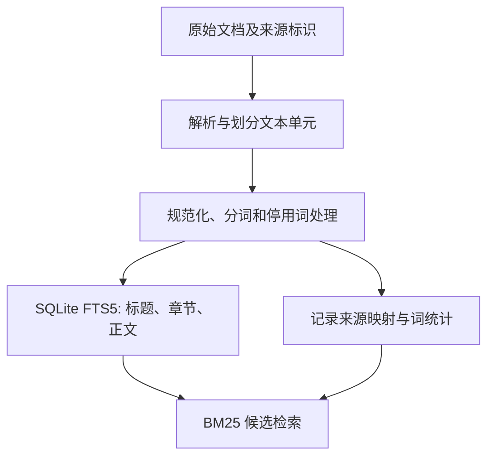
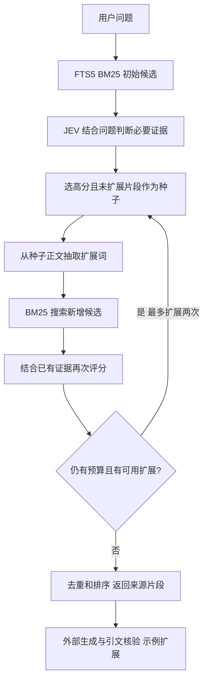
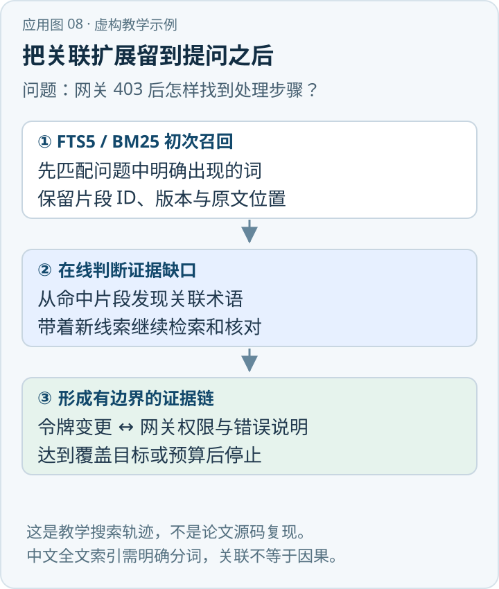

当一个问题需要多段相互关联的证据时，最初的问题文本未必包含第二段文档所用的词。假设提问只出现“事故通知”，第一段说明某类事故须按“联动工作机制”报告，第二段只使用这个机制的名称而没有“事故通知”。如果仅用初始问题做一次关键词搜索，第二段可能漏掉。SAG2 的思路是：先用词法检索找候选片段，在线判断证据，再从有用片段提取词语继续搜索。[\[1\]](https://arxiv.org/abs/2610.22588)

{/* truncate */}

> 知识库技术研究系列 · 资料核验日期：2026 年 11 月 10 日。应急案例均为虚构教学示例。查看[全部专题与架构选型](../11-overview/index.md#系列阅读)。

直接看应用：[动手应用：从网关 403 找到旧令牌处理步骤](#动手应用从网关-403-找到旧令牌处理步骤)。

SAG2 将一部分跨片段关联从入库阶段移到查询阶段。它减少了离线语义抽取和向量化，但为此引入在线模型判断、额外候选处理和服务依赖。“不需要 Embedding”不等于“不使用模型”“离线推理”或“检索免费”。

## 一、论文、作者和已核实的范围

《SAG2: Embedding-Free Multi-Hop Retrieval with BM25 and JEV》，作者 Yuchao Wu，arXiv:2610.22588，v1 于 2026 年 10 月 15 日提交。[\[1\]](https://arxiv.org/abs/2610.22588) 本文核对的是论文正文与作者团队公开的评测仓库，而不只看摘要。[\[1\]](https://arxiv.org/abs/2610.22588)[\[2\]](https://github.com/Zleap-AI/SAG-Benchmark)

论文采用 SQLite FTS5、BM25 和在线 JEV 证据判断；不要求在建索引阶段生成 embedding，也不做 LLM 驱动的事件—实体预抽取。其前身 SAG 使用不同的事件／实体与稠密索引，不能把两者全部当作同一索引实现。[\[1\]](https://arxiv.org/abs/2610.22588)

**一个容易传错的细节：**论文默认机制是初次评分后最多两次扩展，因此最多三轮评分；当无合适扩展时提前终止。它并不是“默认三次扩链，再加初始轮”。[1, §3.5]

论文研究的是证据检索，不是完整企业问答系统。实际落地还需自行增加文档权限、版本、生效条件、最终答案生成和引文校验。

## 二、数据结构：一个全文索引加来源映射



论文中的每个索引单元保存来源身份、标题、正文，以及返回基准数据原始 passage 的映射。作者采用 Jieba 并对连续拉丁字符等进行处理，移除固定停用词；标题、heading、正文的 BM25 字段权重为 2:2:1，论文基准的 heading 字段为空。[1, §3.1] 这些是实验配置，并非对其他中文企业语料的最优值；应按自有术语、混合中英文、编号、缩写和查询类型重新评估。

SQLite FTS5 是 SQLite 的全文检索扩展，建立词项到文档位置的倒排索引并提供 `bm25()` 排序函数。[\[3\]](https://www.sqlite.org/fts5.html) FTS5 是**索引与查询组件**，BM25 是**词法评分方法**；不是两种并列替代品。具体分词、字段权重、SQL 查询及数据同步策略会影响结果。

BM25 综合词项在文档中的出现频率、文档长度和整个语料中的稀有程度。它擅长型号、条款编号、机构名称等字面匹配；对“未使用相同词语的同义表达”不天然具备语义理解。中文分词错误、OCR 噪声、简称和错别字会让相关片段进不了候选池，后续模型也就无法判断该片段。

论文还使用轻量级词法规则来形成多词名称短语；作者明确将其与有类型的实体抽取、实体消歧区分。[\[1\]](https://arxiv.org/abs/2610.22588) 所以“无预先实体抽取”是指无离线模型式事件实体抽取，不应夸大为完全不做文本解析、分词或名称短语识别。

## 三、查询阶段：BM25、JEV 和有限扩展



第一轮将问题分词，最多取 100 个 BM25 候选；默认最多 80 个不同查询词以 OR 方式构造表达式。每个候选连同原问题交给 JEV 的 Noul 接口，判断该候选**自身**是否提供完整答案链所需的事实，包括中间识别事实；上下文中的事实不能算作候选自身提供的事实。接口输出用于排序的连续证据分数，论文将其表示为 0 到 1 之间的标量；模型的内部结构与权重未公开，不应将其内部决策过程描述为已知规则或三标签分类。评分不是在证明内容真实，仍需核验来源。[1, §3.2]

每轮从排名靠前、此前尚未扩展的候选中最多选择 10 个种子。从正文中抽取词或多词短语，结合出现频率、语料稀有程度、所在句与原问题的重叠、种子的证据评分等进行加权。针对选中的每个扩展词，系统分别检索必须命中该词的未见片段；列表内部按“全部扩展词及原问题词”的 OR 表达式计算 BM25 排序，并不要求原问题词必须命中。随后按词优先级和各自排名交错合并、去重，最多选取 100 条新增候选，再把先前证据与候选提供给 JEV。第三轮评分采用先前前十个片段和暂定分数作为上下文并重新判断；最终执行局部多样化排序。[1, §3.2–3.5]

论文所述默认配置最多 340 次 passage judgments，是含重复评分的**片段判断次数上限**，不是 340 次 HTTP 请求、token 预算或延迟保证；早停和候选不足会减少次数。[\[1\]](https://arxiv.org/abs/2610.22588) 选择词语、排序及重用先前证据把关联构建推到查询时，但不能保证每一跳都找得到；某个中间片段缺失时，后续词语搜索可能失去线索。

## 四、同一应急预案问题的教学示例

用户问：“某高速公路发生交通事故后，按照应急预案需要通知哪些单位？通知顺序是什么？各单位分别承担什么职责？”

这是虚构示例，不涉及真实预案。假设初始 BM25 找到“事故报告程序”与“适用范围”；在线判断后，“事故报告程序”片段成为种子，提取其中出现的“联动工作机制”“职责分工”等词，再检索到另一个章节。系统随后以已找到的证据为上下文，判断新章节是否提供必要职责信息。

回答前还必须核对预案生效版本、事故等级、管辖区域与授权；输出每个结论的原文出处。若只找到通知单位清单而未发现明确时序，就应表示“依据当前证据无法确认通知顺序”，不能把列表顺序当成流程。SAG2 可以帮助扩展证据，不能替代业务主体对真实流程的审核。

## 五、论文实验结果到底说明什么

作者在 MuSiQue、2WikiMultiHopQA 和 HotpotQA 各使用 1,000 题开发集子集，以支持段落为证据计算宏平均 Recall。论文报告 SAG2 的 Recall@10 分别为 **86.62%、97.43%、99.00%**；这些是该论文实验设定下的检索指标，不是端到端答案准确率。[1, §4–5]

企业实验使用 EnterpriseRAG-Bench 的 511,962 个源文档，对 500 道主问题中的 470 道有参考文档 ID 的题目，在先按来源文档去重后报告 **81.10% 文档 Recall@10**；它检验找回相关文档，不能证明文件中的所有必要事实都被找到，更不能证明最终回答正确。其企业文档被分割为约 1,000 字符、上限 1,200 字符的检索单元；其余 30 题没有用于该文档召回指标。作者明确指出该企业语料是合成的，基线也存在模型、运行方式或预算差异；其中 Bash Agent 输出集合大小不固定，不等同统一 Top-10 预算。[\[1\]](https://arxiv.org/abs/2610.22588)[\[2\]](https://github.com/Zleap-AI/SAG-Benchmark)

MuSiQue 的 11,656 个 passage 在作者实验环境下建立索引用 **2.36 秒**，数据库 **25.87 MiB**，建索引阶段没有模型调用。[\[1\]](https://arxiv.org/abs/2610.22588) 这不是用户查询 2.36 秒，也不是企业 51 万文档的建库耗时；在线 JEV 服务、每轮查询、网络和生成模型的耗时不包含在这个数字中。论文说明由于服务等待时间与并发执行未分离，没有报告在线延迟。[\[1\]](https://arxiv.org/abs/2610.22588) 文中还给出 MuSiQue 全部 1,000 次查询的模型费用约 4.33 美元，费用不含机器租赁和最终答案生成；这是特定服务、模型版本和计价条件下的测量，不能推广为未来报价或企业成本。

论文也指出：MuSiQue 被用于方法开发，仍需未参与开发的数据、真实私有企业语料和最终答案生成评估；四跳问题的完整证据覆盖率仍有不足；词法路径可能漏掉无字面连接的同义表达。[1, §5.5] 这些限制意味着结果是有价值的研究证据，而不是任何业务系统上线后都能达到相同效果的保证。

## 六、关键部署边界：索引本地，不代表整个系统本地

论文使用托管 JEV 决策服务，通过 OpenRouter 调用 Noul 接口，报告返回模型 `typesafe/jev-1.13-20260917`；研究时使用模型的详细架构和权重未公开，问题与候选片段要发送给服务商。[1, §5.5] 因此，禁止外发敏感数据的环境不能只因 SQLite 存在本地就认定满足私有化要求。换成本地模型是可能的研究方向，但精度、吞吐与资源消耗必须重新测试，不能直接继承论文成绩。

与传统向量 RAG 相比，SAG2 的入库无需逐条生成向量或抽取实体，便于在文字频繁变化时快速建立词法索引；但查询时要承担候选判断与扩展轮次。是否更便宜取决于数据规模、更新频次、查询次数、上下文长度、JEV 定价、并发和缓存命中率。不能用“省掉 embedding”推断总拥有成本一定更低。

在线扩展还会放大无关词漂移：高分种子若本身错误，其派生词可能带来更多错误候选。应限制查询轮次、每轮候选数、词项数、token、超时和调用预算；记录每轮种子与来源，支持失败降级。用户问题和源文均属于不可信输入，不应让候选文字覆盖系统指令。

## 七、生产参考设计：权限、更新、评估

以下为本文提出的工程方案，不是论文已实现功能：

1. **权限先行**：按租户、用户、部门、文档版本及有效期过滤候选；在线服务只能接收用户有权访问的片段。若索引无法可靠前置过滤，采用物理隔离或可验证的授权查询机制。
2. **增量同步**：为源文、每个片段和索引记录版本与内容哈希。变更时删除旧片段、插入新片段并校验原文映射，索引切换保持一致；受影响的查询缓存同步失效。
3. **删除传播**：按来源 ID 找到 FTS 条目、缓存、候选记录及生成物，依据合规保留规则清除或脱敏；外部服务的数据留存需单独确认。
4. **终止与降级**：设置最多轮次、候选数量与总耗时；服务不可用时可返回已获证据、明确不完整，或回退到经评估的 BM25／混合检索；不要伪装成论文原方法。
5. **证据引用**：保留文档 ID、版本、页码／段落和片段 ID，在答案层逐条验证陈述是否受引用支持，存在冲突则保留冲突和适用条件。
6. **评估**：同时测 passage Recall@K、全部证据覆盖率、文档 Recall、答案事实支持率、引用正确率和拒答；按二／三／四跳、无重叠别名、OCR 噪声以及不同权限分组。记录 p50/p95 全链路延迟、每问判断数量、token、费用和更新后可见延迟。

与向量、Hybrid、图检索和 Agentic 检索比较时，要控制文档版本、解析器、模型、候选数、输出长度及预算；对不能统一的差异明确披露。对实时数据和精确数量，可在相同权限下组合 SQL；对长篇结构化预案，可组合 PageIndex；对语义差异大的候选，可增加稠密召回。这些组合是可检验的设计，不是 SAG2 论文已经验证的结果。

## 八、把扩链看成有边界的证据搜索

一轮扩展至少有四个容易混淆的对象：问题、当前候选、保留下来的证据上下文，以及从种子中选出的下一轮查询词。问题始终提供原始目标，候选是等待判断的片段，证据上下文帮助模型判断关联，查询词负责连接下一批候选。把四者混在一起可能导致模型把“上下文中提及的事实”错误归给正在评分的片段。论文特别要求模型区分候选本身和上下文中的事实。[1, §3.2]

例如第一段写“按照《示例联动规定》处理”，第二段写“该规定适用于条件 A”，第三段才列出职责。第一轮用“事故报告”可能只找到第一段；以“示例联动规定”为扩展词可能找到第二段；再扩展可能找到第三段。这个例子只说明机制可能奏效，不表示每一个查询都需要三轮评分，也不表示一定能通过两次扩展找到所有事实。多个词可能指向同名但不同地区的规定，候选判断还必须核对身份、来源和时间。

词法扩展存在两端的失败：词语过于常见时产生大量噪声，过于专门且文档写法不一致时则零命中。论文结合词项稀有度、局部出现频率、与问题的上下文联系及种子评分选择扩展词；这些设计是可复现的实验组件，但不能说明每个因子独立贡献了多少效果，作者也明确没有逐个隔离所有因子。[1, §5.5] 实际调参应记录每轮新证据的边际收益，避免无上限扩展。

## 九、与邻近方案的边界

| 方案 | 预处理主要内容 | 查询关联方式 | 对本案例的风险 |
|---|---|---|---|
| 一次 BM25 | 分词与倒排索引 | 初始问题匹配词项 | 未出现问题词的中间事实可能缺失 |
| 密集向量检索 | 片段 embedding 和向量索引 | 向量相似度找语义近邻 | 语义近不等于条款适用，仍可能漏多跳证据 |
| 图检索 | 抽实体、关系及来源，构建图 | 遍历、路径或图与文本混合 | 图构建有成本，抽取关系可能错误 |
| 论文中的 SAG2 | 原始片段词法索引，不做离线模型式实体抽取 | JEV 判断与词法反馈，多轮有界扩展 | 词汇鸿沟、托管模型依赖和在线开销 |
| Agent 检索 | 依赖选用的各类工具和索引 | 由控制器决定是否检索、调用什么工具 | 调用预算、权限和中间错误传播 |

这些并非同一维度的互斥选项：一个 Agent 可以调用 FTS5，也可以把 SAG2 风格证据扩展与向量召回组合。图检索也可在查询时调用模型。将处理前移还是后移，是成本分配与效果上的选择，并非能力等级。

**评估统计也要区分。** 单段 Recall@10 可以因为找到部分证据而提高，但对于必须同时找到三个条款的问题，即使只找到两个，回答仍然可能缺少必要条件。因此还需报告每道题所有必要证据均出现的完整覆盖率；对企业数据再增加文档级和片段级两个视角。应避免把基准上的平均召回率直接翻译成“百分之多少的用户问题可以正确回答”。
本次未检索到可核验的 SAG2 微信公众号原文正文，论文及官方仓库是本文的主要证据。

## 动手应用：从网关 403 找到旧令牌处理步骤



*应用示意图 · 对应下方虚构教学数据。* [查看 SVG 原图](../assets/application-08.svg) · [下载 PNG](../assets/application-08.png)

下面是自建词法索引和在线扩链的**虚构教学示例**，用于理解思路；它不是 SAG2 论文的源码或论文实验复现，也不等价于论文的 JEV 评分实现。[\[1\]](https://arxiv.org/abs/2610.22588)[\[3\]](https://www.sqlite.org/fts5.html)

| 片段 | 手册原文 | 人工规范化检索词 |
|---|---|---|
| S1 | 网关返回 403 时，检查请求是否仍携带旧令牌 oldtoken。 | `gateway 403 oldtoken` |
| S2 | 停用 oldtoken，轮换凭据，再由值班员验证新凭据。 | `oldtoken credential rotate` |

**第一步：建立 FTS5 表。** 为使示例在标准 SQLite `unicode61` 分词器下可核对，检索列使用人工提供的空格分隔英文词，原文另存供展示；这不表示默认分词器已解决中文切词。生产环境应选合适的中文分词方式，保证建索引和查询同一规范，同时保存原文、版本及权限。

```sql
CREATE VIRTUAL TABLE passages USING fts5(
  doc_id UNINDEXED, tokens, raw_text UNINDEXED,
  tokenize='unicode61'
);
INSERT INTO passages VALUES
  ('S1', 'gateway 403 oldtoken', '网关返回403时，检查请求是否仍携带旧令牌oldtoken。'),
  ('S2', 'oldtoken credential rotate', '停用oldtoken，轮换凭据，再由值班员验证新凭据。');

-- 用户问题“网关403怎么办”经规范化得到查询词。
SELECT doc_id, raw_text FROM passages
WHERE passages MATCH 'gateway AND 403'
ORDER BY bm25(passages);
```

**第二步：验证候选并扩链。** 首轮预期只得到 S1，判断它与网关 403 相关，并从中提取 `oldtoken`；S1 本身只说要检查旧令牌，尚未说明处理步骤。接着查询 `WHERE passages MATCH 'oldtoken' AND doc_id != 'S1' ORDER BY bm25(passages)`，预期找到 S2。此时再次核对它是否适用该系统、环境和版本；本例假设两段均来自同一版本且权限允许。扩展词与相关性判断在此是演示步骤，实际可以由模型、规则或人工完成，不应把它们说成已实现的 JEV。[\[1\]](https://arxiv.org/abs/2610.22588)

**第三步：给出有依据的答案。** 示例回答：“先检查请求是否携带旧令牌［S1］；若需要处理旧令牌，则停用、轮换凭据并验证新凭据［S2］。”S1 没有写所有 403 都由令牌导致，因此不能断言这就是唯一原因。若第二轮找不到可信来源，应说明未找到处理步骤，而不是自行补全。

部署试验时先用可复查的文档集建立索引，保留每轮查询词、候选、判断结果和原文位置，设置检索轮次与成本上限；再用“只找到 S1”“两段齐全”“S2 已撤权”等样本测试证据完整性、权限隔离和延迟。中文分词和同义词扩展应分别评估，不能仅凭英文演示推断真实语料效果。

## 参考资料

[1] Yuchao Wu，《SAG2: Embedding-Free Multi-Hop Retrieval with BM25 and JEV》，[arXiv 摘要与版本信息](https://arxiv.org/abs/2610.22588)，[v1 论文全文](https://arxiv.org/html/2610.22588v1)，2026-10-15。

[2] Zleap AI，[SAG-Benchmark 官方仓库](https://github.com/Zleap-AI/SAG-Benchmark)，包含实验设置、结果与复现说明；[SAG2 官方技术介绍](https://zleap.com/technology/sag2)。项目方结果需结合论文口径与局限阅读。

[3] SQLite，[FTS5 官方文档](https://www.sqlite.org/fts5.html)，包括倒排索引、分词器、查询语法和 BM25 排序。

---

[上一篇：Ontology](../07-ontology/index.md) · [下一篇：Agentic RAG](../09-agentic-rag/index.md)
