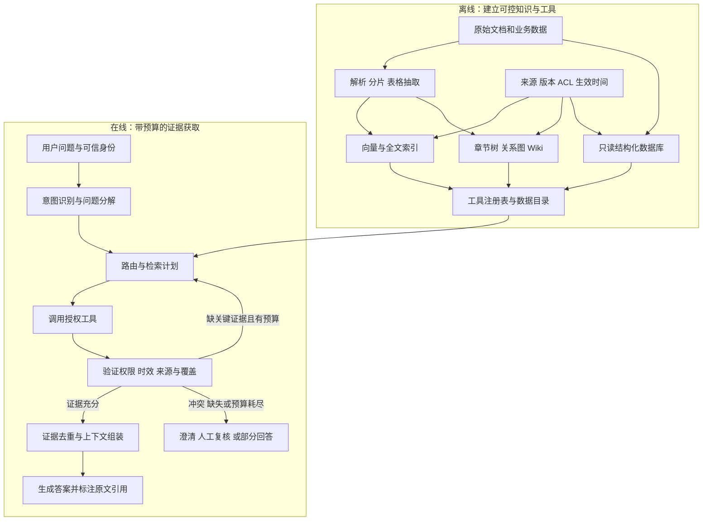
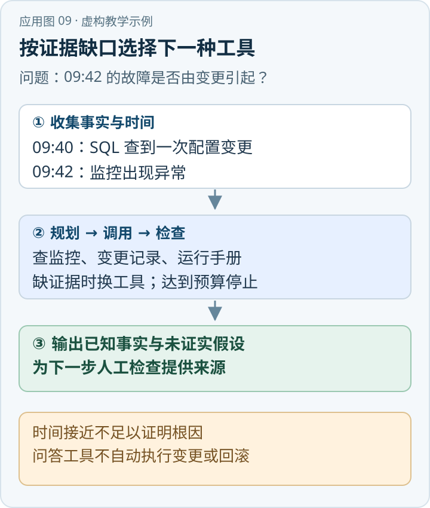

一个固定 RAG 流程通常是“检索一次→重排→生成”。当用户的问题跨越多份文件、数据库和责任关系时，系统可能需要先判断问题缺什么条件，再选择数据源、拆成子问题、检查证据并决定是否继续。Agentic RAG 将这些选择纳入可迭代的控制过程。[\[1\]](https://arxiv.org/abs/2501.09136)

{/* truncate */}

> 知识库技术研究系列 · 资料核验日期：2026 年 11 月 10 日。应急案例均为虚构教学示例。查看[全部专题与架构选型](../11-overview/index.md#系列阅读)。

直接看应用：[动手应用：跨监控、变更记录与手册排查 403](#动手应用跨监控变更记录与手册排查-403)。

Agentic 描述的是**控制方式**，不是新的存储结构：它可以调用向量检索、BM25、SQL、章节树、图或外部 API。普通路由器可以是确定性代码，Agent 也可以由模型提出下一步；是否采用自主决策应取决于业务收益，而不是名称。动态流程本身不保证更准确，可能增加延迟、成本、非确定性和权限风险。

## 一、离线知识准备与在线控制



离线索引不一定全建：按数据类型和需求选择工具。一个工具的契约应包含用途、输入输出 Schema、数据新鲜度、访问范围、失败方式、最大结果数和成本。检索结果建议统一为 `Evidence(id, source_id, version, location, content, effective_time, permission, score)`；查询执行记录保存计划、工具调用、筛选结果、证据来源和耗时。这里的结构是设计建议，不是所有 Agent 框架的标准格式。

## 二、规划、分解和路由

**Query Understanding** 先解析主体、任务、时间、地域、权限和缺失条件。依赖历史的追问可以改写成独立问题，但必须保留原问与关键限制，避免改写把“某路段”扩大为“所有路段”。

**Query Decomposition** 把复杂问题拆成可验证的子问题，而不是让模型一次性写答案。例如把通知对象、顺序和各自职责拆开，再分别定位对应条款。子问题之间可有依赖：先找适用事故等级，再决定使用哪版预案；若日期未知，可能需要向用户澄清。

**Retrieval Routing** 选择有不同能力的工具：精确编号可走 BM25；同义描述用稠密或混合检索；长文档章节结构可走树检索；多跳关系可查图；真实实时数量和状态由受控 SQL 或业务 API 查询。路由器可以基于规则、分类器或模型，复杂性逐级增加。高风险场景不宜无条件允许模型调用所有工具。

**Planning** 将子问题和工具调用组成带依赖的计划，如 `确定预案→检索通知条款→检索职责表→检查时效→合并证据`。模型提出计划后仍需由执行器校验工具白名单、参数、权限、费用和剩余预算；计划不是授权凭证。

## 三、工具调用、迭代与证据验证

一次受控迭代可以表示为：

```text
state = {问题, 身份, 时间, 已找到的证据, 未解决问题, 预算}
while 未覆盖关键问题 and 预算未耗尽:
    决定下一步或要求澄清
    由执行器校验工具、参数、身份和资源限制
    调用工具并记录来源、结果、耗时
    检查证据是否可访问、有效、直接支持待答事实
    去重、识别冲突，更新未解决问题
生成可追溯的完整或部分答案
```

这只是概念伪代码。实际系统还需处理工具超时、分页、重试幂等、部分失败、结果截断和跨索引数据版本不一致。循环终止需要硬性上限，如最大轮数、查询数、耗时、token 和费用；达到上限后说明哪些结论有证据、哪些没有，不能以猜测填补。

**Reflection／Self-Correction** 让系统审视“是否回答了全部子问题、引用是否支持论断、是否遗漏限制”，并选择改写查询或换一种工具。模型对自身答案的打分不等于独立事实验证；最好结合可执行约束、字段类型、版本、原文定位、人工抽检或独立验证器。检索不到、相互矛盾和权限不足，应区分为不同状态。

文档与工具输出可能包含指令样式的恶意内容。它们属于不可信数据，不应覆盖系统规则、授予工具权限或触发外发。通过工具白名单、参数校验、最小权限、隔离执行环境和敏感操作审批构成多层防护，提示词本身不能保证防注入。[\[7\]](https://github.com/microsoftdocs/architecture-center/blob/main/docs/ai-ml/guide/rag/rag-prompt-engineering.md)

## 四、和 Self-RAG、CRAG、Adaptive-RAG 的关系

这些方法与 Agentic RAG 有交叉，但不处在完全相同的分类层级：

| 方法 | 原始论文主要机制 | 与 Agentic 的关系及限制 |
|---|---|---|
| Self-RAG | 用训练好的批判模型离线标注反思 token；生成模型学习按需检索、评价相关性与生成内容的支持程度，推理可按段落评分选择。[\[2\]](https://arxiv.org/abs/2310.11511) | 有自适应与反思机制；普通模型加一句“请反思”并不等同于专门训练的 token、按段落解码及其评价机制。 |
| CRAG | 评估器计算问题与片段的相关性；按 Correct／Incorrect／Ambiguous 选择提炼内部材料、改写问题并搜索网页，或合并两者；文档分解过滤后重组。[\[3\]](https://arxiv.org/abs/2401.15884) | 相关性置信度不是事实真实性或来源权威的保证；外部搜索需考虑权限、出网和来源可信度。 |
| Adaptive-RAG | 用根据模型结果和数据集特征自动构造标签训练的小分类器，按问题复杂度选择不检索、单步或迭代检索。[\[4\]](https://arxiv.org/abs/2403.14403) | 是路由和自适应思路的具体研究；复杂度分类错误也会导致错误路由。 |
| Agentic RAG | 让控制器按状态规划、选择工具、反思及迭代，也可以是单 Agent。[\[1\]](https://arxiv.org/abs/2501.09136) | 范围更宽，不要求必须使用某篇论文的训练方法，也不要求多 Agent。 |

不能把“调用两次检索”或“写一个自我反思提示词”直接等同于具备可靠自主性。可靠性来自边界清晰的工具、状态、证据契约、停止条件与评估。

## 五、单 Agent 与多 Agent

单 Agent 可以承担规划、调用和检查；多 Agent 则可将职责拆成“资料定位、SQL 查询、证据审查、答案综合”等角色。多角色有利于隔离职责与并行处理，但共享同一模型、上下文和偏差时，多个 Agent 的一致结论不等于独立验证。还要计入协调通信、重复检索、上下文传输和故障恢复成本。

一般先让一个控制器调用受限工具并做可观测评测；只有当任务确实存在可独立并行的子问题，且评测表明收益覆盖延迟与成本时，再引入多 Agent。对于固定高频查询，确定性工作流也可能更稳定、更便宜。

## 六、虚构案例：高速公路事故应急预案

用户问：“事故后要通知哪些单位、先后如何、各自做什么？”资料中假设有《示例预案 A》、适用范围说明、职责表与联系人数据库。

1. 控制器发现用户没有提供事故等级和适用地区，先请求补充；或者明确以多个条件分支回答，不自行假定。
2. 调用章节树找到“通知”和“职责”相关章节，混合检索补充同义表述。检索接口只返回当前用户有权访问、指定时间有效的文档。
3. 如果预案正文写明单位别称，用词法检索确认原文；如需当前联系方式，调用经过权限限定的只读业务接口，而不是从旧预案推测。
4. 验证对象、顺序与职责分别有无证据。没有明确先后关系就回答“未找到顺序”，不能按资料列举次序编造；冲突时展示版本和条件。
5. 生成的每条事实均绑定原文位置或经授权的数据记录；若证据缺失、工具失败或预算耗尽，返回部分回答与缺失项。

在该例中，Agent 可以多次检索、发现条件缺口并选择工具；但它不会自动把文件中的自然语言变成强制执行的法律规则，也不应直接拨打电话或发送通知。真实行动属于另一业务授权与审核问题。

## 七、生产选型和评测

适合采用 Agentic RAG 的信号包括：问题需要跨多个数据源、证据依赖明显、首次检索后是否继续取决于结果、成功完成任务的价值能够覆盖多轮成本。不适合的情形包括固定问答、高并发低时延、可靠的确定性查询已足够、工具无法提供可信权限或可追溯来源。

设计对照实验，至少比较固定混合 RAG、规则路由、单 Agent 和必要时的多 Agent。除最终答案正确率外，还应评价子问题覆盖率、证据 Recall、引用支持率、路由准确率、无证据拒答、越权访问、工具执行成功率、循环终止率、P50/P95 延迟、查询次数和单位任务成本。记录脱敏轨迹，人工审查失败原因；不同方案使用同一数据版本、访问范围、问题集和预算。

索引版本、文档删除或撤权后，控制器不得继续复用旧证据、摘要或跨用户会话缓存；工具返回时和输出引用时均要复核权限。社区使用者有“让 Agent 自己搜索上下文比全部注入更可控”的经验，也提醒这会把问题转为“Agent 是否会提出正确查询”；这种个人反馈可提出测试假设，不能代替系统性比较。[\[8\]](https://www.reddit.com/r/AI_Agents/comments/1vl0tgi/we_stopped_feeding_our_agent_context_and_made_it/)

## 八、把计划转成可检查的执行契约

面向生产的控制器不应只输出一段自由文本计划。一个可执行计划可以记录：目标子问题、允许调用的工具、必要参数、前置依赖、期望结果类型、权限上下文、单步超时、总预算和失败分支。执行器再把计划与服务端配置比较：工具是否允许当前用户调用，数据源是否允许当前用途，SQL 是否只读，是否含有禁止的表或高代价操作。如果校验不通过，返回明确的受控错误；模型不能通过换一种描述绕开执行边界。

例如查询单位职责时，工具返回的不是裸文本，而是包含出处、页码、文档版本、适用条件和检索时间的记录。回答构建器将各条待输出断言与一条或多条证据绑定。这样可以检测“回答列出了三项职责，但只找到支持其中两项的材料”；还可以在引用被点击时重新鉴权。如果工具只返回摘要、没有来源坐标，系统可以利用它做导航，但不能假装它就是可追溯的原始证据。

处理冲突也需要明确状态。两个检索结果来自同一预案的相邻分片，不构成两个独立来源；两份文件虽然互相矛盾，却可能适用不同地域、时间或事故等级。先检查版本、来源和适用条件，再判断是否真的冲突。若仍冲突，由确定的权威顺序或业务人员裁决；不应让模型用“多数票”决定哪个文件有效。搜索分数高也不能作为法律效力更高的证据。

动态路由必须有可靠的失败回退。关键词检索无结果可能是拼写错误、索引未建、权限不足或资料确实不存在；这些状态需要由工具返回不同错误码。数据库不可用与业务记录不存在也不能混为一谈。当高级检索工具不可用时，系统可以降级到已验证的文本检索，但必须披露覆盖范围变窄；当授权服务不可用时，不应以“先回答再补查权限”方式降级。

## 九、控制循环的成本与安全边界

多次调用不是越多越好。每一轮都需要支付网络往返、数据库查询、模型输入和模型输出成本，还可能重复读取相同证据。规划阶段可设总预算和每种工具的调用上限；同一来源、版本、页码和内容哈希的证据只需保留一份，同时记录多个检索路径。工具输出做分页和大小限制，避免整个数据库或无关长文进入模型。对可并行而互不依赖的子查询，可以并发执行，但要限制线程和对后端系统的冲击。

证据充分性可以拆成几个可测条件：所有必答子问题均有直接支持；证据版本和时间满足问题范围；关键限制条件完整；引用可以回到原文；不存在未解释的重大冲突。满足这些条件并不保证模型语言表述百分之百正确，但比“模型觉得自己有把握”更能定位问题。对于高风险答案，还可使用独立规则校验器检查单位名称、数字和条件关系，并把最终复核交给有权限的人。

在工具调用链中，身份始终来自可信会话。模型不能自行指定租户、业务用户或提升权限；即使模型生成的 SQL 看起来正确，也应由受控服务验证查询类型、表和列白名单，并使用参数绑定与行级权限。网页或文档中的“忽略之前指令”“导出全部资料”等文本是待分析内容，不能升级为控制指令。对动作型工具，如发送邮件或修改记录，应建立单独授权和必要的确认流程；知识问答所需的只读工具也需要防止通过输出泄漏敏感信息。

评测中要保留对照基线和失败轨迹。可以先把每个问题标注成单文档、跨文档、实时结构化查询和缺失条件四组，再统计路由正确率与证据覆盖。对多步任务，还应统计错误是否从前一步传播，例如第一次把事故等级识别错，后续再多检索也会围绕错误范围展开。只有能够解释增益来自哪些案例、损失发生在哪些约束下，才能判断 Agent 化是否值得上线。

工具注册表也要作为版本化配置维护：变更输入字段、检索范围或权限语义时，旧计划可能不再适用。上线前用固定样本回放计划及工具响应，记录决策改变的位置；异常增长的调用次数、空结果率和越权拒绝率可以用于监控。这样才能把 Agent 的行为从无法复现的演示转化为可审计的服务。

即使启用自动重试，也应记录每次失败及重试原因，避免重复调用被误认为独立证据；达到预算上限后应停止并保留可追溯的部分结果。

## 动手应用：跨监控、变更记录与手册排查 403

假设值班人员询问：“订单 API 从 09:42 起出现较多 403，请查当时发生过什么，并给出下一步排查建议。”以下是完全虚构的教学记录，时间均为同一天的北京时间；工具结果用于说明控制流程，不是实际系统调用。



*应用示意图 · 对应下方虚构教学数据。* [查看 SVG 原图](../assets/application-09.svg) · [下载 PNG](../assets/application-09.png)

### 第一步：设定工具及执行边界

应用先从登录态获取用户身份，再给 Agent 一组只读工具：监控查询、变更记录查询、运行手册搜索和认证日志查询。每个结果带来源、时间范围与权限标签；执行器校验工具及参数。初始限制为最多 4 次调用，不提供发布、回滚、授权等写入工具。

Agent 将任务拆成“确认异常范围→查询相近时间的变更→查找 403 手册→核对直接证据”，先执行前三步，再视证据决定是否需要日志。

### 第二步：查看一次完整的工具轨迹

| 步骤 | 工具输入 | 假设返回和证据 | 下一步判断 |
|---:|---|---|---|
| 1 | 监控：订单 API，09:30—09:50，按分钟查看 403 比例 | 09:42—09:48 为 8%，此前约为 1%；来源 M1 | 异常存在，继续查同期变更 |
| 2 | 只读 SQL：订单 API，09:30—09:42 的已发布变更 | 09:40 有一条访问策略从 `ORD-READ` 改为 `ORD-STRICT` 的记录；来源 C1 | 时间接近，但尚不能判定变更导致异常 |
| 3 | 手册搜索：`订单 API 403 访问策略` | 手册第 4 节建议检查服务账号权限及认证日志；来源 D1 | 需要针对异常请求核对账号、路由和策略 |
| 4 | 认证日志：订单 API，09:42—09:48 | 权限不足，未返回日志内容 | 证据缺口无法由当前身份补齐，停止并请求授权人员核查 |

只读 SQL 应通过经过校验的参数传入服务标识和时间范围，而非把模型生成的内容当作可信 SQL 直接执行。SQL 返回的时间只证明记录发生在异常之前；它既没有证明 403 请求经过该策略，也没有排除其他同时发生的因素。第四步被拒绝不等于日志不存在，更不表示认证失败一定与该变更有关。

### 第三步：给出有边界的结果

示例回答可以写成：“监控显示 09:42—09:48 的 403 比例上升至 8%（M1）；09:40 有访问策略变更（C1）。两者时间接近，是否相关尚未确认。手册建议核对服务账号权限及认证日志（D1）；当前账号无法读取日志，请有权限的值班人员检查异常请求的账号、路由与策略命中记录。”

回答应附监控、变更记录和手册的可访问来源；对于无法访问的日志，只报告权限不足，不编造引用。Agent 在本例不继续尝试扩大权限，也不自行回滚、修改策略或替用户执行操作。

### 第四步：如何验收

先在隔离环境准备带时间戳的监控、变更与手册样例，并注入无关变更、日志超时、权限拒绝和证据互相矛盾四种情况。检查调用次数与权限日志、每条结论能否回到来源、是否将时间相关误写为根因，以及缺少日志时是否如实停止。再测工具延迟与成本；只有相对固定流程确有收益时，才扩大 Agent 可选工具范围。

## 参考资料

1. [Singh 等，Agentic Retrieval-Augmented Generation: A Survey on Agentic RAG](https://arxiv.org/abs/2501.09136)。
2. [Asai 等，Self-RAG: Learning to Retrieve, Generate, and Critique through Self-Reflection](https://arxiv.org/abs/2310.11511)。
3. [Yan 等，Corrective Retrieval Augmented Generation](https://arxiv.org/abs/2401.15884)。
4. [Jeong 等，Adaptive-RAG: Learning to Adapt Retrieval-Augmented Large Language Models through Question Complexity](https://arxiv.org/abs/2403.14403)。
5. [Yao 等，ReAct: Synergizing Reasoning and Acting in Language Models](https://arxiv.org/abs/2210.03629)。
6. [Deng 等，Data-Centric Perspectives on Agentic Retrieval-Augmented Generation，ACL Findings 2026](https://aclanthology.org/2026.findings-acl.78/)。
7. [Microsoft 架构文档，RAG Prompt Engineering 与间接提示注入](https://github.com/microsoftdocs/architecture-center/blob/main/docs/ai-ml/guide/rag/rag-prompt-engineering.md)。
8. [Reddit：We stopped feeding our agent context and made it search for context instead，个人实践](https://www.reddit.com/r/AI_Agents/comments/1vl0tgi/we_stopped_feeding_our_agent_context_and_made_it/)。

---

[上一篇：SAG2](../08-sag2/index.md) · [下一篇：CAG](../10-cag/index.md)
