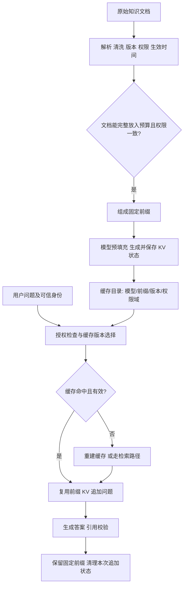
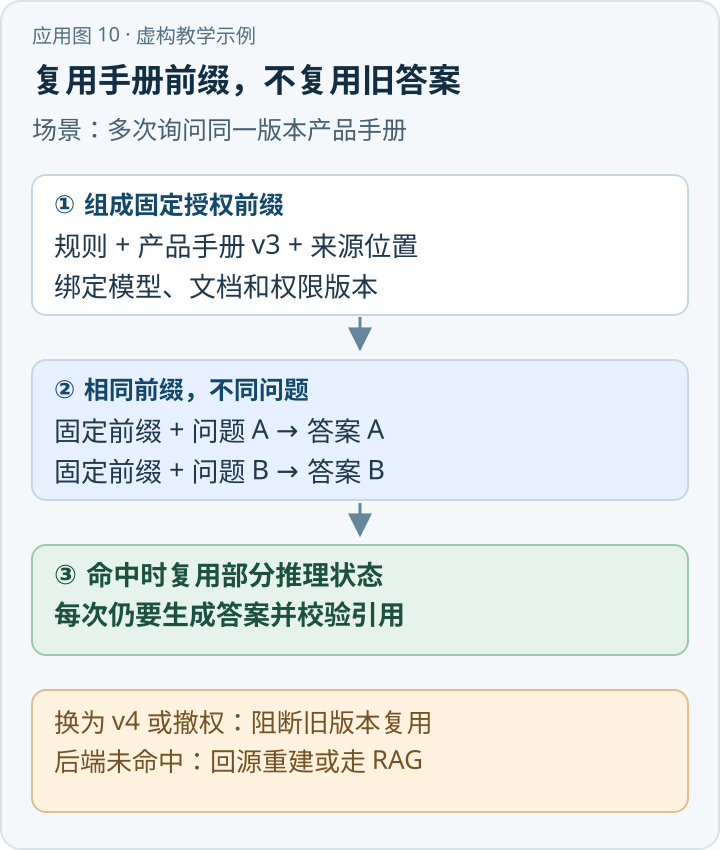

当用户反复询问同一份短而稳定的预案，系统未必需要每次都重新检索并重新处理全部背景：它可以先把一组资料放入长上下文，保存模型处理这些 token 后的状态，再针对不同问题复用。Cache-Augmented Generation（CAG）研究的就是这种思路。[\[1\]](https://arxiv.org/html/2412.15605v2)

{/* truncate */}

> 知识库技术研究系列 · 资料核验日期：2026 年 11 月 10 日。应急案例均为虚构教学示例。查看[全部专题与架构选型](../11-overview/index.md#系列阅读)。

直接看应用：[动手应用：让固定产品手册支持重复问答](#动手应用让固定产品手册支持重复问答)。

CAG 主要改变**已有上下文如何复用**，不天然建立文档索引，也不负责决定未来知识是否适用于当前用户。当知识量较小、权限范围稳定、重复查询多时，它可能减少重复检索或预填充；知识库持续增长、频繁更新或存在复杂权限时，通常需要结合检索、版本管理与授权服务，而不是假设“缓存已经解决了知识管理”。

## 一、先区分三种容易混淆的缓存

| 概念 | 保存什么 | 位于哪里 | 解决什么 | 不等于什么 |
|---|---|---|---|---|
| KV Cache | 模型注意力层已有 token 对应的 Key、Value 张量等推理状态 | 推理引擎的显存、内存或缓存层 | 避免生成下个 token 时重复计算过去 token 的 K/V | 不是人可直接维护的知识数据库；不意味着回答被验证 |
| Prompt／Prefix Cache | 对重复输入前缀的处理结果建立可复用缓存；底层可能使用 KV blocks | 推理服务或模型提供方 | 跨请求复用相同前缀的预填充 | 不是“语义近似即可命中”；具体匹配、保存时长和计费依实现而异 |
| 应用层会话记忆 | 历史消息、摘要、用户偏好、事件及其索引 | 应用数据库、对象存储或记忆服务 | 跨轮次保存和选择历史信息 | 不是模型自动永久记忆，也不是 KV 缓存的同义词 |

应用层记忆可以被选择并装入 Prompt，推理服务随后可能缓存其前缀；两者相互配合但生命周期不同。即使 KV Cache 被清除，会话记录仍可能保存在数据库中；反过来，数据库记录已删除也不能假设所有推理缓存自动同步删除。

## 二、KV Cache 在计算中做了什么

在 Transformer 的注意力层，输入 token 产生 Query、Key、Value。自回归生成时，新 token 的 Query 需要与既有 Key 计算注意力，再结合对应 Value。若每生成一个 token 都重新计算既有 token 的 K/V，代价会重复累积。KV Cache 保存既有位置的 K/V，后续只需计算新增 token 的表示并利用已有结果。[\[2\]](https://docs.vllm.ai/en/latest/design/prefix_caching/)

简化表示为：

```text
预填充：Cache_0 = Prefill(model, 系统说明 + 固定文档)
问题生成：answer, Cache_1 = Decode(model, Cache_0, 当前问题)
独立问题结束：释放或截断本次追加状态，保留可复用的 Cache_0
```

这是概念接口，不保证所有模型服务允许直接导入、持久化或截断内部缓存。前缀复用通常依赖模型权重、tokenizer、位置编码、输入 token 顺序、适配器及执行配置兼容；语义相同但文本、标点或顺序不同，未必命中。[\[2\]](https://docs.vllm.ai/en/latest/design/prefix_caching/)[\[3\]](https://platform.openai.com/docs/guides/prompt-caching)

KV 缓存也有代价。粗略估计，单序列 KV 内存与 `2 × 层数 × token 数 × KV 头数 × 每头维度 × 每元素字节数` 成正比；其中 2 表示 K 和 V。实际还受分组查询注意力、量化、分块、并发共享、框架布局与内存碎片影响。缓存节省部分重复计算，却会占用内存／显存、增加装载和淘汰成本；处理每个新 token 时仍需关注先前上下文，长上下文不等于零成本。

## 三、离线准备与在线调用



离线将已授权的内容按确定顺序序列化，保留原文标识、位置、版本和有效期；对特定模型前缀做一次预填充，形成可重用状态。在线用可信身份选择对应权限域和文档版本的缓存，命中后追加用户问题；未命中时按业务策略回源重建，或切换到 RAG。引用仍需能回到原始文件与位置。

论文中的 cache reset 是复用固定前缀、截去后续问题产生的新 token 状态，以便处理新的独立查询。[\[1\]](https://arxiv.org/html/2412.15605v2) 这与连续多轮对话是否保留历史不同；若业务需要对话历史，应在应用层显式管理并授权后注入，不能把上一个用户的问题留给下一个用户。

## 四、原始论文到底验证了什么

Brian J Chan、Chao-Ting Chen、Jui-Hung Cheng 和 Hen-Hsen Huang 的论文《Don't Do RAG: When Cache-Augmented Generation is All You Need for Knowledge Tasks》于 **2024-12-20** 首次提交 arXiv，v2 日期为 **2025-02-23**，作为 WWW 2025 会议短文发表。[\[1\]](https://arxiv.org/html/2412.15605v2) 标题有论辩性，不代表作者证明所有 RAG 都应该被取代。

论文实验采用 Llama 3.1 8B、8 张 Tesla V100 32GB，在 SQuAD 1.0 和 HotPotQA 的自建不同规模子集上比较预加载 CAG 与 BM25、稠密向量 RAG；RAG 的 Top-K 为 1、3、5、10。HotPotQA 三组分别为 16／32／64 篇、约 21k／43k／85k token；SQuAD 为 3／4／7 篇、约 21k／32k／50k token。回答质量使用 BERTScore，而不是精确事实正确率或人工合规率。[\[1\]](https://arxiv.org/html/2412.15605v2)

论文表 2 中，大多数设置 CAG 的 BERTScore 较高，但并非全部：HotPotQA-large 中 CAG 为 **0.7407**，BM25 Top-5 为 **0.7535**。论文表 3 的列名分别是 Retrieval 和 Generation；同一规模 CAG 的 Generation 列为 **2.2631 秒**，Sparse RAG／BM25 Top-3 的 Retrieval 与 Generation 列分别为 **0.0008 秒和 0.6667 秒**。原文表格没有清楚给出计时分位数、缓存加载及所有预处理是否计入的完整口径，不能将这几个数字直接写成生产端到端 SLA；它们至少说明省去检索步骤并不意味着表中生成时间一定更短。[\[1\]](https://arxiv.org/html/2412.15605v2)

解读还要看到：论文针对预先抽样的有限参考材料构造测试集，CAG 预加载该组全文；实验使用特定模型、任务与计时方法，未证明海量动态企业库、复杂权限和其他模型上也有同样效果。BERTScore 衡量语义相似，不能单独证明单位名称、日期或顺序完全正确。构建、预热、缓存驻留、装载和失效成本也应纳入生产基准；不能把表中推理阶段单项时间当完整生命周期成本。

## 五、Prompt Cache 的命中与失效

将稳定部分放在前缀，变化部分放在后面，例如：

```text
[固定系统约束][固定授权预案及来源标记][本次问题]
```

如果前缀中插入当前时间、随机 ID 或不断变化的用户字段，后续 token 的前缀可能不再完全匹配。具体服务是否要求完全匹配、是否以块为单位缓存、最低长度、保留时间、价格及是否可手动清除，必须看提供方当时的文档，不能把一种产品的规则推广到全部系统。vLLM 的前缀缓存文档说明了块、哈希和额外键等机制，并讨论隔离相关设计。[\[2\]](https://docs.vllm.ai/en/latest/design/prefix_caching/) 官方 API 文档也将缓存命中与前缀匹配联系起来，但服务细节可能变化。[\[3\]](https://platform.openai.com/docs/guides/prompt-caching)

应用应记录 `tenant / permission_scope / document_version / model_version / prompt_template_version / tokenizer_version` 等上下文，且由可信服务强制匹配；这些字段只是设计示意，不意味着每个推理后端都暴露同样的缓存键。跨租户共享同一私有前缀有泄漏或侧信道风险，需要适当隔离并结合服务商安全特性验证。不能单靠缓存键代替每次访问授权。

更新预案后应先生成新版本并完成预热，再切换路由；撤权或删除时立即阻断旧缓存的使用，按平台能力清除旧 KV、相关检索结果和会话派生内容。TTL 只能限定最长留存，不能代替即时撤权。多节点环境还需要广播失效与一致性对账；如果提供方不支持即时删除或隔离，就不应将敏感资料放入不可控的共享缓存。

## 六、与 RAG 的互补方式

| 路线 | 预先放入的内容 | 在线处理 | 适用条件与主要风险 |
|---|---|---|---|
| 仅 CAG | 固定范围的全部授权资料 | 每个问题直接利用已缓存上下文 | 小、稳定、重复问答多；长上下文理解和版本失效仍需测 |
| 仅 RAG | 文档被索引，不要求完整预加载 | 每问检索相关证据再生成 | 数据大、权限复杂或更新频繁；可能漏召回和错排序 |
| CAG＋RAG | 稳定公共规则作为前缀 | 针对问题检索实时、长尾或高权限材料 | 可兼顾复用与灵活；注意上下文冲突和来源版本 |
| 会话记忆＋RAG／CAG | 经授权的历史摘要或记录 | 按轮次选择记忆，再复用或检索 | 适合连续任务；必须防止错误摘要长期传播和跨用户泄漏 |

长上下文能够容纳更多内容，但不代表模型能同样可靠地利用所有位置。研究观察到部分模型对中间位置的信息利用下降；该现象与模型、任务及上下文长度有关，不能机械套用到所有模型。[\[4\]](https://arxiv.org/abs/2307.03172) 对于需要精确引用、及时更新或跨大型语料查询的场景，RAG 及其索引仍有价值。CAG 的固定前缀也可以和按需检索的结果一起输入模型，但应显式规定冲突时的来源优先级，并保留原始证据。

## 七、虚构应急预案案例

某路段有一份篇幅适中且经授权的《示例预案 A》，日常有大量关于适用条件和职责的咨询。系统可以把该预案特定生效版本作为固定前缀预加载；用户提问后，在其权限范围内引用对应章节回答。若问“通知顺序”，只有原文明确给出时才能作答，不能按文字出现顺序推断；没有明确依据就说明证据不足。

如果用户进一步问“此刻谁值班、最新联系方式是什么”，这属于动态业务数据：应调用受权的只读接口或检索最新记录，再将结果与预案一并交给模型。预案换版或人员撤权后，旧缓存必须失效；不同单位能看到的附件不同，也不能无条件共用同一个包含全部附件的缓存。

## 八、如何评估是否值得使用

比较无缓存长上下文、固定混合 RAG、仅 CAG 和“稳定前缀＋动态检索”。保持模型、资料版本、权限、问题集及答案判定标准一致，并统计预热次数、缓存命中率、预填充耗时、首 token 时间、总延迟 P50/P95、GPU 显存／CPU 内存、吞吐、缓存淘汰、每千次查询总成本。问答还需测精确答案、证据覆盖、引用支持、长上下文位置敏感性、更新后新鲜度、无答案拒答与跨租户隔离。

vLLM 社区有用户在一个性能测试问题中报告：重复测试命中热前缀后，吞吐结果与每轮清理缓存的结果差异显著；该报告针对特定配置，并非普遍性能指标。[\[5\]](https://github.com/vllm-project/vllm/issues/52884) 评测必须区分冷启动、预热和稳定运行。官方安全公告记录过共享前缀缓存的计时侧信道，影响版本低于 0.9.0，修复版本为 0.9.0；部署仍应核查具体版本与隔离措施。[\[7\]](https://github.com/vllm-project/vllm/security/advisories/GHSA-4qjh-9fv9-r85r)

## 九、估算何时值得预加载

预加载是否划算，关键在知识变化频率、同一前缀被复用的次数，以及未命中时的回退方式。设固定文档一次解析和预填充费用为 `P`，每次复用的平均费用为 `C`，同一版本生命周期内有 `N` 次查询，则不考虑容量与淘汰时，总费用近似 `P + N×C`。如果普通 RAG 每次检索、上下文处理和生成平均费用为 `R`，总费用近似 `N×R`。只有 `R > C` 且 `N > P/(R-C)` 时，预加载才可能在这个简化模型中节省费用。

这只是用于讨论的工程模型，不是论文定律。实际还应加上缓存占用费、预热失败、硬件并发容量、数据变更导致的重建、缓存命中率、授权分区造成的重复前缀、答案质量差异及工程运维成本。生成部分如果两种方法的输入长度不同，也不能简单假设它们相同。对高频问题固定的一小组手册，`N` 可能足够大；对每位用户都拥有不同权限文档集的系统，可共享前缀可能很短，每个权限分组预热一次反而代价高。

评估延迟时还要拆分排队、检索、预填充、首 token 和生成。较长前缀可能在命中时省去重复预填充，却因 KV 体积大挤占并发容量；若需要从远端加载缓存，读取时间和网络竞争也可能抵消收益。与之相对，检索系统只把少量相关片段送入模型时，查询和生成开销可能更低。必须同时报告冷缓存、热缓存、命中率以及版本重建期间的表现，避免把最理想的热命中结果当作全天服务水平。

## 十、缓存键、生命周期和撤权示例

可以将一次缓存看作附带访问标签的派生物：它来自哪些源文档、哪一版本、在哪个授权范围内生成、使用什么模型和模板、何时创建、何时过期、当前是否允许访问。标签应保存于可信控制平面，与实际推理后端缓存标识相互关联。文档版本变化时，控制平面先创建新缓存并执行一致性检查，再切换可用版本；如果重建失败，可根据业务要求暂用仍然有效的旧版、走实时检索或暂停回答，不能无提示地继续使用已经失效的规定。

撤权与普通内容更新的优先级不同：一旦用户不再有权查看某份附件，应立即停止向该用户返回包含附件的缓存前缀；即使后端暂时无法物理清除，应用层也必须先阻断访问并追踪清理完成情况。索引、应用会话摘要、答案缓存和异步日志如果含有受影响内容，也需要遵循同一删除与保留策略。缓存命中信息本身也可能泄露某份文档是否被其他租户访问，因此应考虑隔离与必要的审计。

与用户对话有关的前缀还存在隐蔽风险：如果第一位用户的问题和答案被追加到缓存中，而后端没有重置到固定文档位置，下一位用户可能看到上一位用户的上下文。复用固定缓存时需要证明请求之间的状态隔离；不能只在代码注释中声明“已清理”。工程测试应交替发起两个不同身份的问题，检查输出、缓存命中和日志是否相互污染；必要时为每个会话或权限域分配独立状态。

最后，缓存是模型执行的性能优化，知识质量仍依赖源文档。即使完整预加载，过期预案、识别错误的扫描件、冲突附件以及缺少明确通知顺序的条款都不会自动变正确。仍需保留文档版本、页码、原文引用和冲突提示，按真实数据集分别评估证据支持率与答案正确率。对要求实时事实的问题，应优先读取具备数据权限和更新时间的系统，而不是让长上下文中的旧资料覆盖实时状态。

## 动手应用：让固定产品手册支持重复问答

假设客服每天反复查询一份虚构的《产品手册 v3》：手册内容稳定、对同一授权组均可见，而每次问题不同。以下数字和流程仅为教学设计，不是任何厂商报价或线上实测。



*应用示意图 · 对应下方虚构教学数据。* [查看 SVG 原图](../assets/application-10.svg) · [下载 PNG](../assets/application-10.png)

### 第一步：准备可复用的固定前缀

固定前缀由“客服回答规则 + 已审核的手册 v3 内容及章节来源”构成；每次请求再追加当前问题，例如“如何查看订单状态？”或“如何申请售后？”。回答时仍要引用对应章节。手册以外的实时订单状态应走经授权的业务 API，不能从手册推断。

应用维护自己的缓存清单，记录文档 ID、版本 `v3`、内容摘要、规则模板版本、模型标识、租户和授权范围，以及缓存状态和到期时间。每次请求先核验调用者当前权限，再选择符合条件的固定前缀；不要将上一位用户的问题和回答拼进下一位用户可复用的前缀。

模型推理层的 KV Cache 保存的是注意力计算的中间状态；提供商的 Prompt Cache 通常以服务约定的方式复用可命中的前缀。应用维护的清单是用于选择和治理缓存的元数据，并不是 KV 本身；它们也不等同于缓存好的最终答案。具体复用边界、命中反馈和清除能力应以所用推理服务为准。[\[1\]](https://arxiv.org/html/2412.15605v2)[\[2\]](https://docs.vllm.ai/en/latest/design/prefix_caching/)[\[3\]](https://platform.openai.com/docs/guides/prompt-caching)

### 第二步：按请求处理命中与失效

| 时刻 | 事件 | 应用动作 |
|---|---|---|
| T1 | v3 生效，客服 A 提问 | 先检查 A 的权限；选择 v3 固定前缀并提交问题；若无可用缓存则正常预填充 |
| T2 | 同授权范围的客服 B 提另一个问题 | 再次检查 B 的权限；在服务支持且命中条件满足时复用相同前缀，问题和回答仍各自独立 |
| T3 | v4 已生效 | 将 v3 从可选清单撤下；建立并校验 v4 前缀后切换，不能把已失效的 v3 当作当前手册回答 |
| T4 | v4 缓存准备失败 | 走授权的 v4 原文检索或直接加载 v4；都不可用时如实提示，等待恢复 |
| T5 | B 的文档权限被撤销 | 即刻阻断 B 的手册访问；按服务能力清除或等待物理缓存过期，同时跟踪清理状态 |

“可复用”不代表一定命中：前缀有任何不兼容的变化、模型或服务策略不同、缓存被淘汰，都可能走冷路径。若 v4 尚未生效且 v3 仍是经批准的有效版本，可继续使用 v3；生效之后不得以缓存构建失败为由静默回退至过期规则。

### 第三步：用假设数字判断是否值得做

假定一次预热花费 6 个成本单位，热命中后每次问答为 2 单位；另一套普通 RAG 流程每次为 4 单位。在 **10 次均成功热命中**、两种口径都包含同一类生成成本且暂不计存储与运维时，预加载方案为 `6 + 10 × 2 = 26` 单位，对照方案为 `10 × 4 = 40` 单位。这只是便于手算的假设，不能当作价格、性能承诺或真实节省；缓存失效、未命中、不同答案质量和容量占用都会改变结果。

### 第四步：上线前验证

分别测试首次冷请求、重复请求、不同用户交替提问、v3 到 v4 切换和撤权后的访问。核对服务实际返回的缓存命中信息、引用版本、答案正确性，以及是否串入其他用户内容；再记录冷／热延迟、命中率、成本和缓存占用。只有在授权隔离与版本一致性通过、且相同质量目标下收益明确时，才扩大预加载范围。

## 参考资料

1. [Chan 等，Don't Do RAG: When Cache-Augmented Generation is All You Need for Knowledge Tasks，arXiv v2 全文](https://arxiv.org/html/2412.15605v2)；[提交历史与作者](https://arxiv.org/abs/2412.15605)。
2. [vLLM，Automatic Prefix Caching 设计文档](https://docs.vllm.ai/en/latest/design/prefix_caching/)。
3. [OpenAI，Prompt caching 官方文档](https://platform.openai.com/docs/guides/prompt-caching)。具体条款以访问时的最新文档为准。
4. [Liu 等，Lost in the Middle: How Language Models Use Long Contexts](https://arxiv.org/abs/2307.03172)。
5. [vLLM Issue #52884：热前缀缓存影响基准测试的用户报告](https://github.com/vllm-project/vllm/issues/52884)。报告数据适用于其特定测试配置。
6. [Lu 等，TurboRAG: Accelerating Retrieval-Augmented Generation with Precomputed KV Caches for Chunked Text](https://arxiv.org/abs/2410.07590)：预计算 KV 与检索结合的另一条路线。
7. [vLLM 官方安全公告：前缀缓存计时侧信道](https://github.com/vllm-project/vllm/security/advisories/GHSA-4qjh-9fv9-r85r)。

---

[上一篇：Agentic RAG](../09-agentic-rag/index.md) · [下一篇：总论与架构选型](../11-overview/index.md)
