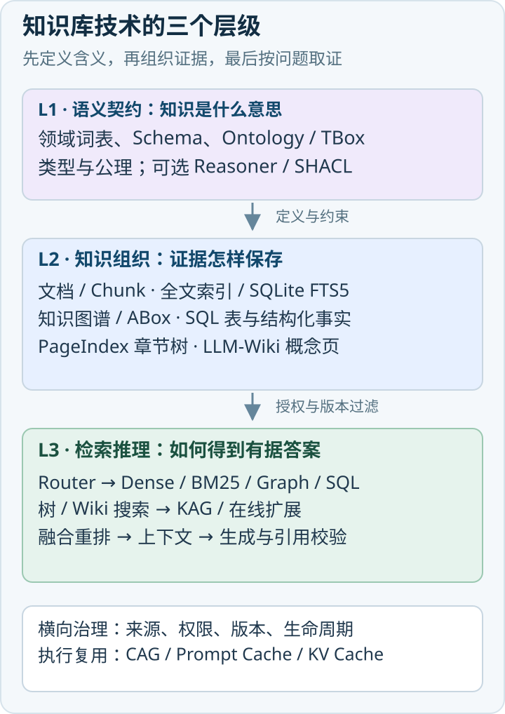
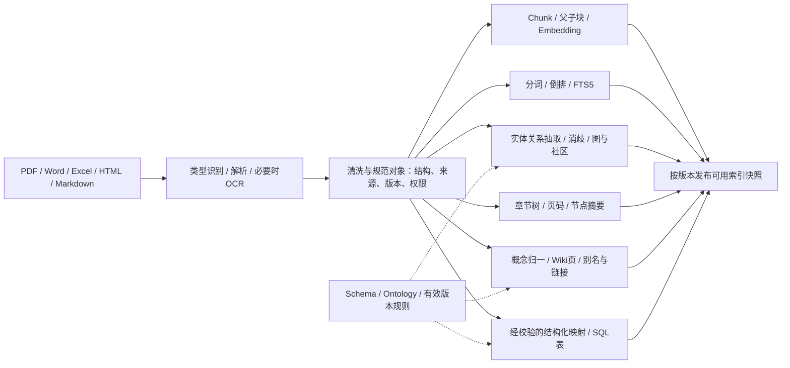
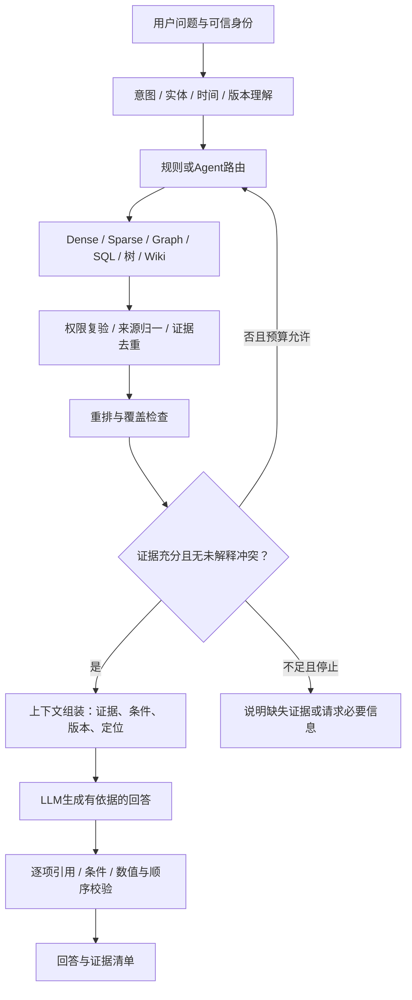
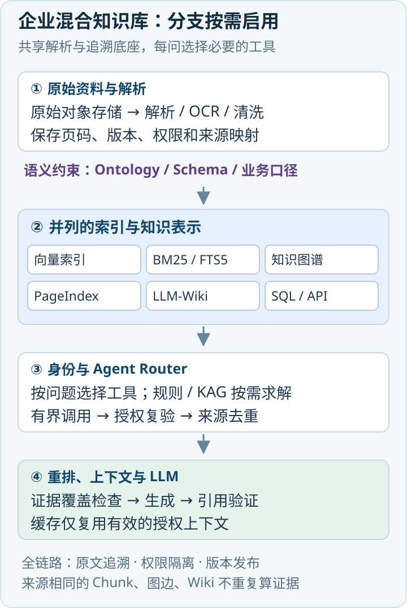
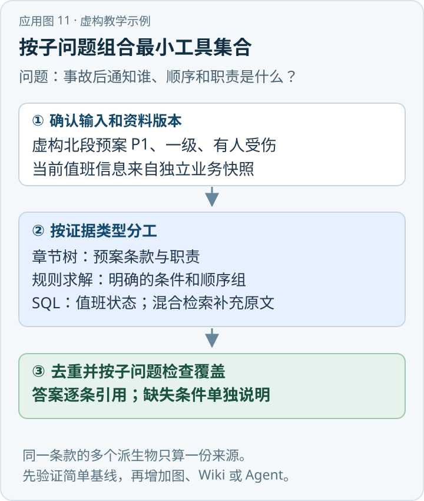

企业知识库需要把语义约束、知识组织、检索与推理放在同一架构中比较。本文从三层分类出发，分析技术路线、业务选型及生产环境的组合方式。

{/* truncate */}

> 知识库技术研究系列 · 资料核验日期：2026 年 11 月 10 日。应急案例均为虚构教学示例。查看[全部专题与架构选型](../11-overview/index.md#系列阅读)。

直接看应用：[动手应用：把一次应急问答接成可验收的服务](#84-动手应用把一次应急问答接成可验收的服务)。

## 1. 从“找相似段落”到“获取足够证据”

“高速公路发生交通事故后，应通知哪些单位、按什么顺序通知、各单位承担什么职责？”这个问题至少包含四种工作：确定适用预案，找全单位与职责，识别顺序与并行条件，核对预案版本和事件等级。相似度最高的五段文字可能足以解释“应急响应”的含义，却未必包含完整的通知依赖关系。反过来，一张完美的职责关系图也可能没有最新的联系电话。

因此，架构选型应围绕**证据的形态、约束和获取方式**展开。文本适合表达解释与例外；表格适合精确记录状态、数量和业务规则；图适合表达关系；章节树保留文档层次；概念页保存经过组织的知识；本体规定概念及其关系的语义。原始 RAG 研究把检索得到的外部资料引入生成过程，知识不必全部固化在模型参数里；它没有规定所有资料只能储存在向量数据库中。[\[1\]](https://arxiv.org/abs/2005.11401)

这也解释了为什么研究文章需要拆成专题：Ontology、PageIndex、GraphRAG、CAG 分别触及语义、组织、检索和执行优化。把它们直接放在一张“谁取代谁”的排行榜里，会掩盖架构的真实取舍。本文先建立坐标，再对比机制，最后给出可逐步实施的组合方案。十篇专题的入口见[系列目录](#系列阅读)。

## 2. 三层框架：语义契约、知识组织、检索与推理

### 2.1 L1：语义契约层——知识表示的含义是什么

L1 定义领域术语、实体类型、属性、允许的关系及约束。例如，“运营管理单位”“消防救援机构”是类，“负责路段”“适用事件等级”是属性，“应通知”是关系。关系型 Schema、业务词表和 OWL 本体都能承担部分契约职责，但表达能力与推理语义不同。

严格描述逻辑通常把概念与角色公理放入 TBox，把个体断言放入 ABox，写作 `KB = (T, A)`；一些表述另外列出 RBox。**TBox 和 ABox 是逻辑角色划分，并不意味着 ABox 在物理架构上必须只存于 L1。**实例通常落在 L2 的 RDF 图、图数据库或其他存储中，受 L1 解释。OWL 2 的语义不能简化为“给图的节点加类型”：开放世界假设、可满足性、等价类、基数限制等都有明确含义。缺少某个事实通常不能直接推出该事实为假。[\[3\]](https://www.w3.org/TR/owl2-primer/)

需要检查“每条通知记录必须有来源页码”等数据完整性要求时，可以设计应用校验或使用 SHACL。OWL Reasoner 的逻辑一致性检查与 SHACL 的图约束验证目的不同，二者可以配合。[\[4\]](https://www.w3.org/TR/shacl/)

### 2.2 L2：知识组织层——证据以什么形态存在

L2 保存文档与 Chunk、实体关系图、章节树、Wiki 概念页、关系表和全文索引。多个表示可以来自同一份原始资料。图边、Wiki 段落与树节点都应保留来源映射，否则预处理生成的内容容易脱离原始依据。

SQLite FTS5 在这里主要属于全文索引的实现组件；BM25 属于检索评分方法。Ontology 本身可以序列化为 RDF 图，但“RDF 图”“业务知识图谱”“具有 OWL 蕴含语义的本体知识库”并不等价。[\[3\]](https://www.w3.org/TR/owl2-primer/)[\[5\]](https://www.sqlite.org/fts5.html)

### 2.3 L3：检索与推理层——如何找到并使用证据

L3 选择 Dense、Sparse、Graph、SQL、章节树搜索，执行证据扩展、重排与生成。KAG 把模式约束和逻辑形式接入求解；Agentic RAG 控制这些操作的执行策略。CAG 通过上下文预加载与缓存复用减少重复计算，属于可跨阶段使用的执行策略。[\[6\]](https://github.com/OpenSPG/KAG)[\[7\]](https://www.microsoft.com/en-us/research/blog/lazygraphrag-setting-a-new-standard-for-quality-and-cost/)[\[8\]](https://arxiv.org/abs/2412.15605)

**RAG 是检索增强生成范式，不是与知识图谱、SQL 表并列的一种存储结构。** 向量 RAG、图 RAG 和基于词法索引的检索流程可以共享生成器、引用机制与权限控制，也可以由同一个 Router 调度。[\[1\]](https://arxiv.org/abs/2005.11401)[\[2\]](https://arxiv.org/abs/2312.10997)

*图 1：知识库三层架构。图片直接展示；需要查看大图时可使用下方 SVG／PNG 入口。*

图中的虚线表示约束或横向支持，不代表所有存储都必须经过 OWL 推理。L3中的模块按任务选择，并非每次查询顺序执行全部机制。SAG2 是一种具体的查询时证据召回方案，可以在 L3 调用 L2 的词法索引；它不是一种新的本体语言。[\[9\]](https://arxiv.org/abs/2610.22588)

查看原图与下载：[SVG](../assets/knowledge-layers.svg) · [PNG](../assets/knowledge-layers.png)。

### 表一：七大技术体系总览

原始研究需求按七大体系组织，系列文章则进一步拆开 GraphRAG、KAG、SQL，以及 Agentic RAG、CAG，以免在同一篇里混淆不同机制。

| 技术体系 | 核心思想与底层结构 | Embedding / 知识抽取 / 预处理 | 索引与查询 | 推理能力与适用边界 |
| --- | --- | --- | --- | --- |
| 向量／文档 RAG | 文档、Chunk、元数据与向量 | 向量分支需要 Embedding；通常不要求实体抽取；需要解析与切分 | ANN 或精确向量搜索，可加 BM25、RRF 与重排 | 依赖召回证据与生成器；适合模糊表述和文本问答，跨片段完整性需另行保障 |
| 图与结构化 RAG | 实体关系图、Schema、关系表 | 图方案通常抽取实体关系；SQL 可直接使用已有表；向量可选 | 图邻域、社区、路径、KAG 求解、SQL JOIN／聚合 | 图遍历、规则求解、SQL 执行各有不同语义；适合关系、条件与精确事实 |
| PageIndex | 章节层级、页码范围、节点摘要 | 核心树搜索不要求向量；需要文档层次解析 | LLM 阅读目录与节点摘要，再取对应页面 | 适合结构清晰的长文档；依赖树质量与在线推理预算 |
| LLM-Wiki | 概念页、主题页、来源链接与版本 | LLM 在入库阶段组织知识；检索方法可另选 | 词法、链接导航、向量或 Agent 读页 | 复用预先整理的知识；需处理冲突、失真与更新传播 |
| Ontology 本体库 | 类、属性、公理与实例断言 | Embedding 非必要；需领域建模和实例映射 | SPARQL 查询，可配 Reasoner | 在选定逻辑语言和配置下进行蕴含或一致性推理；不是通用文本问答器 |
| SAG／SAG2 | SAG2 论文采用 SQLite FTS5 词法索引与在线证据判断 | 核心方案无 Embedding、无预先实体抽取；仍需建索引 | BM25 初召回，JEV 判断与有界在线扩展 | 评估支持证据召回；不能直接外推为最终答案质量提升 |
| Agentic RAG 与 CAG | 前者是控制流程，后者复用上下文或推理状态 | 取决于底层工具；缓存不消除原始资料处理 | 动态工具调用／迭代检索；缓存命中后复用 | Agent 增加适应性也增加轨迹与成本；CAG 受上下文、版本和权限边界约束 |

机制依据分别见文档 RAG 综述、图与 KAG 原论文、PageIndex 官方实现、LLM-Wiki 原始说明、OWL 标准、SAG2 和 CAG 原论文。[\[2\]](https://arxiv.org/abs/2312.10997)[\[6\]](https://github.com/OpenSPG/KAG)[\[8\]](https://arxiv.org/abs/2412.15605)[\[9\]](https://arxiv.org/abs/2610.22588)[\[10\]](https://github.com/VectifyAI/PageIndex)[\[11\]](https://gist.github.com/karpathy/442a6bf555914893e9891c11519de94f)[\[12\]](https://arxiv.org/abs/2404.16130)

## 3. “五代演进”应如何理解

Naive、Advanced、Modular 的划分来自常见 RAG 综述框架；把 Graph RAG、Agentic RAG 再接在后面，可以帮助理解关注点变化，但不是行业统一制定的五代标准。图检索也不必以某种模块化框架为前提，Agent 同样可以只调用 BM25。[\[2\]](https://arxiv.org/abs/2312.10997)

| 阅读框架 | 主要解决的问题 | 新增组件与流程变化 | 新增代价 | 与前面路线的关系 |
| --- | --- | --- | --- | --- |
| 1. Naive RAG | 模型缺少私有或更新知识 | 切分→Embedding→Top-K→拼接→生成 | 解析、索引、检索与生成调用 | 最小基线，仍适合简单且证据集中的任务 |
| 2. Advanced RAG | 查询表达和证据表达不一致，噪声多 | Rewrite、HyDE、过滤、父子检索、重排 | 更多模型调用、调参和评估 | 增强固定流水线；不是必须把所有组件都打开 |
| 3. Modular RAG | 单一路径难以适应不同任务 | 路由、并行检索、模块解耦、可组合上下文 | 接口、状态、可观测性与组合验证 | 是组织系统的方法，可容纳图、SQL 和 Agent |
| 4. Graph RAG | 关系分散、集合性问题和多跳证据困难 | 实体／关系／社区索引或图扩散 | 抽取、消歧、摘要及增量维护 | 与向量和全文检索互补；不保证精确数值或任意关系都正确 |
| 5. Agentic RAG | 问题复杂度和所需工具在运行时变化 | 规划、分解、工具调用、证据验证与停止策略 | 在线延迟、Token、循环失败与轨迹审计 | 控制检索方式，底层仍可使用前面任何检索器 |

RAG 2.0 是另一个需要单独解释的名称。Contextual AI 用它描述检索器与生成器更紧密的端到端联合优化思路，针对模块独立优化造成的目标错配。联合训练并非始于这个名称：Lewis等2020年的原始RAG已经联合微调查询编码器和生成器，并固定文档编码器与索引。[\[1\]](https://arxiv.org/abs/2005.11401)[\[13\]](https://contextual.ai/research/introducing-rag2) ApeRAG官方仓库介绍全文、向量和图等产品能力；本次核验未确认它以“RAG 2.0”定义Contextual式联合训练。其他产品介绍即使使用同名标签，也应检查训练目标、梯度路径、数据与参数更新范围，名称相同不构成技术等价。[\[14\]](https://github.com/apecloud/ApeRAG)

## 4. 十四类具名架构：保留名称，同时标明层级

下面十四项是研究目录，不是互斥分类。前三项是宽泛范式，Hybrid 是融合策略，GraphRAG 等是具体方法族或项目，Self-RAG 等是论文方法，Agentic 是控制范式，多模态是数据与模型能力维度。一个系统可以同时满足其中多项。[\[2\]](https://arxiv.org/abs/2312.10997)[\[15\]](https://arxiv.org/abs/2410.05779)[\[16\]](https://arxiv.org/abs/2502.14802)[\[17\]](https://arxiv.org/abs/2401.18059)[\[18\]](https://arxiv.org/abs/2310.11511)[\[19\]](https://arxiv.org/abs/2401.15884)[\[20\]](https://aclanthology.org/2024.naacl-long.389/)[\[21\]](https://arxiv.org/abs/2210.03629)[\[22\]](https://arxiv.org/abs/2407.01449)

### 表四：十四类 RAG 架构对比

“多跳”表示能否显式组织跨证据过程，不等同于已证明的逻辑正确性；“动态路由”表示原方法是否以此为核心，不代表无法额外扩展。

| 架构及层级 | 核心机制／关键组件 | 数据组织与索引 | 召回与推理流程 | 多跳／动态路由 | 复杂度、优势与主要局限 |
| --- | --- | --- | --- | --- | --- |
| Naive RAG·基线 | 一次召回后生成 | Chunk与向量索引，也可精确扫描 | 查询向量→Top-K→LLM | 通常隐式／通常无 | 低；便于建立基线，容易漏证据或召回重复片段 |
| Advanced RAG·增强范式 | 查询前后优化 | 元数据、父子块、候选集与重排模型 | Rewrite／Expansion→检索→Rerank→生成 | 可加入／可加入 | 中；改善表达错配，组件收益要用消融验证 |
| Modular RAG·组织范式 | 模块解耦与可组合流程 | 支持多种知识表示 | 路由、并行、融合、生成 | 可实现／可实现 | 中至高；可扩展，调试和接口一致性更复杂 |
| Hybrid RAG·检索策略 | 稀疏与稠密互补 | 倒排索引＋向量索引 | BM25／Dense→RRF等融合→重排 | 本身不提供／通常无 | 中；兼顾术语与语义，双索引更新与分词需要维护 |
| Microsoft GraphRAG·方法族 | 图社区与多尺度摘要 | 实体、关系、来源块、社区报告 | Local 围绕实体；Global 汇总社区报告 | 关系扩展／按模式选择 | 高；适合实体关系和语料级综合，抽取与摘要成本较高 |
| LightRAG·具体方法 | 低层实体与高层关系双层检索 | 图与实体／关系的向量索引 | 关键词抽取→两层检索→关联文本 | 支持关系扩展／非通用Agent路由 | 中至高；统一局部与高层信息，质量依赖抽取与匹配 |
| HippoRAG 2·具体方法 | 记忆图与 Personalized PageRank | passage／phrase 节点、OpenIE关系和语义连接 | 密集检索、过滤、图扩散→passage排序 | 显式关联／非通用Agent路由 | 高；跨片段关联是核心，图结构和种子误差会传播 |
| LazyGraphRAG·具体路线 | 延后查询相关语义分析 | 轻量图、社区与文本索引 | 先缩小范围，再相关性判断与迭代深入 | 支持扩展／有查询自适应 | 中至高；降低部分预先摘要成本，更多工作移到在线阶段 |
| RAPTOR·层次检索方法 | 递归聚类与抽象摘要 | 叶块＋聚类摘要树 | 对多层节点做语义检索→生成 | 跨层综合／通常无 | 中至高；帮助全局抽象，摘要会丢细节且更新有传播成本 |
| Self-RAG·训练与生成方法 | 检索与反思 token | 可接外部检索库；需专门训练 | 判断是否检索→生成候选→批判支持性 | 可迭代／检索决策自适应 | 高；显式控制依据，不能等同于给普通LLM加反思提示词 |
| CRAG·纠错方法 | 检索相关性评估与修正 | 文本库＋检索评估器，可用网页 | 评估相关性并按置信结果分支→保留／分解／补检→生成 | 可补充／按评价结果分支 | 中至高；处理坏召回，评估器失准仍会选错路径，不等于核实事实真伪 |
| Adaptive-RAG·复杂度路由 | 学习问题复杂度分类 | 同一文本库及不同执行路径 | 无检索／单次／迭代检索三路选择 | 迭代分支支持／是 | 中；控制平均成本，分类错判会损害难题表现 |
| Agentic RAG·控制范式 | 规划、工具与反馈循环 | 可调用Chunk、图、SQL、树、Wiki | 分解→调用→验证→继续或停止 | 取决于工具／是 | 高；适合开放任务，必须限制循环、预算和权限 |
| 多模态 RAG·能力维度 | 跨模态表示或视觉晚交互 | 图文块、页面图像、表格、音视频片段 | 模态检索→证据定位→多模态生成 | 取决于编排／可加入 | 中至高；保留版面与图表信息，计算与引用定位更复杂 |

上述每类的典型应用与区别还可以进一步压缩为一组判断：客服释义先试 Naive／Advanced；术语密集的运维手册常需 Hybrid；多数据源平台需要 Modular；关系与语料全局问题分别考察图检索和社区摘要；长资料综合可比较 RAPTOR；希望学习检索与批判行为才考虑 Self-RAG；坏召回补救关注 CRAG；多数简单、少数复杂的问题可评估 Adaptive-RAG；跨工具调查使用 Agentic；图纸与扫描表格考虑多模态。它们是根据机制做的候选映射，不是未经业务测试的效果承诺。

## 5. 七类业务知识库：业务用途不决定底层架构

### 表五：七类业务知识库选型对比

规模和更新频率在此是常见的规划特征，必须以企业实际盘点为准；“准确性要求”是不同错误的业务代价，不是系统已达到的准确率。

| 业务类型与目标 | 数据来源、规模／更新 | 典型查询与准确性要求 | 权限／结构化需求 | 推荐组合、成本与复杂度 | 教学型业务案例 |
| --- | --- | --- | --- | --- | --- |
| 客户自助 | FAQ、帮助中心、政策；中小至大规模，随产品更新 | 操作解释、退换规则；对政策边界敏感 | 公开内容为主；订单需个人权限与API／SQL | Hybrid＋重排＋版本；中等；订单数据走受控工具 | 问“退款窗口多久”，查政策并确认购买日期 |
| 企业内部 | 制度、会议、项目、业务表；规模不一，持续更新 | 制度适用、项目历史、跨部门关联；高追溯要求 | 强权限；常需组织与项目结构 | Hybrid打底；按任务加Wiki、SQL、图；中至高 | 查某项目的最新决策与负责部门 |
| 产品文档 | 手册、版本说明、规格、长PDF；按版本发布 | 配置、兼容、跨章节限制；版本必须准确 | 通常按客户／版本授权；规格表有用 | Hybrid＋PageIndex；图片多时加视觉检索；中等 | 查询某型号在特定固件下的安装限制 |
| IT Helpdesk | 工单、运行手册、资产与监控；高频变化 | 故障诊断、处置步骤；错误操作代价高 | 强权限；CMDB和实时状态必须结构化 | Hybrid＋SQL／API＋有限Agent；中至高 | 查服务异常的关联资产与可执行检查步骤 |
| 开发者 | API文档、代码、Issue、示例；随提交更新 | 符号、调用关系、迁移；精确名称与版本重要 | 仓库／分支权限；代码结构不可只当普通文本 | 词法／符号索引＋Dense＋可选代码图；中至高 | 找某接口的定义、调用者与变更说明 |
| 混合型 | 上述来源与实时业务系统并存；异构且量大 | 事实＋解释＋调查；对跨源一致性敏感 | 最强权限与租户边界；高度结构化 | Modular Router＋受控多检索器；高 | 组合合同条款、履约记录与责任归属 |
| 社区 | 帖子、评论、问答、用户经验；高频增量 | 相似问题、解决方案；需区分传闻与官方结论 | 公开／私有板块；信誉和时间元数据有用 | Hybrid＋可信度标记＋来源；按需Wiki；中等 | 汇总某故障的可复现解决办法并标明争议 |

同一“企业内部知识库”完全可以用 SQL 查当前责任人、用 PageIndex 找合同条款、用向量检索找相近案例，再由 Agent 组合答案。业务名称只帮助识别目标、风险与权限，不能替代数据模型与查询负载分析。

## 6. 从入库到回答：共同底座与九条路径

### 6.1 先正确解析，再建立任何索引

PDF 需要恢复阅读顺序、页码、表格和版面；扫描页可能需要 OCR。Word 应保留标题层级、列表与表格；Excel 应识别工作表、单元格类型、表头及公式／展示值；HTML 应去除导航噪声又保留标题和链接；Markdown 应保留标题、代码块和表格。不能用一个字符串清洗函数代替所有解析。Docling 等官方项目体现了文档结构解析与 OCR、表格结构处理的独立地位。[\[23\]](https://github.com/docling-project/docling)

建议先形成可追溯的规范文档对象，再按目标建立不同派生表示。规范对象至少保留来源ID、版本、页码或定位范围、标题路径、有效时间、租户与访问控制。由 OCR 得到的证据还应保留原图坐标与质量标记。

这是一种参考流水线，不要求所有资料都进入所有分支。实时业务表应优先使用既有可信系统，不能为了统一入库而把动态状态复制成长期不更新的文档。

### 6.2 查询流程不能把“命中”直接等同于“充分证据”

生成时，Prompt 应明确证据与指令的边界；检索到的文档不能授予工具权限。Hallucination Detection 也不应写成“再问一次LLM即可保证正确”：应分别检查事实是否被来源支持、来源是否有效、引用定位是否准确、结果是否覆盖问题要求，以及冲突是否被披露。RAGAS 提供了把检索与生成质量分开评价的思路，但自动评审仍需要人工样本校准。[\[24\]](https://arxiv.org/abs/2309.15217)

### 6.3 用同一个问题比较九条检索路径

以下全部是**虚构教学案例**。假设预案第3章规定响应条件，第4章规定通知流程，附件A列单位职责，另有通讯录业务表。我们不预设哪些真实单位必须被通知，也不把部门名称直接解释为法定义务。

| 路径 | 怎样取证并形成回答 | 主要能力边界 |
| --- | --- | --- |
| 传统向量RAG | 把问题向量化，召回通知／职责相关块；不足时取父章节；LLM从证据中整理单位与顺序 | “通知”语义相似不能证明召回了全部对象；跨附件、否定与并行条件容易漏 |
| Hybrid RAG | 原问题和规范化术语同时做BM25与Dense，融合去重后重排，补取相邻块与原页 | 能兼顾“第Ⅲ级”等精确表达和释义；融合本身不能恢复不存在于候选集的条件 |
| GraphRAG | 从事故、等级、单位等节点出发，沿“触发响应／通知／承担职责”取关联证据，回读来源条款 | 关系有助于连通分散资料；未抽取的关系、错误方向与摘要丢失会影响答案 |
| KAG | 把问题分解成适用条件、通知对象、依赖顺序、职责四个子目标，用Schema与Logical Form调用检索／求解 | 只有明确建模的条件和规则才能可靠执行；“后继关系”不自动等于完整应急流程 |
| SQL知识库 | 在经审核的规则表中按路段、等级、有效时间过滤，JOIN单位与职责，返回前置条件／并行组及来源 | 已结构化事实可精确查；自然语言例外若未入表，SQL不会自行理解 |
| PageIndex | 先看目录与节点摘要，定位响应章、流程章与职责附件，再逐页回读并跨章节核对 | 善用文档结构；错误目录、扫描页和不规则附件需要降级与补检 |
| LLM-Wiki | 先读“事故响应”“某单位职责”等概念页及双链，再查看对应预案版本的来源条款 | 减少重复组织；概念页可能混合旧版本或把条件性规定过度概括 |
| SAG2 | 以BM25取得候选，JEV的Noul接口给出“候选是否提供必要事实”的yes概率，用于排序与种子选择，再有界扩展 | 排序分不是事实真值概率；召回证据不等于已完成顺序与职责的正确生成，初始词法覆盖仍重要 |
| Agentic RAG | 先确定版本和等级，分别调用树／全文查规则、图或KAG查关联、SQL查当前单位信息；验证覆盖后生成 | 适合跨工具组合；规划错、工具结果不完整或停止过早仍会失败 |

前八条机制分别在专题01—08详述，第九条见专题09。CAG不单独决定此题的通知对象，它可以复用经授权且版本未变的预案上下文；动态通讯录仍要重新查询或验证。对于有条件、可并行的流程，答案应给出前置条件与依赖关系，不能擅自压成一个固定编号列表。[\[6\]](https://github.com/OpenSPG/KAG)[\[7\]](https://www.microsoft.com/en-us/research/blog/lazygraphrag-setting-a-new-standard-for-quality-and-cost/)[\[8\]](https://arxiv.org/abs/2412.15605)[\[9\]](https://arxiv.org/abs/2610.22588)[\[10\]](https://github.com/VectifyAI/PageIndex)[\[11\]](https://gist.github.com/karpathy/442a6bf555914893e9891c11519de94f)[\[12\]](https://arxiv.org/abs/2404.16130)

## 7. 横向比较：先比较机制，再讨论效果

### 表二：底层检索机制对比

本表的延迟和成本是路径构成分析，不是统一硬件下的测量。“低”始终相对于同一数据规模、权限过滤条件、候选预算与服务目标而言。

| 机制及所在维度 | 召回原理 | 语义／精确匹配 | 多跳能力 | 延迟与计算成本来源 | 维护成本与主要限制 |
| --- | --- | --- | --- | --- | --- |
| BM25·排序函数 | 倒排词项匹配，使用词频饱和、逆文档频率和长度归一 | 无内生深层语义；术语、编号匹配有优势，依赖分词 | 本身不做多跳；可由外层迭代 | 通常无需逐次运行深度编码器；受命中词频与候选数影响 | 需维护词法索引、词典、字段权重；同义表达可能漏召回 |
| Dense Retrieval·表示与检索 | 编码查询与文档，按内积／余弦等检索向量 | 可匹配释义；型号、否定、细粒度条件可能失真 | 单次相似度不提供关系链保证 | 查询编码、精确或ANN搜索及内存占用；建库需文档编码 | 模型变更常需重嵌入；使用近似索引时，过滤与近似召回需一起评估 |
| Hybrid·融合策略 | 多路候选做RRF或经校准的分数融合 | 兼顾词法与语义，但不会自动修复全部盲点 | 取决于外层工作流 | 多路搜索可并行；总延迟受慢分支、融合和重排影响 | 双索引一致性、去重与权重管理；相关检索器可能重复投票 |
| Graph Retrieval·结构操作 | 邻域、路径、社区或图扩散 | 精确边与关系模式较强；语义入口可配向量 | 显式支持关系扩展；不等于逻辑蕴含 | 图规模、分支、路径长度及语义判断调用 | 抽取、消歧、来源、关系失效与社区更新 |
| SQL Retrieval·查询执行 | 关系代数、过滤、JOIN、聚合和排序 | 表内已建模事实精确；自然语言理解在SQL生成前 | 多表关联可表达链式条件；递归查询需单独设计 | 查询计划、索引、连接基数、执行限制 | Schema与指标口径治理；合法SQL仍可能业务语义错误 |
| PageIndex·文档定位方案 | 目录／章节摘要引导下逐层选节点并读取页区间 | 依赖LLM理解章节语义，保留结构与上下文 | 可跨章节反复取证；非形式化证明 | 结构解析、可选模型细化，以及在线选择与回读成本 | 目录、页码、结构解析与版本重建；目录弱时收益下降 |
| FTS5·实现组件 | SQLite全文虚拟表支持MATCH、排序和片段定位 | 取决于tokenizer与查询表达式；可使用BM25评分 | 本身不做多跳 | 本地索引访问通常较轻；在线模型扩展另算 | 中文切词、外部内容同步、删除及并发策略要设计 |
| Agentic Retrieval·控制方式 | 根据状态选择、调用和组合检索工具 | 由所调用工具和规划质量共同决定 | 可以主动拆解与扩展 | 工具调用轮数、LLM推理与验证开销 | 状态、预算、失败恢复、权限、停止与审计都需治理 |

FTS5 的内置 `unicode61` tokenizer 不等于完整中文分词器；`trigram` 面向三字符片段匹配，也不能直接等同中文词义理解。FTS5 的 `bm25()` 采用“更优结果数值更小”的约定，不能不经确认就与越大越好的向量相似度相加。[\[5\]](https://www.sqlite.org/fts5.html) RRF 按名次融合，不要求不同检索器的原始分数在同一尺度；它也丢弃分数间隔，所以不是在任何场景下都最优。[\[25\]](https://www.elastic.co/docs/reference/elasticsearch/rest-apis/reciprocal-rank-fusion)

### 表三：知识组织方式对比

本表按研究需求保留Ontology，但它承担L1语义职责，可序列化到L2，并非与Chunk等物理表示互斥的存储选项；FTS5则是派生索引。表中比较的是它们分别怎样组织信息与承担维护责任。

| 表示 | 存储结构 | 关联方式 | 更新／删除方式 | 适用范围与边界 |
| --- | --- | --- | --- | --- |
| 文档Chunk | 文本单元＋父文档＋定位与版本 | 相邻块、父子块、相似度、元数据 | 根据规范文档差异重切／重嵌入，失效旧块 | 文本证据细粒度召回；切分不应破坏条件与表格关系 |
| 知识图谱 | 实体节点、关系边、属性与来源 | 显式关系、路径与社区 | 撤销受影响的断言／边，重新消歧和聚合 | 关系与多跳；图里没有的事实不能由遍历凭空产生 |
| PageIndex章节树 | 章节层级、页区间、标题与摘要 | 父子节点、章节路径、交叉引用 | 文档改版后核对页码与节点摘要，可重建受影响子树 | 单文档和长文档结构定位；不等于全库自动目录 |
| LLM-Wiki | 概念／主题页、别名、双向链接、来源片段 | 语义归一与显式链接 | 维护来源到页面的依赖，更新正文、链接和冲突记录 | 反复使用的概念知识；长期编译错误会累积 |
| Ontology（L1语义，可序列化到L2） | 类、属性、公理、个体断言的逻辑表示 | 子类、等价、不相交、角色与断言 | 变更公理后做一致性／回归推理，管理实例兼容性 | 领域语义与可解释蕴含；并非所有业务规则都适合OWL |
| 关系型数据库 | 表、列、行、主键及逻辑／物理引用 | JOIN键与关系约束 | 事务内更新，可配变更流和历史表 | 精确事实与聚合；自然语言例外需明确结构化 |
| SQLite FTS5 | 文档内容或引用＋词项索引＋位置 | MATCH表达式及行ID回源 | 同步内容与索引；外部内容模式需显式维护 | 轻量全文检索；是索引组织方式，不是领域知识模型 |

这些更新策略是参考设计。RDF／OWL 的逻辑定义、FTS5 的外部内容与删除行为、PageIndex 的文档树结构，分别以对应标准和官方实现为准。[\[3\]](https://www.w3.org/TR/owl2-primer/)[\[5\]](https://www.sqlite.org/fts5.html)[\[10\]](https://github.com/VectifyAI/PageIndex)

### 表六：生产环境技术选型矩阵

为避免虚假精确评分，使用三种定性标记：**适合**表示机制直接匹配任务；**条件**表示必须加建模、工具或工程措施；**非主项**表示该机制本身不解决这一目标。矩阵分析的是路线核心能力，并不限制工程扩展。数据规模不设统一条数阈值，因为段落长度、向量维度、图密度与在线预算都会改变边界。

| 路线 | 小规模 | 海量文档 | 高频更新 | 精确事实 | 模糊语义 | 复杂关系 |
| --- | --- | --- | --- | --- | --- | --- |
| Dense文档RAG | 适合 | 条件：搜索与分片规划 | 条件：增量编码 | 条件：回源核对 | 适合 | 非主项 |
| Hybrid文档RAG | 适合 | 条件：双索引扩展 | 条件：一致发布 | 适合术语召回，事实仍需校验 | 适合 | 非主项 |
| GraphRAG | 条件：投入需合算 | 条件：图密度与摘要成本 | 条件：消歧与派生更新 | 条件：抽取质量 | 条件：语义入口 | 适合显式关系 |
| KAG | 条件：先有领域模型 | 条件：混合索引与求解预算 | 条件：Schema和规则联动 | 适合已建模事实 | 条件：语义匹配 | 适合已建模逻辑 |
| SQL | 适合已有业务表 | 条件：数据库规划 | 适合事务性更新 | 适合 | 条件：语义层／Text-to-SQL | 适合已建模关联 |
| PageIndex | 适合少量长文档 | 条件：先选文档再选章节 | 条件：树与页码更新 | 条件：回读原页 | 适合章节语义 | 条件：跨章节组织 |
| LLM-Wiki | 适合反复使用的知识 | 条件：编译治理成本 | 条件：变更传播 | 条件：来源与冲突核对 | 适合概念化表达 | 条件：链接覆盖 |
| Ontology | 适合边界清楚的领域 | 条件：逻辑表达性与推理策略 | 条件：一致性回归 | 适合有明确语义的断言 | 非主项 | 适合形式化关系 |
| SAG2 | 适合词法索引可覆盖的资料 | 条件：候选与JEV预算 | 适合轻索引增量，需同步 | 条件：初召回与判断 | 条件：词法入口＋在线语义 | 条件：扩链覆盖 |
| Agentic RAG | 条件：复杂度须值得 | 条件：依赖工具扩展性 | 条件：工具数据需新鲜 | 条件：工具与校验 | 条件：规划与检索 | 适合跨工具组织 |
| CAG | 适合可装入上下文的稳定资料 | 非主项：受上下文和缓存资源约束 | 条件：失效与重建 | 条件：模型读取与更新 | 条件：模型能力 | 条件：上下文内信息足够 |

| 路线 | 多跳推理 | 长文档跨章节 | 低成本部署 | 低延迟查询 | 可解释性 | 可追溯性 |
| --- | --- | --- | --- | --- | --- | --- |
| Dense文档RAG | 条件：多轮／补证据 | 条件：父子块与结构 | 条件：模型和向量规模 | 条件：编码＋精确或ANN搜索＋生成 | 可解释召回来源，难解释向量语义 | 适合，前提是保留定位 |
| Hybrid文档RAG | 条件：外层编排 | 条件：结构补取 | 条件：增加词法索引 | 条件：并行与重排预算 | 可检查各路命中与名次 | 适合，需跨索引统一来源 |
| GraphRAG | 适合关系链，非必然逻辑证明 | 条件：来源链接完整 | 条件：抽取与摘要可控 | 条件：模式及分支预算 | 可显示路径，需解释边来源 | 条件：每条边与摘要回源 |
| KAG | 适合支持的逻辑形式 | 条件：文本互索引 | 条件：建模和求解投入 | 条件：计划复杂度 | 适合展示求解步骤 | 条件：步骤均有事实或规则来源 |
| SQL | 适合关系链／递归已建模时 | 非主项 | 适合复用已有数据库 | 条件：查询计划和限额 | 可展示SQL与口径 | 适合返回行、版本和来源 |
| PageIndex | 条件：在线多轮读文档 | 适合 | 条件：在线LLM成本 | 条件：树深和回读轮数 | 适合展示章节路径 | 适合页码与原文定位 |
| LLM-Wiki | 条件：链接导航和校验 | 条件：编译时保留结构 | 条件：摊销与维护 | 条件：概念页可直接复用 | 适合人类阅读概念关系 | 条件：派生段落保留依据 |
| Ontology | 适合逻辑语言支持的蕴含 | 非主项 | 条件：专家和Reasoner | 条件：逻辑配置／预物化 | 条件：Reasoner支持解释 | 条件：公理和断言来源 |
| SAG2 | 条件：有界扩展，深链仍有缺口 | 条件：段落与跨文档链接 | 条件：索引轻，JEV服务另计 | 条件：在线评分轮数 | 可记录候选与证据扩展 | 条件：定位和判断日志 |
| Agentic RAG | 适合组织多步取证 | 条件：有合适工具 | 条件：调用预算与复用 | 条件：工具并行和停止 | 条件：保存可审计行动，非私有思维链 | 条件：全程传递来源ID |
| CAG | 条件：模型在上下文内完成 | 条件：文档装得下且读得准 | 条件：复用次数覆盖预加载成本 | 条件：命中可减少prefill，整体延迟需实测 | 非主项 | 条件：上下文仍保留定位和版本 |

评价依据是各机制的“必须完成的工作”：稠密检索需要编码和相似度搜索，图需要关系与派生维护，KAG需要模式与可执行求解，SQL需要正确Schema与口径，PageIndex需要结构与页面回读，Wiki需要编译与更新传播，SAG2将语义判断移至在线，Agent增加控制循环，CAG只有在可复用上下文与计算状态时才能节省重复工作。**这些条件不能汇总为一个总分。**SAG2的召回率、PageIndex的官方演示、CAG的小规模实验，也不能直接填进企业采购表当作同口径性能数据。[\[5\]](https://www.sqlite.org/fts5.html)[\[6\]](https://github.com/OpenSPG/KAG)[\[7\]](https://www.microsoft.com/en-us/research/blog/lazygraphrag-setting-a-new-standard-for-quality-and-cost/)[\[8\]](https://arxiv.org/abs/2412.15605)[\[9\]](https://arxiv.org/abs/2610.22588)[\[10\]](https://github.com/VectifyAI/PageIndex)[\[11\]](https://gist.github.com/karpathy/442a6bf555914893e9891c11519de94f)[\[12\]](https://arxiv.org/abs/2404.16130)[\[26\]](https://github.com/pgvector/pgvector)

## 8. 一个生产级混合知识库：统一底座，按需启用分支

### 8.1 完整架构与数据流

下面是目标架构，不建议第一期同时建设全部模块。优先建立来源、权限、版本和评估底座，再用业务失败样本证明新增模块的价值。

*图 2：企业混合知识库的数据流。索引分支按需选择，语义、权限、版本与来源贯穿全程。*

离线数据流是原始资料→规范对象→派生任务→各索引与知识资产→版本发布。在线数据流是身份与问题→路由→工具→证据融合→重排与覆盖检查→上下文→生成→引用验证。图中索引列为并列能力，不表示需要依次访问。语义层约束建模与求解；追溯层横跨存储和查询。SQL 可以直接访问授权业务系统，不必通过文档入库。

查看原图与下载：[SVG](../assets/enterprise-hybrid.svg) · [PNG](../assets/enterprise-hybrid.png)。

### 8.2 Router 的决策逻辑

Router 应输出可审计计划：目标、工具、参数、权限范围、候选预算、截止时间与停止条件。以下是参考决策表，不是由模型自由决定权限的授权规则。

| 问题特征 | 优先路径 | 追加条件与停止依据 |
| --- | --- | --- |
| 型号、错误码、条款编号、精确术语 | BM25／符号检索 | 词法命中不足或用户使用释义时并行Dense；回源核对版本 |
| 模糊描述、概念释义、相似案例 | Dense或Hybrid | 重排后检查支持性；没有支持证据不能用相似主题替代 |
| 数量、排名、时间窗口、当前状态、业务清单 | SQL／受控API | 使用可信Schema与口径；只读执行、超时、行数和租户限制 |
| 指定长PDF、跨章节条款、附件例外 | 先筛文档，再PageIndex／章节搜索 | 回读原页；不能只根据目录摘要作答 |
| 跨实体关联、依赖、语料级主题 | 图检索；全局综合可试社区报告 | 图边和摘要都要回源；完整枚举应优先检查结构化记录 |
| 高频概念说明、稳定主题综合 | Wiki概念页 | 核对来源版本、更新状态与冲突；必要时下钻原文 |
| 条件约束、规则组合、数值比较、多步可执行逻辑 | 有Schema和求解器时用KAG／规则／SQL | 仅执行系统支持的逻辑形式，缺少条件时返回不足 |
| 工具未知、问题多阶段、前一步结果决定下一步 | Agent规划与迭代 | 每轮检查覆盖增量、预算和未解决子目标；无进展则停止 |
| 稳定资料被大量重复问及，授权前缀可复用 | CAG或Prompt Cache辅助 | 缓存键包含模型、内容与权限版本；动态事实仍要查新来源 |

默认可以从Hybrid文档检索开始，但“默认”应由业务评估确定。简单问题走短路径；需要精确业务计算时不必先做一轮向量搜索；Agent只在静态路径无法预先确定时增加价值。文本问题也可能需要SQL确认事实，不能仅凭问题表面出现什么词就硬编码唯一工具。

### 8.3 融合与去重需要统一证据对象

建议每条候选至少携带：`source_id`、`version_id`、`locator`、`content_hash`、`valid_time`、`tenant_scope`、`retrieval_channel`、`score_semantics`、`derived_from`。这些字段描述来源与派生关系，不是要求复用本文的具体命名。

去重先按同版本的稳定来源与范围合并，再处理高度重叠的Chunk；向量和全文命中同一原文只保留一份内容，但记录两条召回理由。图边、Wiki段落、章节摘要若来自同一页，不应被当作三份独立佐证。对相似但版本不同的条款保留冲突，不要用内容去重抹掉差异。

同类排序列表可以使用RRF；SQL返回的聚合结果、图路径和原文Chunk并非同类候选，宜先做类型化证据合并，再按子问题覆盖度组装。Reranker主要判断查询与文本的相关性，不能替代SQL正确性、逻辑有效性或权限校验。[\[25\]](https://www.elastic.co/docs/reference/elasticsearch/rest-apis/reciprocal-rank-fusion)

最终回答中的每个关键事实应能追溯到原文页码／段落、表行与查询快照，或明确标识为由哪些事实和规则推导而来。图／Wiki来源只是中间表示，必要时必须下钻原始资料。用户点击引用时重新检查权限，不能假定生成时有权限就永久可读。

### 8.4 动手应用：把一次应急问答接成可验收的服务

用户问：“北段一级事故且有人受伤，应通知哪些单位、顺序和职责是什么？当前对应哪个值班岗位？”下面所有单位、条款、事件和岗位都是**虚构教学数据**；这里演示系统怎样组织证据，不提供真实处置指令。

*应用示意图 · 对应下方虚构教学数据。* [查看 SVG 原图](../assets/application-11.svg) · [下载 PNG](../assets/application-11.png)

**先准备能逐项核对的输入。** 不必先建满所有索引；本例用一份预案、经审核的规则和一张值班表即可。

| 输入 | 虚构内容 | 来源定位 |
| --- | --- | --- |
| 事件 E7 | 北段、一级、有人受伤；查询快照为 2026-11-10 09:00（北京时间） | 演练记录 E7 |
| 预案 P1，第 5.1 条 | 一级事故先通知指挥中心；职责为协调资源 | P1 v1，第 12 页 |
| 预案 P1，第 5.2 条 | 有人受伤时，在通知指挥中心后通知高速交警和医疗救援；两者之间未规定先后；分别承担交通管控、伤员救治 | P1 v1，第 13 页 |
| 值班快照 S1 | 指挥中心→岗位 D1；高速交警→D2；医疗救援→D3，均覆盖该查询时点 | 授权值班视图 S1 |

入库时保留 P1 的页码、条款和有效版本；业务人员审核条件、单位、职责与顺序组。把第 5.1 条映射为顺序组 10，第 5.2 条映射为顺序组 20，组内不强加先后。规则保留指向 P1 原文的依赖；值班状态留在结构化系统里，不写进静态预案缓存。

**在线按子问题选择工具。** 下表工具名是应用接口示意，不是某个项目的内置 API；身份和授权范围由服务端附加。

| 步骤 | 输入与动作 | 返回证据及检查 |
| --- | --- | --- |
| 1．确定范围 | 读取 E7，筛选北段、查询时点有效的 P1 | 若缺等级或版本冲突，先澄清；不扩大到其他路段 |
| 2．章节取证 | `read_sections(P1, [5.1, 5.2])` | 取得第 12、13 页原文；检查通知条件、职责与交叉引用 |
| 3．条件求解 | `solve_notice(E7, P1)` | 组 10：指挥中心；组 20：高速交警、医疗救援；附规则和条款来源 |
| 4．值班查询 | 受控只读查询三个单位在快照时点的授权岗位 | S1 返回 D1、D2、D3；无权限与没有记录分别处理 |
| 5．覆盖检查 | 合并条款、规则及表行，再核对四个子问题 | 单位、顺序、职责、岗位均有对应依据才形成完整答案 |

若职责原文的叫法与问题不一致，可以用 Hybrid 检索补找段落；如果两个章节已经完整支持回答，就不为流程完整而再调图、Wiki 和 Agent。由同一条款生成的图边、规则和 Wiki 段落归并到相同的 `source_id + version + locator`，只算一个原始来源。SQL 行也不参与文本 RRF 排名，而是按“当前岗位”这个子问题直接归位。

**预期答案应长这样：**“先通知指挥中心，负责协调资源［P1 v1，第 12 页，第 5.1 条］；其后通知高速交警、医疗救援，分别承担交通管控、伤员救治，两者之间未规定先后［P1 v1，第 13 页，第 5.2 条］。在指定值班快照中，三个单位分别对应岗位 D1、D2、D3［S1，查询时点］。”这只是上述虚构输入的推演，未运行真实应急系统。

**把正确与失败情形一起验收。** 删除第 13 页时，系统不得继续从旧 Wiki 或规则补出完整职责；把伤亡改为未知时，应保留已能证明的部分并询问条件；撤销 S1 访问权时，仍可回答有权查看的预案条款，但不输出岗位；换版 P1 后，派生规则和缓存须重新校验。先用这一组小样本检查引用、覆盖和撤权，再增加实际业务问题。收益若来自修正原文解析，就先解决解析，不应把它归功于新增了 Agent。

## 9. 工程选型：把新增复杂度变成可测的收益

### 9.1 Embedding、Chunk、向量库与重排

Embedding应按语言、领域、查询长度、表格与代码特征、可接受吞吐和部署限制选择。先固定评测集比较候选模型，再决定维度、量化与索引。修改模型后旧向量通常不能直接与新查询向量混用；模型版本必须进入索引版本。

Chunk Size与Overlap没有通用最优值。先按标题、段落、列表、表格边界切分，再用真实问题验证证据完整性。太小会拆散前提和结论，太大会稀释检索信号并增加上下文成本；Overlap可以缓解边界丢失，也会增加重复和索引体积。父子检索可用小块定位、较大块补上下文，仍需控制最终Token预算。[\[2\]](https://arxiv.org/abs/2312.10997)

向量库选择应比较过滤能力、租户隔离、备份恢复、增量更新、监控和团队运维能力，而不仅是ANN排行榜。已有PostgreSQL且规模与负载可控时，可先评估pgvector；需要专门向量服务时，再比较独立引擎的扩展与运维取舍。pgvector官方文档明确讨论了近似索引与过滤导致候选不足，以及迭代扫描等处理方法，这说明“带权限过滤后的召回”必须作为独立测试项目。[\[26\]](https://github.com/pgvector/pgvector)

Reranker选型要同时测相关性、中文长输入、截断影响、批处理和延迟。模型越大不意味着系统一定更好：若候选集漏掉目标证据，重排无法把它补回来。需要先判断错误属于解析、召回、排序、上下文还是生成阶段，再增加组件。

### 9.2 BM25与中文全文索引

BM25参数应结合字段长度分布、词频和任务调整，常见的词频饱和与长度归一参数也不能脱离分词器讨论。标题、产品型号、正文可以采用不同字段权重；同义词扩展和编号规范化应保留原始查询，避免改写抹掉专有名称。SQLite FTS5内置BM25的参数接口与其他搜索引擎不同，不应把某引擎的 `k1/b` 配置照搬过去。[\[5\]](https://www.sqlite.org/fts5.html)

中文测试必须包括非连续词组合、同义改写、缩写、编号、混合英文和罕见实体。“搜索一个原文子串成功”不足以证明分词和召回可靠。

### 9.3 图、Wiki与本体的维护账

图构建成本包括实体关系抽取、名称归一、同名消歧、来源绑定、社区与摘要生成。文档变化不只影响一条边，还可能影响实体聚合、社区和报告。Wiki同样存在来源改动后的依赖传播：概念页、别名、双向链接、综合页和冲突标记可能都需更新。Ontology变更则涉及概念语义、实例映射和推理回归。

建议把可撤销的来源断言与聚合结果分开：删除文档时先失效来源，再重新计算仍由其他来源支持的知识；不要删除某条来源就误删整个实体，也不要保留已无支持依据的综合结论。图和Wiki专题分别讨论这些参考设计及其与官方实现的差别。

### 9.4 索引一致性、删除和多租户

为每份资料记录原始版本及派生任务状态；只有满足发布条件的索引进入当前可用快照。若全文索引先更新而向量、图或Wiki尚未完成，查询必须能明确选择一致快照或展示更新状态，不能混用两个版本后宣称“已经同步”。

删除不是只删对象存储文件：还需撤销Chunk、全文命中、向量、图断言、社区摘要、Wiki派生页、缓存及可复用上下文。可以先用墓碑与访问校验阻断服务，再异步清理派生物，并核对清理完成。权限撤销也应有版本或失效机制。

租户和用户范围从可信身份上下文取得，进入每一路工具调用，不能由LLM填一个租户ID来决定。检索阶段过滤降低泄露面，返回与引用阶段再校验防止权限变化。图边、Wiki摘要、章节摘要和缓存也可能包含受限信息，不能只给原文加ACL。本文的这些要求属于目标设计，不表示列出的开源项目默认全部满足。

### 9.5 延迟、Token与CPU／GPU成本

总延迟至少拆成：解析与入库延迟、查询编码、召回、重排、每轮判断／规划、上下文prefill、答案decode。并行召回可以减少等待，但会增加并发资源和融合工作。图、Wiki的预编译把部分计算移到离线；SAG2与Lazy路线将更多与问题相关的判断移到在线；CAG减少可复用前缀的重复prefill，仍需存储缓存并执行后续生成。[\[7\]](https://www.microsoft.com/en-us/research/blog/lazygraphrag-setting-a-new-standard-for-quality-and-cost/)[\[8\]](https://arxiv.org/abs/2412.15605)[\[9\]](https://arxiv.org/abs/2610.22588)

CPU常承担分词、倒排、SQL和图操作，GPU常承担Embedding、Reranker和LLM，但这不是硬性边界。不能因为不使用向量库就推断“不需要模型算力”，也不能把在线模型调用隐藏在API费用里后宣布CPU方案没有推理成本。

### 9.6 效果评估：既测单条证据，也测完整任务

| 层面 | 建议指标／检查 | 怎样避免误读 |
| --- | --- | --- |
| 解析与索引 | OCR和表格质量、页码定位、构建时间、失败率、新鲜度 | 解析丢失不能归咎于检索器；索引快不代表查询快 |
| 检索 | Recall@K、MRR、nDCG、精确率、过滤后召回 | 固定候选数、证据粒度、权限和数据范围才可比较 |
| 多跳 | 单证据召回、全部必需证据命中率、关系／条件覆盖 | 找到一段与找全四跳依据是不同指标 |
| SQL与规则 | 执行正确性、结果正确性、Schema Linking、条件覆盖 | SQL能执行不代表指标口径或JOIN正确；多种SQL可能语义等价 |
| 生成 | 事实支持率、引用准确／覆盖、条件保真、回答完整性 | 文风流畅、含引用不等于来源支持该结论 |
| 系统 | p50／p95延迟、每个正确任务成本、并发、资源、新鲜度 | 同时统计失败、重试与缓存未命中，不能只报成功路径 |
| 权限与生命周期 | 越权候选、引用访问、撤权／删除传播、租户隔离 | 用特制无权限样本和更新场景验证，不能只查正常账号 |

离线评估应覆盖简单事实、术语、跨章节、多跳、冲突、过期、无答案和越权问题。在线灰度再观察真实分布。自动LLM评审可以辅助规模化评估，关键场景需要人工金标准与分层抽样。[\[24\]](https://arxiv.org/abs/2309.15217) Text-to-SQL研究也提示，真实企业任务远超简短自然语言到单条查询的映射：Spider 2.0明确纳入真实工作流和复杂数据库环境，不能拿简化基准的成绩直接替代生产验收。[\[27\]](https://spider2-sql.github.io/)

一个可执行的落地顺序是：先建立来源／权限／版本和评测集；用词法、Dense、Hybrid三条可比基线定位失败；证据跨章节就增加结构检索，关系缺失再评估图，重复概念整理再考虑Wiki，精确业务事实接SQL，已形式化规则接KAG；最后评估是否需要Agent动态控制和缓存摊销。每一步都要求相同问题集上的收益与新增成本可见。

## 10. 未来方向：多种知识表示协同，但治理必须统一

从本系列分析可以提出三项趋势判断，它们是工程推论，不是所有企业必然采用的统一路线。

第一，系统会越来越多地保存原始资料和可重建的派生表示，而不是只保留一套向量。向量、图、树与Wiki表达的是不同信息，同一来源的多种表示有机会提高任务覆盖，也增加了版本和删除一致性的要求。

第二，离线编译与在线推理会共同存在。稳定且高复用的知识适合预先组织；变化快或问题相关性强的关系可以在查询时建立。LLM-Wiki、GraphRAG、LazyGraphRAG和SAG2体现了不同计算分配点，并不存在单一最优边界。

第三，评价单位应从“回答像不像”转向“是否以可接受成本完成一个有证据、有权限、有时效的任务”。长上下文与缓存能减少部分检索，Agent能组织更多工具，二者仍无法自动保证证据完整。长上下文研究中的位置敏感性也说明，“装得下”与“可靠使用”是两个问题。[\[28\]](https://arxiv.org/abs/2307.03172)

## 11. 来源交叉核验与争议的处理

### 11.1 三种证据分别说明什么

| 证据类型 | 本系列的使用方式 | 不能推出什么 |
| --- | --- | --- |
| 论文与标准 | 核实机制、定义、实验条件、逻辑语义 | 论文基准优势不直接等于企业上线收益 |
| 官方代码／文档／博客 | 核实具体实现、接口、默认值和官方主张 | 宣传页数字不等于独立复现或统一条件对比 |
| Issue、论坛、中文文章与公众号 | 发现成本、更新、过滤和部署争议，再回到拥有该行为的代码／文档核验 | 单个用户经历不能证明所有数据集或所有版本都如此 |

本次检索覆盖了GitHub Issues／Discussions、Reddit、Hacker News、Stack Overflow、Hugging Face社区、V2EX、知乎、掘金、CSDN和微信公众号相关公开结果。只有原文可读并足以定位具体主张的内容，才纳入下列阅读线索；登录页、错误跳转和只见搜索摘要的结果不承担技术结论。

一类常见争议是“长上下文足以代替检索”。CAG论文展示了在上下文可容纳、知识稳定且可预加载的设置中缓存复用的价值；长上下文位置敏感、动态更新、权限和上下文容量则限制了替代范围。适当结论是按负载比较长上下文、检索和二者组合，而不是宣布检索已失效。[\[8\]](https://arxiv.org/abs/2412.15605)[\[28\]](https://arxiv.org/abs/2307.03172)

另一类争议是“图一定优于向量”或“没有Embedding就更便宜”。图抽取和摘要可能把成本前移，在线扩链可能把成本后移。SAG2报告的是支持证据召回，未在相同模型和预算条件下验证所有企业任务；相应优势只能在论文设置内解释。论文中的最多两次扩链对应三轮评分，不能改写成三次扩链；索引时间也不能改写为查询延迟。[\[9\]](https://arxiv.org/abs/2610.22588)

### 11.2 中文与社区阅读线索

下列内容用于观察不同立场和工程问题，具体实现仍以篇末一手来源为准。无法直接读取的公众号原文不标记为“原文已核验”，也不推断未取得的评论。

| 资料 | 状态与用途 |
| --- | --- |
| [pgvector官方README中的Filtering与Iterative Index Scans](https://github.com/pgvector/pgvector#filtering) | 官方文档已读；用于核验“近似检索加过滤可能候选不足”这类工程问题。[\[26\]](https://github.com/pgvector/pgvector) |
| [Reddit：Hybrid search and reranking made my RAG worse](https://www.reddit.com/r/Rag/comments/1v7g3oe/hybrid_search_and_reranking_made_my_rag_worse/) | 正文及部分讨论已读；属于个人评测与反思，作者也承认评测集小，不作为普遍效果结论。 |
| [《无 Embedding、无向量数据库的 RAG 方法：PageIndex 技术解析》公开转载](https://developer.cloud.tencent.com/article/2658053) | 中文转载阅读线索；不能代替PageIndex官方实现及原始评测，公众号原文另行核验。 |
| 公众号原文及其他论坛搜索线索 | 未取得足以核验的公众号原文正文或评论，不计为原文已读。部分论坛搜索结果与实际页面标题不一致，已排除，不据此转述观点。 |

## 12. 参考资料与延伸阅读

下表的编号与正文对应。原始项目会持续更新；涉及默认值和实验时，应进一步记录具体版本。专题文章提供更细的实现来源与实验限定。

| 编号 | 原始资料与用途 |
| --- | --- |
| [1] | Lewis等：[Retrieval-Augmented Generation for Knowledge-Intensive NLP Tasks](https://arxiv.org/abs/2005.11401)，原始RAG定义、联合训练及实验设置。 |
| [2] | Gao等：[Retrieval-Augmented Generation for Large Language Models: A Survey](https://arxiv.org/abs/2312.10997)，Naive／Advanced／Modular框架。 |
| [3] | W3C：[OWL 2 Primer](https://www.w3.org/TR/owl2-primer/)，本体语义、类、属性与实例。 |
| [4] | W3C：[SHACL](https://www.w3.org/TR/shacl/)，RDF图约束验证；另见[SPARQL 1.1 Query](https://www.w3.org/TR/sparql11-query/)。 |
| [5] | SQLite：[FTS5 Extension](https://www.sqlite.org/fts5.html)，tokenizer、MATCH、BM25、外部内容与删除。 |
| [6] | OpenSPG：[KAG官方仓库](https://github.com/OpenSPG/KAG)，Schema、Builder、Solver及混合知识表示。 |
| [7] | Microsoft Research：[LazyGraphRAG官方说明](https://www.microsoft.com/en-us/research/blog/lazygraphrag-setting-a-new-standard-for-quality-and-cost/)，轻索引与查询时深入分析。 |
| [8] | Chan等：[Don't Do RAG: When Cache-Augmented Generation is All You Need for Knowledge Tasks](https://arxiv.org/abs/2412.15605)，CAG原论文。 |
| [9] | Yuchao Wu：[SAG2: Embedding-Free Multi-Hop Retrieval with BM25 and JEV](https://arxiv.org/abs/2610.22588)，2026-10-15首次提交；[v1全文](https://arxiv.org/html/2610.22588v1)。 |
| [10] | VectifyAI：[PageIndex官方仓库](https://github.com/VectifyAI/PageIndex)，文档树生成与结构化检索路线。 |
| [11] | Karpathy：[LLM Wiki原始说明](https://gist.github.com/karpathy/442a6bf555914893e9891c11519de94f)；GoogleCloudPlatform：[Open Knowledge Format规范](https://github.com/GoogleCloudPlatform/open-knowledge-format/blob/main/SPEC.md)。二者不是统一必选标准，细节见[专题06](../06-llm-wiki/index.md)。 |
| [12] | Edge等：[From Local to Global: A Graph RAG Approach to Query-Focused Summarization](https://arxiv.org/abs/2404.16130)及[GraphRAG官方文档](https://microsoft.github.io/graphrag/)。 |
| [13] | Contextual AI：[Introducing RAG 2.0](https://contextual.ai/research/introducing-rag2)，原始技术说明；分析见[专题01](../01-document-rag/index.md)。 |
| [14] | ApeRAG：[官方仓库](https://github.com/apecloud/ApeRAG)，产品“RAG 2.0”命名与实现范围。 |
| [15] | Guo等：[LightRAG: Simple and Fast Retrieval-Augmented Generation](https://arxiv.org/abs/2410.05779)。 |
| [16] | [HippoRAG 2原论文](https://arxiv.org/abs/2502.14802)及[官方实现](https://github.com/OSU-NLP-Group/HippoRAG)。 |
| [17] | Sarthi等：[RAPTOR: Recursive Abstractive Processing for Tree-Organized Retrieval](https://arxiv.org/abs/2401.18059)。 |
| [18] | Asai等：[Self-RAG: Learning to Retrieve, Generate, and Critique through Self-Reflection](https://arxiv.org/abs/2310.11511)。 |
| [19] | Yan等：[Corrective Retrieval Augmented Generation](https://arxiv.org/abs/2401.15884)。 |
| [20] | Jeong等：[Adaptive-RAG: Learning to Adapt Retrieval-Augmented Large Language Models through Question Complexity](https://aclanthology.org/2024.naacl-long.389/)。 |
| [21] | Yao等：[ReAct: Synergizing Reasoning and Acting in Language Models](https://arxiv.org/abs/2210.03629)，Agent控制与工具调用的代表性基础，非Agentic RAG唯一标准。 |
| [22] | Faysse等：[ColPali: Efficient Document Retrieval with Vision Language Models](https://arxiv.org/abs/2407.01449)，视觉文档检索的代表；多模态RAG不局限此方法。 |
| [23] | [Docling官方仓库](https://github.com/docling-project/docling)，文档解析、OCR与结构处理。 |
| [24] | Es等：[RAGAS: Automated Evaluation of Retrieval Augmented Generation](https://arxiv.org/abs/2309.15217)，分层评价思路。 |
| [25] | Elastic：[Reciprocal rank fusion](https://www.elastic.co/docs/reference/elasticsearch/rest-apis/reciprocal-rank-fusion)，基于名次的融合实现说明。 |
| [26] | [pgvector官方仓库](https://github.com/pgvector/pgvector)，向量索引、过滤与迭代扫描。 |
| [27] | [Spider 2.0官方项目](https://spider2-sql.github.io/)，企业Text-to-SQL工作流评估。 |
| [28] | Liu等：[Lost in the Middle: How Language Models Use Long Contexts](https://arxiv.org/abs/2307.03172)，长上下文使用的局限。 |

本文给出的选型决策应通过企业自己的证据集、权限模型、更新负载与成本目标验证。第一项可执行工作是整理一组包含困难和失败情形的真实问题，并保存每题所需的全部来源证据；它将决定后续究竟需要增加结构、关系、求解器、Agent，还是只需修正解析与检索。

## 系列阅读

按专题深入机制，或从本文开始比较与选型。

| 文章 | 主要内容 |
| --- | --- |
| [01 · 文档 RAG](../01-document-rag/index.md) | Chunk、Embedding、BM25、RRF、Reranker 与联合训练：从文档入库到有依据回答的完整流程。 |
| [02 · GraphRAG](../02-graphrag/index.md) | 对照 Microsoft GraphRAG、LightRAG、HippoRAG 2 与 LazyGraphRAG，分析图结构、索引和查询机制。 |
| [03 · KAG](../03-kag/index.md) | 解释模式约束、Logical Form、图文互索引与多步逻辑求解的实现和工程边界。 |
| [04 · SQL 知识库](../04-sql/index.md) | 从 Schema Linking 到 SQL 生成、JOIN、安全执行与结果溯源，理解结构化知识查询。 |
| [05 · PageIndex](../05-pageindex/index.md) | 用章节树定位长文档证据，分析建树、页码校正、跨章节取证与当前实现边界。 |
| [06 · LLM-Wiki](../06-llm-wiki/index.md) | 把原始资料编译为概念页、别名和双向链接，分析知识资产的冲突、更新和版本维护。 |
| [07 · Ontology](../07-ontology/index.md) | 从 TBox、ABox 到 RDF、OWL、SPARQL 和 Reasoner，区分语义建模、本体推理与数据校验。 |
| [08 · SAG2](../08-sag2/index.md) | 核验 SAG2 论文的 BM25、FTS5、JEV 与在线证据扩展，区分实验结果与未经验证的主张。 |
| [09 · Agentic RAG](../09-agentic-rag/index.md) | 分析 Agent 如何规划、拆解问题、路由工具、迭代取证、验证证据并决定停止。 |
| [10 · CAG](../10-cag/index.md) | 区分 KV Cache、Prompt Cache 与会话记忆，分析上下文预加载、缓存失效和 RAG 组合。 |
| [11 · 总论与架构选型](../11-overview/index.md) | 统一 L1／L2／L3 分类，对比十四类 RAG、七类业务与生产选型，设计企业混合知识库架构。 |

---

[上一篇：CAG](../10-cag/index.md)
